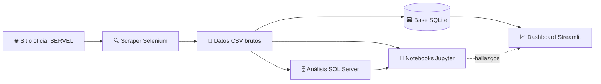

# 🗳️ Elecciones Presidenciales de Chile 2025 — Sistema Integral de Inteligencia

       

> 🇬🇧 **English version:** [README.md](README.md)

---

## 📋 Descripción General

Este repositorio es un **sistema integral de inteligencia** para las **Elecciones Presidenciales de Chile 2025** — desde la adquisición de datos brutos hasta la visualización interactiva. Cubre tanto la **primera vuelta** (16 de noviembre de 2025) como el **balotaje / segunda vuelta** (14 de diciembre de 2025), en el que **José Antonio Kast** derrotó a **Jeannette Jara** por un margen de **16,48 puntos porcentuales** — el mayor en la historia de los balotajes chilenos desde el retorno a la democracia.

El sistema está construido como un **pipeline ETL + analítico de cuatro etapas**:

1. **🔍 Web Scraping** (Selenium) — extrae los resultados oficiales del SERVEL para las **346 comunas** de las **16 regiones**
2. **🗄️ Análisis SQL** (SQL Server / T-SQL) — 26 consultas analíticas organizadas con CTEs
3. **📊 Análisis en Notebooks** (Python · Pandas · GeoPandas · scikit-learn) — análisis territorial, estadístico y político
4. **📈 Dashboard Interactivo** (Streamlit · Plotly · PyDeck) — aplicación web bilingüe (ES/EN)

Todo el sistema funciona con **datos públicos del SERVEL**, está **completamente documentado en inglés y español**, y se distribuye bajo **licencia MIT**.

---

## 🎯 Hallazgos Analíticos Clave

### Primera Vuelta 2025 (16 de noviembre)

| Candidato                | Votos     |    % | Bloque             |
| :----------------------- | --------: | ---: | :----------------- |
| **Jeannette Jara**       | 3.446.854 | 26,75% | Izquierda        |
| **José Antonio Kast**    | 3.086.963 | 23,96% | Derecha conservadora |
| **Franco Parisi**        | 2.550.770 | 19,71% | Antisistema      |
| **Johannes Kaiser**      | 1.796.034 | 13,94% | Libertario       |
| **Evelyn Matthei**       | 1.603.104 | 12,44% | Derecha tradicional |
| Marco Enríquez-Ominami   |   154.321 |  1,20% | Izquierda (indep.) |
| Harold Mayne-Nicholls    |  ~92.000  |  ~0,72% | Independiente   |
| Eduardo Artés            |  ~68.000  |  ~0,53% | Izquierda radical |

- **Ningún candidato superó el 27%** — la primera vuelta más fragmentada de la historia democrática chilena
- **La derecha combinada (Kast + Kaiser + Matthei) superó el 50%** por primera vez en la era del voto obligatorio
- **Franco Parisi creció +184%** (899 mil → 2,55 millones de votos) — la irrupción antisistema
- **Kast ganó 169 comunas (48,8%)**, Jara 105 (30,3%), Parisi 64 (18,5%)
- **Gradiente urbano-rural**: Jara domina comunas urbanas grandes; Kast domina comunas con menos de 10 mil habitantes
- **Parisi como árbitro**: sus 2,55 millones de votantes se convirtieron en el electorado decisivo del balotaje

### Segunda Vuelta 2025 (14 de diciembre)

| Candidato                | Votos      |    % |
| :----------------------- | ---------: | ---: |
| **José Antonio Kast**    | ~7.200.000 | 58,16% (oficial) |
| **Jeannette Jara**       | ~5.180.000 | 41,84% (oficial) |

- **Margen: 16,48 pp** y **más de 2 millones de votos** — sin precedentes en balotajes chilenos
- **Kast ganó las 16 regiones** y **310 de 346 comunas (89,6%)**
- **Las 36 comunas de Jara** se concentran en solo 5 regiones: RM (21), Valparaíso (5), Atacama (4), Coquimbo (3), Antofagasta (3)
- **El voto nulo se disparó +116,9%** (360 mil → 782 mil) — máximo histórico
- **El 63,6% de todas las comunas dio a Kast >60%** — apoyo territorial profundo, no solo amplio
- **Transferencia de Parisi**: ~42% a Jara, ~37,7% a Kast, ~20,3% protesta/abstención
- Incluso con **80% de los votos de Parisi**, Jara no habría ganado — necesitaba >65%
- **Kast creció en todas las regiones**, con mayor fuerza en el Norte antisistema (+36 pp en Arica y Parinacota)

### Realineamiento histórico 2021 → 2025

- **El 56,1% de las comunas cambió de ganador** entre 2021 y 2025 (194 de 346)
- **158 comunas pasaron de Boric a Kast** — se perdió el 81,4% de la base territorial de la izquierda de 2021
- Kast retuvo el **100%** de sus comunas de 2021 y sumó 158 nuevas
- El voto obligatorio (restituido en 2022) impulsó la participación **+60,4%** (8,3M → 13,4M)

---

## 🏗️ Arquitectura del Sistema

```text
Chilean-Presidential-Elections-2025-Analysis/
│
├── first_round/                          ← Primera vuelta (16 nov 2025)
│   ├── 1_web_scraper/                    [Selenium · Firefox · Python]
│   ├── 2_1.sql_queries/                  [SQL Server · 9 consultas]
│   └── 2_2.electoral_notebooks/          [Jupyter · 14 capítulos]
│
├── second_round/                         ← Segunda vuelta (14 dic 2025)
│   ├── 1_web_scraper/                    [Selenium · Firefox · Python]
│   ├── 2_1.sql_analysis/                 [SQL Server · 17 consultas]
│   └── 2_2.notebooks/                    [Jupyter · 12 capítulos]
│
├── dashboard/                            ← Dashboard bilingüe Streamlit
│   ├── app.py                            [Punto de entrada · 3 páginas · 10 vistas]
│   ├── config/                           [Constantes · traducciones]
│   ├── components/                       [Tema · layout · títulos · gráficos]
│   ├── pages/                            [Orquestadores: Resumen · 1V · 2V]
│   ├── utils/                            [Datos · cálculos · geometrías · HTML]
│   └── views/                            [10 vistas analíticas · ~18.000 líneas]
│
└── raw/                                  ← Datos (cargados vía HTTPS)
    ├── chile_2025_first_round.csv
    ├── chile_2025_second_round.csv
    ├── chile_2021_first_round.csv
    ├── chile_2021_second_round.csv
    ├── communes_population_2024.csv
    ├── region_dimension.csv
    └── database/
        └── chile_elections.db            [SQLite · fuente del dashboard]
```

### Flujo de Datos



---

## 📦 Desglose de Componentes

### 1. 🔍 Web Scrapers — Adquisición de Datos

Dos scripts independientes de Selenium que extraen los datos oficiales del SERVEL.

| Característica         | Primera Vuelta                           | Segunda Vuelta                     |
| :--------------------- | :--------------------------------------- | :--------------------------------- |
| **URL objetivo**       | `elecciones.servel.cl`                   | `segundavotacion.servel.cl`        |
| **Candidatos**         | 8                                        | 2 (Jara, Kast)                     |
| **Columnas de salida** | 27                                       | 12                                 |
| **Comunas**            | 346                                      | 346                                |
| **Tiempo de ejecución**| 25–40 min                                | 25–40 min                          |
| **Retención de backups**| 7 días                                  | 7 días                             |
| **Guardado parcial**   | Cada 10 comunas                          | Cada 10 comunas                    |
| **Normalización de nombres** | Mayúsculas → Title Case con excepciones | Igual                        |
| **Modo headless**      | ✅ `--headless`                          | ✅                                 |
| **Modo prueba**        | ✅ `--comunas N`                         | ✅                                 |

📖 **Documentación:** [Scraper Primera Vuelta](first_round/1_web_scraper/README.md) · [Scraper Segunda Vuelta](second_round/1_web_scraper/README.md)

**Inicio rápido:**

```bash
cd first_round/1_web_scraper
pip install -r requirements.txt
python web_scraper.py --headless          # ejecución completa
python web_scraper.py --comunas 10       # prueba
```

### 2. 🗄️ Análisis SQL — Consultas Estructuradas

26 consultas analíticas en **T-SQL (SQL Server 2012+)**, documentadas y organizadas con CTEs.

| Vuelta      | Consultas | Ejemplos de objetivos |
| :---------- | --------: | :-------------------- |
| **Primera** | 9         | Resultados nacionales · mapeo territorial · comunas reversibles · voto antisistema |
| **Segunda** | 17        | Comparación entre vueltas · crecimiento del nulo · simulación transferencia Parisi (17 escenarios) · proxies de K-Means |

**Modelo de datos:**

- `first_round_2025` (346 filas, 24 columnas)
- `second_round_2025` (346 filas, 12 columnas)
- Clave compuesta: `(commune, region)`
- Todos los porcentajes como `DECIMAL(5,2)`

📖 **Documentación:** [SQL Primera Vuelta](first_round/2_1.sql_queries/README.md) · [SQL Segunda Vuelta](second_round/2_1.sql_analysis/README.md)

**Inicio rápido:**

```bash
cd second_round/2_1.sql_analysis/sql_server_scripts
python create_elections_database.py        # ETL de CSV a SQL Server
# O solo generar el SQL:
python create_elections_database.py --no-execute
```

### 3. 📓 Notebooks — Análisis Profundo

Dos Jupyter notebooks (versiones EN/ES de cada uno) con **análisis territorial, estadístico y político**.

| Notebook             | Secciones | Aspectos destacados |
| :------------------- | --------: | :------------------ |
| **Primera Vuelta**   | 14        | Participación · geografía del nulo/blanco · bastiones · gradiente urbano-rural · proyección de balotaje · fenómeno Parisi · realineamiento 2021–2025 |
| **Segunda Vuelta**   | 12        | Comparación entre vueltas · barrido territorial de Kast · archipiélago de Jara · **segmentación K-Means de Parisi** · realineamiento 2021–2025 · conclusiones estratégicas |

**Librerías:** Pandas · GeoPandas · NumPy · Matplotlib · Seaborn · scikit-learn · SciPy

📖 **Documentación:** [Notebooks Primera Vuelta](first_round/2_2.electoral_notebooks/README.md) · [Notebooks Segunda Vuelta](second_round/2_2.notebooks/README.md)

**Inicio rápido:**

```bash
cd second_round/2_2.notebooks
pip install -r requirements.txt
jupyter lab electoral_analysis_2025_second_round_EN.ipynb
```

### 4. 📈 Dashboard — Visualización Interactiva

Aplicación **Streamlit bilingüe (ES/EN)** que expone 3 páginas y 10 vistas.

| Página             | Vistas |
| :----------------- | :----- |
| **Resumen Ejecutivo** | KPIs de ambas vueltas, ganadores, deltas |
| **Primera Vuelta** | Resumen · Explorador Territorial · Panorama (12 secciones) · Histórico (2021 vs 2025) |
| **Segunda Vuelta** | Resumen · Explorador Territorial · Panorama (12 secciones) · Jara · Kast · Histórico |

**Aspectos destacados:**

- **Navegador territorial de seis niveles**: Macrozona → Región → Circunscripción → Distrito → Provincia → Comuna
- **873 claves bilingües por idioma** (ES/EN)
- **Demo en vivo:** [chilean-presidential-election-2025.streamlit.app](https://chilean-presidential-election-2025.streamlit.app/)
- **Estadística y ML**: correlación de Pearson con p-valores, número efectivo de candidatos de Laakso–Taagepera, K-Means + PCA
- **Capa geoespacial robusta**: descarga automática de GeoJSON, `make_valid`, coincidencia difusa de nombres

📖 **Documentación:** [Dashboard](dashboard/README.md)

**Inicio rápido:**

```bash
cd dashboard
pip install -r requirements.txt
streamlit run app.py
```

---

## 📊 Fuentes de Datos

| Archivo                           | Descripción                                                   | Unidad  |
| :-------------------------------- | :------------------------------------------------------------ | :------ |
| `chile_2025_first_round.csv`      | Votos por candidato, primera vuelta                           | Comuna  |
| `chile_2025_second_round.csv`     | Votos Jara/Kast, balotaje                                     | Comuna  |
| `chile_2021_first_round.csv`      | Primera vuelta 2021 (línea base comparativa)                  | Comuna  |
| `chile_2021_second_round.csv`     | Balotaje 2021 (Boric vs Kast)                                 | Comuna  |
| `communes_population_2024.csv`    | Proyecciones censales 2024                                    | Comuna  |
| `region_dimension.csv`            | Macrozona, orden de presentación, códigos de región           | Región  |
| `chile_elections.db`              | Base SQLite que alimenta el dashboard                         | Ambos   |
| GeoJSON de comunas chilenas       | Geometrías (de [caracena/chile-geojson](https://github.com/caracena/chile-geojson)) | Comuna |

**Fuente primaria:** [Servicio Electoral de Chile (SERVEL)](https://www.servel.cl/) — autoridad electoral oficial (dominio público).

Todos los archivos se cargan directamente desde `raw/` vía HTTPS. No se requiere descarga local de datos.

**Descargas rápidas:**

```bash
# CSVs brutos
curl -O https://raw.githubusercontent.com/adroguetth/Chilean-Presidential-Elections-2025-Analysis/main/raw/chile_2025_first_round.csv
curl -O https://raw.githubusercontent.com/adroguetth/Chilean-Presidential-Elections-2025-Analysis/main/raw/chile_2025_second_round.csv

# Base SQLite (dashboard)
curl -O https://raw.githubusercontent.com/adroguetth/Chilean-Presidential-Elections-2025-Analysis/main/raw/database/chile_elections.db
```

---

## 🚀 Guía Completa de Instalación

### Requisitos previos

| Herramienta     | Versión          | Propósito                |
| :-------------- | :--------------- | :----------------------- |
| **Python**      | 3.9+ (3.12 rec.) | Todos los scripts y notebooks |
| **Firefox**     | Última versión   | Scrapers (Selenium)      |
| **GeckoDriver** | Compatible con Firefox | Scrapers (Selenium) |
| **SQL Server**  | 2012+ (opcional) | Análisis SQL             |
| **Git**         | Última versión   | Clonar el repositorio    |

### Instalación paso a paso

#### 1. Clonar el repositorio

```bash
git clone https://github.com/adroguetth/Chilean-Presidential-Elections-2025-Analysis.git
cd Chilean-Presidential-Elections-2025-Analysis
```

#### 2. Crear un entorno virtual

```bash
python -m venv venv

# Linux/Mac
source venv/bin/activate

# Windows
venv\Scripts\activate
```

#### 3. Instalar GeckoDriver (solo para scrapers)

```bash
# Ubuntu/Debian
sudo apt-get install firefox firefox-geckodriver

# macOS
brew install firefox geckodriver

# Windows
# Descargar de https://github.com/mozilla/geckodriver/releases
# Agregar al PATH
```

#### 4. Instalar dependencias (por componente)

```bash
# Scrapers
pip install -r first_round/1_web_scraper/requirements.txt
pip install -r second_round/1_web_scraper/requirements.txt

# Notebooks
pip install -r second_round/2_2.notebooks/requirements.txt

# Dashboard
pip install -r dashboard/requirements.txt
```

#### 5. Ejecutar cualquier componente

```bash
# Scraper (modo prueba)
cd second_round/1_web_scraper
python web_scraper.py --comunas 5 --headless

# Notebook
cd ../../second_round/2_2.notebooks
jupyter lab electoral_analysis_2025_second_round_EN.ipynb

# Dashboard
cd ../../dashboard
streamlit run app.py
```

---

## 🧠 Aspectos Técnicos Destacados

### Normalización de Nombres y Uniones entre Conjuntos de Datos

Se aplica una clave canónica de comuna (`normalize_commune_name`) de forma consistente en CSVs, SQL, notebooks y GeoJSON para evitar la pérdida silenciosa de filas por divergencias de codificación:

1. Minúsculas + `strip`
2. Descomposición NFD → eliminar diacríticos (`ü → u`, `ñ → n` post-fold)
3. Eliminar caracteres no alfanuméricos
4. Colapsar espacios
5. Aplicar tabla de correcciones curada (`Marchigüe → marchihue`, `Llay-Llay → llaillay`, …)

### Orden Geográfico (Norte → Sur)

Las consultas SQL y los mapas de los notebooks usan un `CASE` explícito (`Arica → Magallanes`) en lugar de orden alfabético — esencial para la coherencia geográfica en los análisis regionales.

### Clave Compuesta de Unión

Todas las uniones entre ciclos electorales se hacen sobre `(commune, region)` — no solo por nombre de comuna — para evitar coincidencias falsas donde el nombre de comuna se repite entre regiones.

### Segmentación K-Means de Parisi

K-Means + PCA sobre 7 features del balotaje (`kast_pct`, `jara_pct`, `null_pct`, `blank_pct`, `protest_pct`, `kast_margin`, `null_blank_ratio`) arroja 4 clusters:

| Cluster | Perfil                               | Geografía                    |
| :------ | :----------------------------------- | :--------------------------- |
| 1       | Transferencia casi completa a Kast   | Centro-sur conservador       |
| 2       | Protesta activa (nulo dominante)     | Norte Grande                 |
| 3       | Fragmentación (alta competencia)     | Ciudades intermedias del norte |
| 4       | Transferencia parcial a Jara         | Comunas mineras con sindicatos |

### Reproducibilidad

- `random_state=42` en todo el ML (K-Means, PCA, StandardScaler)
- Todos los scrapers usan **guardado parcial** cada 10 comunas
- Todas las consultas analíticas son **set-based** y corren en <1 segundo en una instancia estándar de SQL Server (346 filas)
- Todas las columnas porcentuales usan `DECIMAL(5,2)` (sin deriva de punto flotante)

---

## 📈 Estimaciones de Rendimiento

| Métrica                              | Valor                              |
| :----------------------------------- | :--------------------------------- |
| 🗂️ Total de comunas procesadas      | 346 (ambas vueltas)                |
| ⏱️ Tiempo del scraper (por vuelta)   | 25–40 minutos                      |
| 🗄️ Rendimiento de consultas SQL     | <1 segundo por consulta            |
| 📓 Tiempo de ejecución de notebook   | 1–3 minutos (datos cacheados)      |
| 📈 Primera carga del dashboard       | Mayor (descarga DB + GeoJSON)      |
| 📈 Cargas posteriores del dashboard  | Rápidas (cacheado)                 |
| 🧠 RAM del dashboard                 | ~500 MB                            |
| 💾 Almacenamiento del scraper por ejecución | 20–50 MB                    |
| 📝 Código del dashboard              | ~22.000 líneas en 24 módulos       |
| 🌐 Claves de traducción bilingüe     | 873 × 2 idiomas                    |

---

## 🐛 Solución de Problemas

### Scrapers

| Error                              | Solución                                                  |
| :--------------------------------- | :-------------------------------------------------------- |
| `GeckoDriver not found`            | `sudo apt-get install firefox-geckodriver`                |
| `Timeout waiting for table`        | Aumentar `TIEMPO_ESPERA_CARGA` en el script               |
| `Element not found`                | Ejecutar con `--verbose`, revisar cambios de layout en SERVEL |
| `Firefox not installed`            | `sudo apt-get install firefox`                            |

### SQL / Base de Datos

| Error                              | Solución                                                  |
| :--------------------------------- | :-------------------------------------------------------- |
| `no such table: first_round_2025`  | Ejecutar primero `create_elections_database.py`           |
| División por cero en comunas pequeñas | Ya manejado con `NULLIF(denominator, 0)`               |

### Dashboard

| Error / Síntoma                    | Solución                                                  |
| :--------------------------------- | :-------------------------------------------------------- |
| `urllib.error.URLError` al iniciar | La primera ejecución requiere internet (descarga DB + GeoJSON) |
| Mapa vacío                         | Borrar `assets/comunas_caracena.geojson` y reintentar     |
| `ImportError: union_all`           | `pip install --upgrade "shapely>=2.0"`                    |
| Error de clave de traducción       | Agregar la clave faltante en `ES` y `EN` en `translations.py` |

### Notebooks

| Error                              | Solución                                                  |
| :--------------------------------- | :-------------------------------------------------------- |
| Problemas de instalación de `geopandas` | `conda install -c conda-forge geopandas`             |
| Uniones de comunas pierden filas   | Revisar la salida de `normalize_commune_name`; agregar alias si es necesario |

---

## 📁 Documentación por Componente

Cada componente tiene un **README dedicado** con instalación detallada, parámetros, estructura de archivos generados y solución de problemas:

| Componente                        | README                                                                |
| :-------------------------------- | :-------------------------------------------------------------------- |
| **Primera Vuelta — Scraper**      | [first_round/1_web_scraper/README.md](first_round/1_web_scraper/README.md) |
| **Primera Vuelta — SQL**          | [first_round/2_1.sql_queries/README.md](first_round/2_1.sql_queries/README.md) |
| **Primera Vuelta — Notebooks**    | [first_round/2_2.electoral_notebooks/README.md](first_round/2_2.electoral_notebooks/README.md) |
| **Segunda Vuelta — Scraper**      | [second_round/1_web_scraper/README.md](second_round/1_web_scraper/README.md) |
| **Segunda Vuelta — SQL**          | [second_round/2_1.sql_analysis/README.md](second_round/2_1.sql_analysis/README.md) |
| **Segunda Vuelta — Notebooks**    | [second_round/2_2.notebooks/README.md](second_round/2_2.notebooks/README.md) |
| **Dashboard**                     | [dashboard/README.md](dashboard/README.md)                            |

---

## 🤝 Contribución

1. **Reportar issues** con traceback completo, componente afectado y comando exacto utilizado
2. **Mantener las traducciones** sincronizadas (tanto `ES` como `EN` en `translations.py`)
3. **Mantener colores y candidatos** en `config/constants.py` (fuente única de verdad)
4. **No renombrar** los identificadores de la máquina de estado territorial del dashboard (ver *No Traducir* en el README del dashboard)
5. **Probar scrapers** con `--comunas 10` antes de ejecuciones completas
6. **Probar cambios del dashboard** en ambos idiomas y ambas vueltas
7. **Documentar nuevas funcionalidades** en el README correspondiente

---

## 📄 Licencia y Atribución

- **Licencia**: MIT
- **Autor**: **Alfonso Droguett**
  - 🔗 **LinkedIn:** [Alfonso Droguett](https://www.linkedin.com/in/adroguetth/)
  - 🐙 **GitHub:** [@adroguetth](https://github.com/adroguetth)
  - 🌐 **Portafolio web:** [adroguett-portfolio.cl](https://www.adroguett-portfolio.cl/)
  - 📧 **Email:** adroguett.consultor@gmail.com
- **Fuente de datos**: [SERVEL](https://www.servel.cl/) (dominio público, autoridad electoral oficial)
- **GeoJSON**: [caracena/chile-geojson](https://github.com/caracena/chile-geojson)
- **Tecnologías**:
  - **Scraping:** Selenium · Firefox · GeckoDriver · Pandas · OpenPyXL
  - **SQL:** SQL Server (T-SQL, CTEs)
  - **Notebooks:** Jupyter · Pandas · GeoPandas · NumPy · Matplotlib · Seaborn · scikit-learn · SciPy
  - **Dashboard:** Streamlit · Plotly · PyDeck · GeoPandas · Shapely · scikit-learn · SciPy
