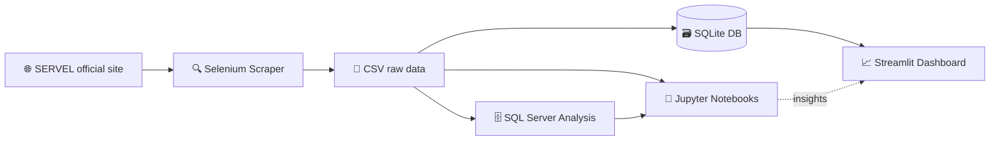

# 🗳️ Chilean Presidential Elections 2025 — Complete Intelligence System

       

> 🇪🇸 **Versión en español:** [README.es.md](README.es.md)

---

## 📋 Overview

This repository is an **end-to-end intelligence system** for the **Chilean Presidential Elections 2025** — from raw data acquisition to interactive visualization. It covers both the **first round** (November 16, 2025) and the **second round / runoff** (December 14, 2025), in which **José Antonio Kast** defeated **Jeannette Jara** by a margin of **16.48 percentage points** — the largest in Chilean runoff history since the return to democracy.

The system is built as a **four-stage ETL + analytical pipeline**:

1. **🔍 Web Scraping** (Selenium) — extracts official SERVEL results for all **346 communes** across **16 regions**
2. **🗄️ SQL Analysis** (SQL Server / T-SQL) — 26 analytical queries organized in CTEs
3. **📊 Notebook Analysis** (Python · Pandas · GeoPandas · scikit-learn) — territorial, statistical and political analysis
4. **📈 Interactive Dashboard** (Streamlit · Plotly · PyDeck) — bilingual (ES/EN) web application

The entire system runs on **public SERVEL data**, is **fully documented in English and Spanish**, and is **licensed under MIT**.

---

## 🎯 Key Analytical Findings

### 2025 First Round (November 16)

| Candidate                | Votes     |    % | Bloc               |
| :----------------------- | --------: | ---: | :----------------- |
| **Jeannette Jara**       | 3,446,854 | 26.75% | Left              |
| **José Antonio Kast**    | 3,086,963 | 23.96% | Conservative Right |
| **Franco Parisi**        | 2,550,770 | 19.71% | Anti-system        |
| **Johannes Kaiser**      | 1,796,034 | 13.94% | Libertarian        |
| **Evelyn Matthei**       | 1,603,104 | 12.44% | Traditional Right  |
| Marco Enríquez-Ominami   |   154,321 |  1.20% | Left (independent) |
| Harold Mayne-Nicholls    |  ~92,000  |  ~0.72% | Independent       |
| Eduardo Artés            |  ~68,000  |  ~0.53% | Far Left          |

- **No candidate exceeded 27%** — the most fragmented first round in Chilean democratic history
- **Combined right (Kast + Kaiser + Matthei) crossed 50%** for the first time in the compulsory-voting era
- **Franco Parisi grew +184%** (899k → 2.55M votes) — the anti-establishment surge
- **Kast won 169 communes (48.8%)**, Jara 105 (30.3%), Parisi 64 (18.5%)
- **Urban–rural gradient**: Jara dominates large urban communes; Kast dominates communes under 10k residents
- **Parisi as kingmaker**: his 2.55M voters became the decisive pool for the runoff

### 2025 Second Round (December 14)

| Candidate                | Votes     |    % |
| :----------------------- | --------: | ---: |
| **José Antonio Kast**    | ~7,200,000 | 58.16% (official) |
| **Jeannette Jara**       | ~5,180,000 | 41.84% (official) |

- **Margin: 16.48 pp** and **over 2 million votes** — unprecedented in Chilean runoff history
- **Kast won all 16 regions** and **310 of 346 communes (89.6%)**
- **Jara's 36 communes** concentrated in 5 regions only: RM (21), Valparaíso (5), Atacama (4), Coquimbo (3), Antofagasta (3)
- **Null vote exploded +116.9%** (360k → 782k) — historical high
- **63.6% of all communes gave Kast >60%** — deep, not just broad, territorial support
- **Parisi transfer**: ~42% to Jara, ~37.7% to Kast, ~20.3% protest/abstention
- Even with **80% of Parisi votes**, Jara would not have won — she needed >65%
- **Kast grew in every region**, strongest in the anti-system North (+36 pp in Arica y Parinacota)

### Historical Realignment 2021 → 2025

- **56.1% of communes changed winner** between 2021 and 2025 (194 of 346)
- **158 communes switched from Boric to Kast** — 81.4% of the left's 2021 base was lost
- Kast retained **100%** of his 2021 communes and added 158 new ones
- Compulsory voting (reinstated 2022) drove turnout **+60.4%** (8.3M → 13.4M)

---

## 🏗️ System Architecture

```text
Chilean-Presidential-Elections-2025-Analysis/
│
├── first_round/                          ← First round (Nov 16, 2025)
│   ├── 1_web_scraper/                    [Selenium · Firefox · Python]
│   ├── 2_1.sql_queries/                  [SQL Server · 9 analytical queries]
│   └── 2_2.electoral_notebooks/          [Jupyter · 14 analysis chapters]
│
├── second_round/                         ← Second round (Dec 14, 2025)
│   ├── 1_web_scraper/                    [Selenium · Firefox · Python]
│   ├── 2_1.sql_analysis/                 [SQL Server · 17 analytical queries]
│   └── 2_2.notebooks/                    [Jupyter · 12 analysis chapters]
│
├── dashboard/                            ← Streamlit bilingual dashboard
│   ├── app.py                            [Entry point · 3 pages · 10 views]
│   ├── config/                           [Constants · translations]
│   ├── components/                       [Theme · layout · titles · charts]
│   ├── pages/                            [Summary · FR · SR orchestrators]
│   ├── utils/                            [Data · calculations · geometries · HTML]
│   └── views/                            [10 analysis views · ~18,000 lines]
│
└── raw/                                  ← Data (loaded via HTTPS)
    ├── chile_2025_first_round.csv
    ├── chile_2025_second_round.csv
    ├── chile_2021_first_round.csv
    ├── chile_2021_second_round.csv
    ├── communes_population_2024.csv
    ├── region_dimension.csv
    └── database/
        └── chile_elections.db            [SQLite · dashboard source]
```

### Data Flow



---

## 📦 Component Breakdown

### 1. 🔍 Web Scrapers — Data Acquisition

Two independent Selenium scripts that extract official SERVEL data.

| Feature                | First Round                              | Second Round                       |
| :--------------------- | :--------------------------------------- | :--------------------------------- |
| **Target URL**         | `elecciones.servel.cl`                   | `segundavotacion.servel.cl`        |
| **Candidates**         | 8                                        | 2 (Jara, Kast)                     |
| **Output columns**     | 27                                       | 12                                 |
| **Communes**           | 346                                      | 346                                |
| **Runtime**            | 25–40 min                                | 25–40 min                          |
| **Backup retention**   | 7 days                                   | 7 days                             |
| **Partial saves**      | Every 10 communes                        | Every 10 communes                  |
| **Name normalization** | Uppercase → Title Case with exceptions   | Same                               |
| **Headless mode**      | ✅ `--headless`                          | ✅                                 |
| **Test mode**          | ✅ `--comunas N`                         | ✅                                 |

📖 **Documentation:** [First Round Scraper](first_round/1_web_scraper/README.md) · [Second Round Scraper](second_round/1_web_scraper/README.md)

**Quick start:**

```bash
cd first_round/1_web_scraper
pip install -r requirements.txt
python web_scraper.py --headless          # full run
python web_scraper.py --comunas 10       # test
```

### 2. 🗄️ SQL Analysis — Structured Queries

26 analytical queries in **T-SQL (SQL Server 2012+)**, documented and CTE-organized.

| Round | Queries | Objective examples |
| :---- | ------: | :----------------- |
| **First**  | 9  | National results · territorial mapping · flippable communes · anti-establishment vote |
| **Second** | 17 | Round-to-round comparison · null vote growth · Parisi transfer simulation (17 scenarios) · K-Means proxies |

**Data model:**

- `first_round_2025` (346 rows, 24 columns)
- `second_round_2025` (346 rows, 12 columns)
- Composite key: `(commune, region)`
- All percentages as `DECIMAL(5,2)`

📖 **Documentation:** [First Round SQL](first_round/2_1.sql_queries/README.md) · [Second Round SQL](second_round/2_1.sql_analysis/README.md)

**Quick start:**

```bash
cd second_round/2_1.sql_analysis/sql_server_scripts
python create_elections_database.py        # ETL from CSV to SQL Server
# Or generate SQL only:
python create_elections_database.py --no-execute
```

### 3. 📓 Notebooks — Deep Analysis

Two Jupyter notebooks (EN/ES versions each) with **territorial, statistical and political analysis**.

| Notebook            | Sections | Highlights |
| :------------------ | -------: | :--------- |
| **First Round**     | 14       | Turnout · null/blank geography · strongholds · urban-rural gradient · runoff projection · Parisi phenomenon · 2021–2025 realignment |
| **Second Round**    | 12       | Round-to-round comparison · Kast's sweep · Jara's archipelago · **K-Means Parisi segmentation** · 2021–2025 realignment · strategic conclusions |

**Libraries:** Pandas · GeoPandas · NumPy · Matplotlib · Seaborn · scikit-learn · SciPy

📖 **Documentation:** [First Round Notebooks](first_round/2_2.electoral_notebooks/README.md) · [Second Round Notebooks](second_round/2_2.notebooks/README.md)

**Quick start:**

```bash
cd second_round/2_2.notebooks
pip install -r requirements.txt
jupyter lab electoral_analysis_2025_second_round_EN.ipynb
```

### 4. 📈 Dashboard — Interactive Visualization

A **bilingual (ES/EN) Streamlit application** exposing 3 pages and 10 views.

| Page               | Views |
| :----------------- | :---- |
| **Executive Summary** | KPIs from both rounds, winners, deltas |
| **First Round**    | Summary · Territorial Explorer · Panorama (12 sections) · Historical (2021 vs 2025) |
| **Second Round**   | Summary · Territorial Explorer · Panorama (12 sections) · Jara · Kast · Historical |

**Highlights:**

- **Six-level territorial navigator**: Macrozone → Region → Circumscription → District → Province → Commune
- **873 bilingual keys per language** (ES/EN)
- **Live demo:** [chilean-presidential-election-2025.streamlit.app](https://chilean-presidential-election-2025.streamlit.app/)
- **Statistics & ML**: Pearson correlation with p-values, Laakso–Taagepera effective number of candidates, K-Means + PCA
- **Robust geospatial layer**: automatic GeoJSON download, `make_valid`, fuzzy name matching

📖 **Documentation:** [Dashboard](dashboard/README.md)

**Quick start:**

```bash
cd dashboard
pip install -r requirements.txt
streamlit run app.py
```

---

## 📊 Data Sources

| File                              | Description                                                   | Unit    |
| :-------------------------------- | :------------------------------------------------------------ | :------ |
| `chile_2025_first_round.csv`      | First-round candidate shares                                  | Commune |
| `chile_2025_second_round.csv`     | Runoff Jara/Kast shares                                       | Commune |
| `chile_2021_first_round.csv`      | 2021 first-round (comparative baseline)                       | Commune |
| `chile_2021_second_round.csv`     | 2021 runoff (Boric vs Kast)                                   | Commune |
| `communes_population_2024.csv`    | 2024 census projections                                       | Commune |
| `region_dimension.csv`            | Macrozone, display order, region codes                        | Region  |
| `chile_elections.db`              | SQLite database powering the dashboard                        | Both    |
| Chilean commune GeoJSON           | Polygon geometries (from [caracena/chile-geojson](https://github.com/caracena/chile-geojson)) | Commune |

**Primary source:** [Servicio Electoral de Chile (SERVEL)](https://www.servel.cl/) — official electoral authority (public domain).

All files are loaded directly from `raw/` over HTTPS. No local data download is required.

**Quick downloads:**

```bash
# Raw CSVs
curl -O https://raw.githubusercontent.com/adroguetth/Chilean-Presidential-Elections-2025-Analysis/main/raw/chile_2025_first_round.csv
curl -O https://raw.githubusercontent.com/adroguetth/Chilean-Presidential-Elections-2025-Analysis/main/raw/chile_2025_second_round.csv

# SQLite database (dashboard)
curl -O https://raw.githubusercontent.com/adroguetth/Chilean-Presidential-Elections-2025-Analysis/main/raw/database/chile_elections.db
```

---

## 🚀 Full Setup Guide

### Prerequisites

| Tool            | Version         | Purpose                  |
| :-------------- | :-------------- | :----------------------- |
| **Python**      | 3.9+ (3.12 rec.) | All scripts and notebooks |
| **Firefox**     | Latest          | Scrapers (Selenium)      |
| **GeckoDriver** | Matching Firefox | Scrapers (Selenium)     |
| **SQL Server**  | 2012+ (optional) | SQL analysis            |
| **Git**         | Latest          | Clone repository         |

### Step-by-Step Installation

#### 1. Clone the repository

```bash
git clone https://github.com/adroguetth/Chilean-Presidential-Elections-2025-Analysis.git
cd Chilean-Presidential-Elections-2025-Analysis
```

#### 2. Create a virtual environment

```bash
python -m venv venv

# Linux/Mac
source venv/bin/activate

# Windows
venv\Scripts\activate
```

#### 3. Install GeckoDriver (for scrapers only)

```bash
# Ubuntu/Debian
sudo apt-get install firefox firefox-geckodriver

# macOS
brew install firefox geckodriver

# Windows
# Download from https://github.com/mozilla/geckodriver/releases
# Add to PATH
```

#### 4. Install dependencies (per component)

```bash
# Scrapers
pip install -r first_round/1_web_scraper/requirements.txt
pip install -r second_round/1_web_scraper/requirements.txt

# Notebooks
pip install -r second_round/2_2.notebooks/requirements.txt

# Dashboard
pip install -r dashboard/requirements.txt
```

#### 5. Run any component

```bash
# Scraper (test mode)
cd second_round/1_web_scraper
python web_scraper.py --comunas 5 --headless

# Notebook
cd ../../second_round/2_2.notebooks
jupyter lab electoral_analysis_2025_second_round_EN.ipynb

# Dashboard
cd ../../dashboard
streamlit run app.py
```

---

## 🧠 Technical Highlights

### Name Normalization & Cross-Dataset Joins

A canonical commune key (`normalize_commune_name`) is applied across CSVs, SQL, notebooks and GeoJSON to prevent silent row loss from encoding divergence:

1. Lowercase + strip
2. NFD decomposition → strip diacritics (`ü → u`, `ñ → n` post-fold)
3. Remove non-alphanumerics
4. Collapse whitespace
5. Apply curated correction table (`Marchigüe → marchihue`, `Llay-Llay → llaillay`, …)

### Geographic Ordering (North → South)

SQL queries and notebook maps use an explicit `CASE` order (`Arica → Magallanes`) instead of alphabetical — essential for geographic coherence in regional analyses.

### Composite Join Key

All joins between election cycles are on `(commune, region)` — not just commune name — to prevent false matches where commune names repeat across regions.

### K-Means Parisi Segmentation

K-Means + PCA on 7 runoff features (`kast_pct`, `jara_pct`, `null_pct`, `blank_pct`, `protest_pct`, `kast_margin`, `null_blank_ratio`) yields 4 clusters:

| Cluster | Profile                              | Geography                    |
| :------ | :----------------------------------- | :--------------------------- |
| 1       | Near-complete transfer to Kast       | Conservative centre-south    |
| 2       | Active protest (null vote dominant)  | Norte Grande                 |
| 3       | Fragmentation (high competition)     | Intermediate northern cities |
| 4       | Partial transfer to Jara             | Mining communes with unions  |

### Reproducibility

- `random_state=42` on all ML (K-Means, PCA, StandardScaler)
- All scrapers use **partial progress saving** every 10 communes
- All analytical queries are **set-based** and run in <1 second on a standard SQL Server instance (346 rows)
- All percentage columns use `DECIMAL(5,2)` (no floating-point drift)

---

## 📈 Performance Estimates

| Metric                            | Value                              |
| :-------------------------------- | :--------------------------------- |
| 🗂️ Total communes processed       | 346 (both rounds)                  |
| ⏱️ Scraper runtime (each round)   | 25–40 minutes                      |
| 🗄️ SQL query performance          | <1 second per query                |
| 📓 Notebook runtime (each)        | 1–3 minutes (cached data)          |
| 📈 Dashboard first load           | Longer (DB + GeoJSON download)     |
| 📈 Dashboard subsequent loads     | Fast (cached)                      |
| 🧠 Dashboard RAM usage            | ~500 MB                            |
| 💾 Scraper storage per run        | 20–50 MB                           |
| 📝 Dashboard code                 | ~22,000 lines across 24 modules    |
| 🌐 Bilingual translation keys     | 873 × 2 languages                  |

---

## 🐛 Troubleshooting

### Scrapers

| Error                              | Solution                                                  |
| :--------------------------------- | :-------------------------------------------------------- |
| `GeckoDriver not found`            | `sudo apt-get install firefox-geckodriver`                |
| `Timeout waiting for table`        | Increase `TIEMPO_ESPERA_CARGA` in script                  |
| `Element not found`                | Run with `--verbose`, check SERVEL layout changes        |
| `Firefox not installed`            | `sudo apt-get install firefox`                            |

### SQL / Database

| Error                              | Solution                                                  |
| :--------------------------------- | :-------------------------------------------------------- |
| `no such table: first_round_2025`  | Run `create_elections_database.py` first                  |
| Division by zero on small communes | Already handled by `NULLIF(denominator, 0)`               |

### Dashboard

| Error / Symptom                    | Solution                                                  |
| :--------------------------------- | :-------------------------------------------------------- |
| `urllib.error.URLError` on start   | First run needs internet (DB + GeoJSON download)          |
| Map is empty                       | Delete `assets/comunas_caracena.geojson` and retry        |
| `ImportError: union_all`           | `pip install --upgrade "shapely>=2.0"`                    |
| Translation key error              | Add missing key to both `ES` and `EN` in `translations.py`|

### Notebooks

| Error                              | Solution                                                  |
| :--------------------------------- | :-------------------------------------------------------- |
| `geopandas` install issues         | `conda install -c conda-forge geopandas`                  |
| Commune joins drop rows            | Check `normalize_commune_name` output; add aliases if needed |

---

## 📁 Per-Component Documentation

Each component has a **dedicated README** with detailed setup, parameters, generated file structure, and troubleshooting:

| Component                    | README                                                                |
| :--------------------------- | :-------------------------------------------------------------------- |
| **First Round — Scraper**    | [first_round/1_web_scraper/README.md](first_round/1_web_scraper/README.md) |
| **First Round — SQL**        | [first_round/2_1.sql_queries/README.md](first_round/2_1.sql_queries/README.md) |
| **First Round — Notebooks**  | [first_round/2_2.electoral_notebooks/README.md](first_round/2_2.electoral_notebooks/README.md) |
| **Second Round — Scraper**   | [second_round/1_web_scraper/README.md](second_round/1_web_scraper/README.md) |
| **Second Round — SQL**       | [second_round/2_1.sql_analysis/README.md](second_round/2_1.sql_analysis/README.md) |
| **Second Round — Notebooks** | [second_round/2_2.notebooks/README.md](second_round/2_2.notebooks/README.md) |
| **Dashboard**                | [dashboard/README.md](dashboard/README.md)                            |

---

## 🤝 Contribution

1. **Report issues** with full traceback, the affected component, and the exact command used
2. **Keep translations** in sync (both `ES` and `EN` in `translations.py`)
3. **Keep colors and candidates** in `config/constants.py` (single source of truth)
4. **Do not rename** territorial state-machine identifiers in the dashboard (see *Do Not Translate* in dashboard README)
5. **Test scrapers** with `--comunas 10` before full runs
6. **Test dashboard changes** in both languages and both rounds
7. **Document new features** in the appropriate README

---

## 📄 License and Attribution

- **License**: MIT
- **Author**: **Alfonso Droguett**
  - 🔗 **LinkedIn:** [Alfonso Droguett](https://www.linkedin.com/in/adroguetth/)
  - 🐙 **GitHub:** [@adroguetth](https://github.com/adroguetth)
  - 📧 **Email:** adroguett.consultor@gmail.com
- **Data source**: [SERVEL](https://www.servel.cl/) (public domain, official electoral authority)
- **GeoJSON**: [caracena/chile-geojson](https://github.com/caracena/chile-geojson)
- **Technologies**:
  - **Scraping:** Selenium · Firefox · GeckoDriver · Pandas · OpenPyXL
  - **SQL:** SQL Server (T-SQL, CTEs)
  - **Notebooks:** Jupyter · Pandas · GeoPandas · NumPy · Matplotlib · Seaborn · scikit-learn · SciPy
  - **Dashboard:** Streamlit · Plotly · PyDeck · GeoPandas · Shapely · scikit-learn · SciPy

---

**🇨🇱 Análisis independiente · Datos oficiales SERVEL · Código abierto (MIT)**
