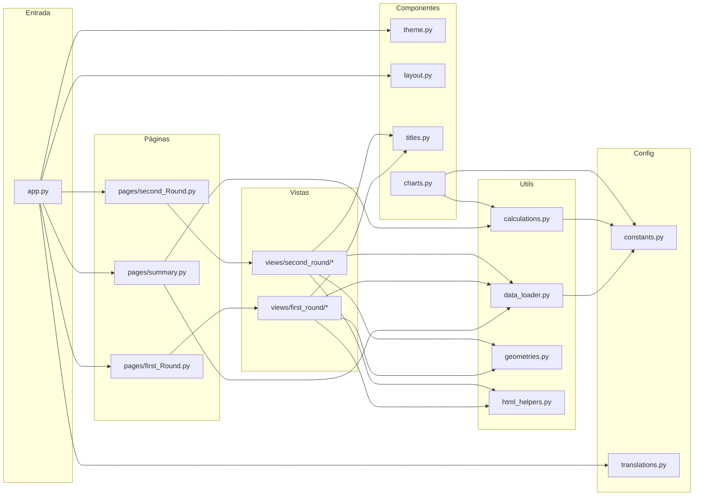
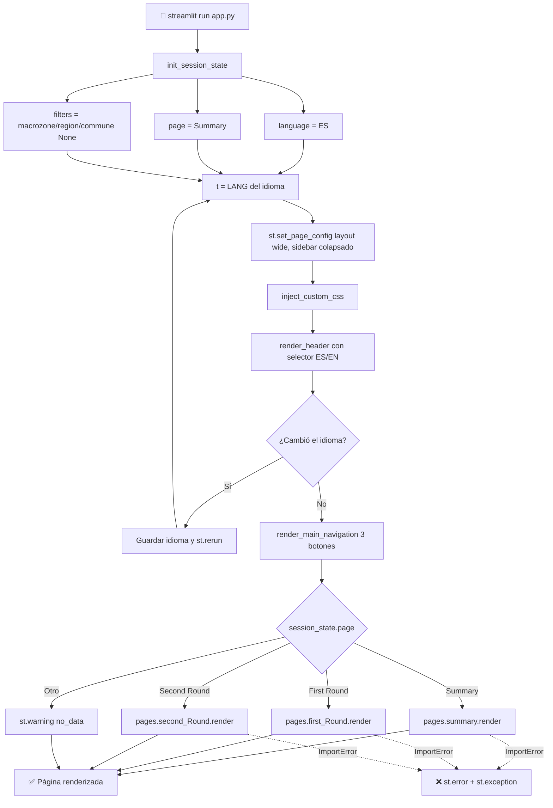
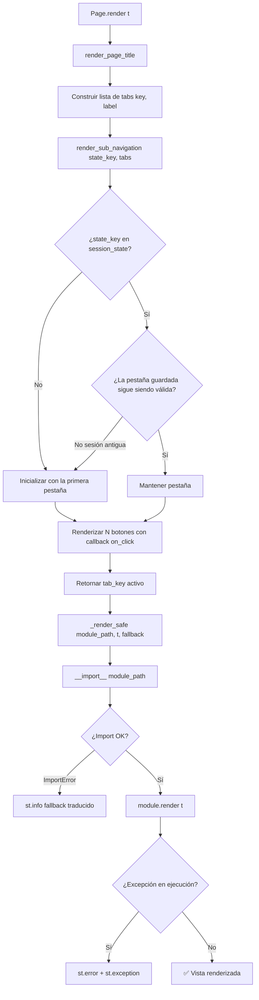
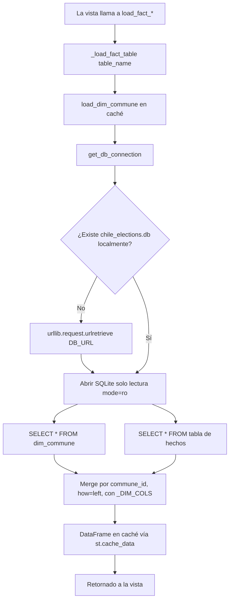
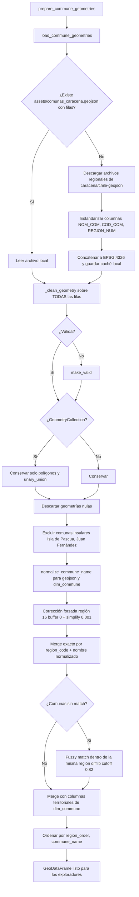
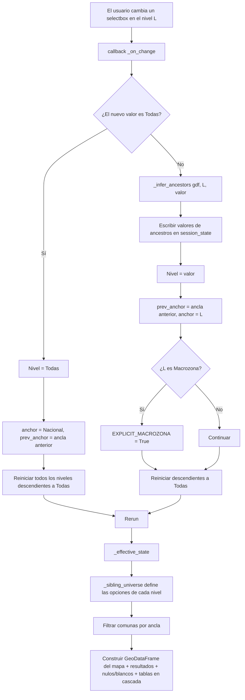
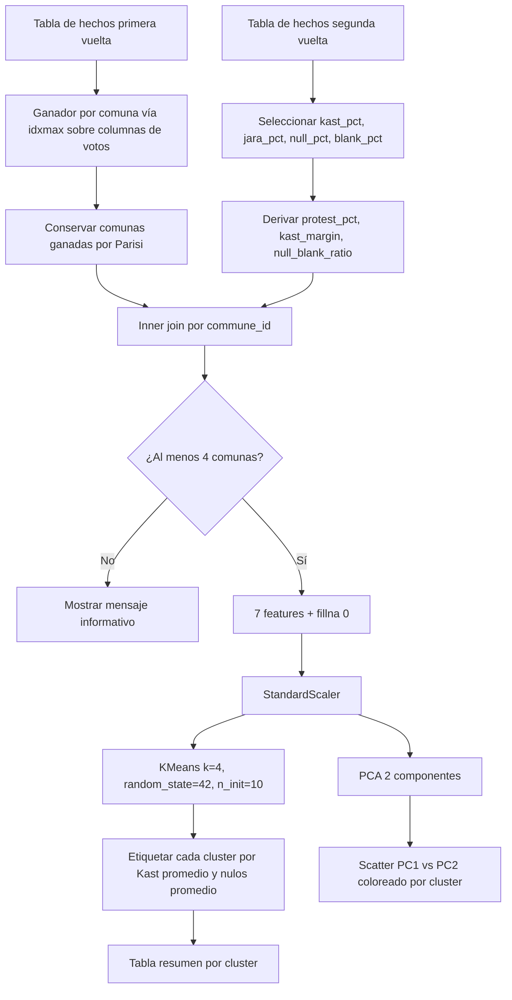
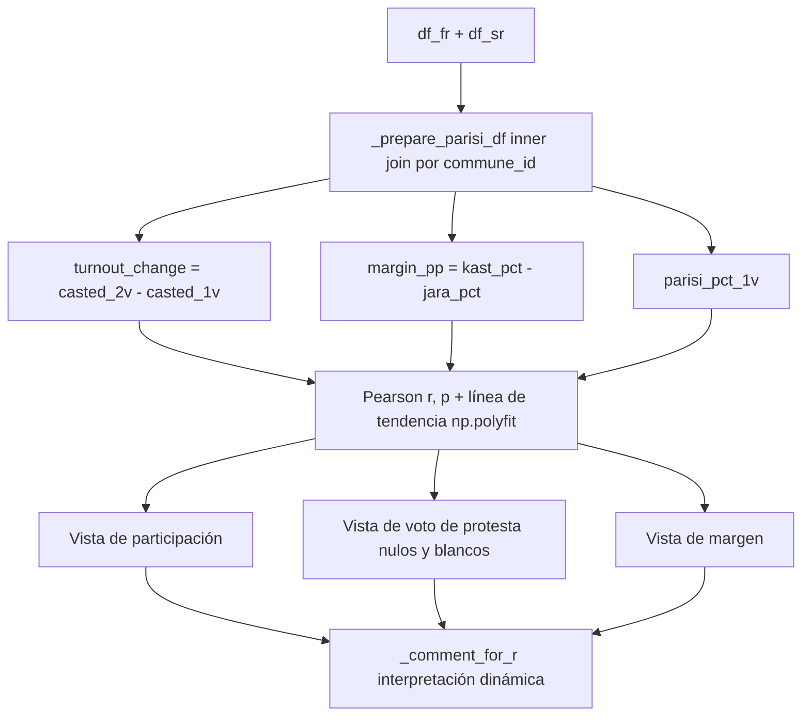
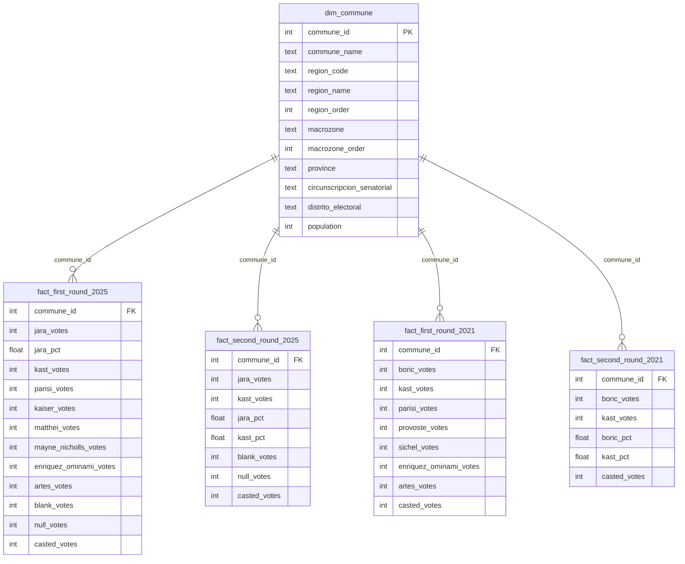

# 🗳️ Dashboard: Elecciones Presidenciales de Chile 2025 — Análisis (Streamlit)

  

 [](https://streamlit.io)       

> 🇬🇧 English version: [README.md](README.md)

## 📋 Descripción General

Este es el **dashboard interactivo de análisis** de las Elecciones Presidenciales de Chile 2025 (primera y segunda vuelta). Transforma los resultados a nivel comunal almacenados en una base de datos SQLite en una aplicación web bilingüe (ES/EN) con **KPIs, mapas, rankings, pruebas estadísticas, comparaciones históricas (2021 vs 2025) y segmentación no supervisada**.

La app está construida con **Streamlit** y sigue una arquitectura estrictamente por capas: un único punto de entrada (`app.py`) despacha a **páginas** (orquestadores con sub-navegación), que importan dinámicamente **vistas** (un módulo por análisis), las cuales se apoyan en **componentes**, **utils** (datos, cálculos, geometrías, helpers HTML) y **config** (constantes y traducciones) compartidos.

🔗 **Demo en vivo:** https://chilean-presidential-election-2025.streamlit.app/

### Características Principales

- **3 páginas principales**: Resumen Ejecutivo · Primera Vuelta · Segunda Vuelta
- **10 vistas de análisis** (4 de primera vuelta, 6 de segunda vuelta) más el resumen ejecutivo
- **Navegador territorial de seis niveles**: Macrozona → Región → Circunscripción Senatorial → Distrito Electoral → Provincia → Comuna, con ancla móvil y mapa PyDeck
- **Interfaz completamente bilingüe** (ES/EN) gobernada por un único diccionario de **873 claves por idioma**
- **Comparación histórica 2021 vs 2025** para ambas vueltas (evolución de bloques, matrices de transición, fragmentación)
- **Estadística y Machine Learning**: correlación de Pearson con p-values, líneas de tendencia lineal, segmentación K-Means + PCA, número efectivo de candidatos de Laakso–Taagepera
- **Capa geoespacial robusta**: descarga automática de GeoJSON, reparación de geometrías (`make_valid`), normalización de nombres y fuzzy matching
- **Orientado al rendimiento**: todos los loaders usan `@st.cache_data`; la base SQLite se abre en modo **solo lectura**
- **Despacho de páginas tolerante a fallos**: una vista rota o ausente muestra un mensaje traducido en lugar de botar la app
- **Consistencia de sistema de diseño**: una única fuente de verdad para colores (`config/constants.py`) y una única jerarquía de títulos (`components/titles.py`)
---
## 🏗️ Visión General de la Arquitectura

El código está organizado en **cinco capas**. Las dependencias solo fluyen hacia abajo: una vista puede importar de components, utils y config, pero nunca de otra vista.

| Capa           | Carpeta       | Responsabilidad                                                                  | ¿Usa Streamlit? |
| :------------- | :------------ | :------------------------------------------------------------------------------- | :-------------- |
| **Entrada**    | `app.py`      | Estado de sesión, config de página, inyección de CSS, header, navegación principal, despacho | ✅      |
| **Páginas**    | `pages/`      | Título de página + pestañas de sub-navegación + import dinámico seguro de vistas | ✅              |
| **Vistas**     | `views/`      | Un módulo por análisis; cada uno expone `render(t)`                              | ✅              |
| **Componentes**| `components/` | UI reutilizable: CSS del tema, header, sub-nav, títulos, gráficos compartidos    | ✅              |
| **Utils**      | `utils/`      | Carga de datos, cálculos puros, geometrías, formato HTML/numérico                | Parcialmente    |
| **Config**     | `config/`     | Constantes (candidatos, colores, macrozonas, URL de la BD) y traducciones        | ❌              |

> **Regla de diseño:** `utils/calculations.py` y `config/constants.py` **no contienen Streamlit, ni UI, ni traducciones**, lo que permite probarlos de forma aislada. `utils/html_helpers.py` solo *transforma* datos en strings listos para HTML; **nunca debe contener un bloque `<style>`** (todo el CSS vive en las vistas).



---

## 📊 Diagramas de Flujo de Procesos

### **Leyenda**

| Color         | Tipo            | Descripción                                                          |
| :------------ | :-------------- | :------------------------------------------------------------------- |
| 🔵 Azul        | Entrada / Inicio | Interacción del usuario, arranque de la app, fuentes de datos externas |
| 🟠 Naranjo     | Proceso         | Renderizado, cómputo, merges                                         |
| 🔴 Rojo        | Decisión        | Ramificación condicional (¿existe el estado?, ¿se encontró el módulo?) |
| 🟢 Verde       | Almacenamiento  | Base SQLite, caché local de GeoJSON, `st.session_state`              |
| 🟣 Morado      | Externo         | Archivos raw de GitHub, mapa base CARTO                              |
| 🟢 Verde oscuro | Salida         | Vista del dashboard renderizada                                      |

### **Diagrama 1: Inicio de la Aplicación y Despacho de Páginas**



### **Diagrama 2: Sub-Navegación e Import Seguro de Vistas**



**¿Por qué callbacks `on_click`?** En Streamlit, si la pestaña activa se asigna *después* de dibujar el botón, el botón y el contenido de abajo pueden quedar desincronizados por un frame (parpadeo o el famoso bug del "doble clic"). `render_sub_navigation` escribe la nueva pestaña en `st.session_state` dentro del callback `on_click`, que Streamlit ejecuta **antes** del rerun, de modo que el estado del botón y el contenido siempre se calculan desde el mismo estado.

### **Diagrama 3: Pipeline de Carga de Datos**



### **Diagrama 4: Pipeline de Preparación de Geometrías**



### **Diagrama 5: Máquina de Estados del Explorador Territorial**

El navegador de seis niveles mantiene **un `selectbox` por nivel** más un **ancla** (el último nivel que el usuario tocó explícitamente). Seleccionar un valor en cualquier nivel (a) infiere y completa todos sus ancestros, (b) reinicia todos sus descendientes a `"Todas"` y (c) mueve el ancla.



### **Diagrama 6: Segmentación de Comunas de Parisi (K-Means + PCA)**



### **Diagrama 7: Flujo de Datos del Panorama de Segunda Vuelta (Votos de Parisi)**



---

## 🔍 Análisis Detallado por Módulo

### 1. `app.py` — Punto de Entrada Principal

Único punto de entrada de la app Streamlit. **No contiene lógica de análisis**, solo orquestación.

| Función                     | Propósito                                                                                     |
| :-------------------------- | :-------------------------------------------------------------------------------------------- |
| `init_session_state()`      | Crea `language="ES"`, `page="Summary"` y el dict `filters` si no existen                      |
| `render_main_navigation(t)` | Tres botones de ancho completo; el activo es `primary`, los demás `secondary`                  |
| `main()`                    | Config de página → CSS → header → navegación → despacho dinámico con manejo de `ImportError`   |

**Claves de estado de sesión** (identificadores internos, **nunca se traducen**):

| Clave                        | Valores / Tipo                                 | Propósito                                |
| :--------------------------- | :--------------------------------------------- | :--------------------------------------- |
| `language`                   | `"ES"` \| `"EN"`                               | Idioma activo de la UI                   |
| `page`                       | `"Summary"` \| `"First Round"` \| `"Second Round"` | Página principal activa              |
| `filters`                    | `{macrozone, region, commune}` → `None`        | Filtros globales (estado inicial vacío)  |
| `first_round_tab`            | `summary` / `territorial_explorer` / `panorama` / `historical_first_round` | Sub-pestaña activa de 1V |
| `second_round_tab`           | `summary` / `territorial_explorer` / `panorama` / `jara` / `kast` / `historical` | Sub-pestaña activa de 2V |
| `communal_*_v2`              | Valores de los selectores territoriales (1V)   | Una clave por nivel territorial          |
| `sr2_*_v1`                   | Valores de los selectores territoriales (2V)   | Con prefijo para evitar colisiones con 1V |

> El `sys.path.insert(0, ...)` al inicio de `app.py` hace que `python app.py` funcione desde cualquier directorio; `streamlit run app.py` también funciona sin él.

### 2. `config/constants.py` — Constantes Globales

Única fuente de verdad de todo lo que es *dato*, no UI.

**Candidatos 2025 (primera vuelta, 8)**

| Candidato              | Columna de votos         | Partido / coalición          | Color     |
| :--------------------- | :----------------------- | :--------------------------- | :-------- |
| Jeannette Jara         | `jara_votes`             | Unidad por Chile             | `#E34843` |
| José Antonio Kast      | `kast_votes`             | Partido Republicano          | `#243C5F` |
| Franco Parisi          | `parisi_votes`           | Partido de la Gente          | `#3466B3` |
| Johannes Kaiser        | `kaiser_votes`           | Partido Nacional Libertario  | `#F1893F` |
| Evelyn Matthei         | `matthei_votes`          | Chile Vamos                  | `#3272BF` |
| Harold Mayne-Nicholls  | `mayne_nicholls_votes`   | Independiente                | `#C0D9E0` |
| Marco Enríquez-Ominami | `enriquez_ominami_votes` | Izquierda Alternativa        | `#DF2884` |
| Eduardo Artés          | `artes_votes`            | Izquierda Radical            | `#CA1518` |

**Otras constantes**

| Constante                        | Descripción                                                                                         |
| :------------------------------- | :-------------------------------------------------------------------------------------------------- |
| `CANDIDATES_2025_SR`             | Candidatos de segunda vuelta (Jara, Kast)                                                           |
| `MACROZONE_MAP` / `MACROZONE_ORDER` | Número de región → macrozona, y macrozona → orden norte a sur                                    |
| `PADRON_ELECTORAL_2025`          | Tamaño del padrón electoral: **15.779.102**                                                         |
| `DB_URL` / `DB_LOCAL_PATH`       | URL raw remota de `chile_elections.db` y nombre del archivo local                                   |
| `DEFAULT_FILTERS`                | `{macrozone, region, commune}` todos en `None`                                                      |
| `CANDIDATE_COLORS`               | Dict plano con **variantes de nombre** (nombre completo, apellido, con/sin tildes)                  |
| `CANDIDATE_COLORS_2021`          | Boric, Kast, Parisi, Provoste, Sichel, Enríquez-Ominami, Artés                                      |
| `POLITICAL_GROUPS`               | 8 grupos ideológicos con colores                                                                    |
| `POLITICAL_BLOCKS`               | 3 bloques agregados: Izquierda, Derecha, Antisistema (`#9AA0A6`)                                    |
| `CANDIDATE_COLOR_VARIANTS`       | Tonos `oficial / claro / muy_claro / intenso` para Jara y Kast                                      |
| `COLOR_POSITIVE/NEGATIVE/DELTA`  | Colores de indicadores (`#2E7D32`, `#C0392B`, `#A03A3A`)                                            |
| `COLOR_VALIDOS/NULOS/BLANCOS`    | Colores por tipo de voto (`#EBE4D6`, `#595959`, `#B4814C`)                                          |
| `TREND_COLOR_UP/DOWN/FLAT`       | Colores de las píldoras de tendencia                                                                |
| `CLUSTER_COLORS`                 | Paleta de 4 colores para los clusters de K-Means                                                    |
| `MARGIN_SCALE_COLORS`            | Escala de márgenes de derrota (`0-1%` … `4-5%`)                                                     |
| `HEATMAP_SCALE_PCT / _KAST / _COUNT` | Escalas de color reutilizables para heatmaps (rojo para Jara, azul para Kast, rojo para conteos) |
| `NEUTRAL_COLOR`                  | `#6B7280` — respaldo para nombres no reconocidos                                                    |

**Helpers de color**

| Función                         | Descripción                                                                                                       |
| :------------------------------ | :---------------------------------------------------------------------------------------------------------------- |
| `_get_candidate_color(name)`    | Resuelve un color desde **cualquier** variante de nombre: exacto → id numérico (`"1"`…`"8"`) → normalizado → coincidencia de tokens → primera palabra |
| `_hex_to_rgba(hex, alpha=180)`  | Lista `[r, g, b, a]` para PyDeck                                                                                  |
| `_hex_to_rgba_string(hex, a)`   | String `rgba(r,g,b,a)` para CSS                                                                                   |

Orden de resolución de `_get_candidate_color`:

1. `None`, `NaN` o string vacío → `NEUTRAL_COLOR`
2. Clave exacta en `CANDIDATE_COLORS`
3. Id numérico `"1"…"8"` mapeado mediante `_ID_TO_NAME`
4. Igualdad o subcadena sin distinguir tildes ni mayúsculas
5. Token compartido de más de 3 caracteres
6. Primera palabra del nombre contenida en alguna clave
7. Respaldo → `NEUTRAL_COLOR`

### 3. `config/translations.py` — Diccionario Bilingüe

Un único diccionario `LANG = {"ES": {...}, "EN": {...}}`.

| Propiedad               | Valor                                                                          |
| :---------------------- | :----------------------------------------------------------------------------- |
| Claves por idioma       | **873** (ES y EN son totalmente simétricos)                                    |
| Líneas                  | ~2.235                                                                         |
| Placeholders            | `.format()` de Python (p. ej. `"{pct}% del total"`)                            |
| Convención de nombres   | Prefijo por vista: `fr_te_*`, `fr_pano_*`, `fr_hist_*`, `sr_pano_*`, `sr_jara_*`, `sr_kast_*`, `sr_hist_*`, `*_orch_*` |
| Lo que **no** se traduce | Nombres propios: candidatos, partidos, regiones, macrozonas, comunas          |
| Textos con HTML         | Se mantienen completos (nunca divididos) para que los placeholders sigan siendo válidos |

### 4. `utils/data_loader.py` — Carga de Datos

| Función                          | En caché | Descripción                                                          |
| :------------------------------- | :------- | :------------------------------------------------------------------- |
| `get_db_connection()`            | ❌        | Descarga la BD si falta; retorna una conexión SQLite de **solo lectura** |
| `load_dim_commune()`             | ✅        | Tabla `dim_commune` completa                                          |
| `_load_fact_table(name)`         | ❌        | Lee una tabla de hechos y hace left join de `_DIM_COLS` por `commune_id` |
| `load_fact_first_round_2025()`   | ✅        | `fact_first_round_2025` + dimensión                                   |
| `load_fact_second_round_2025()`  | ✅        | `fact_second_round_2025` + dimensión                                  |
| `load_fact_first_round_2021()`   | ✅        | `fact_first_round_2021` + dimensión                                   |
| `load_fact_second_round_2021()`  | ✅        | `fact_second_round_2021` + dimensión                                  |

Columnas incorporadas a cada tabla de hechos (`_DIM_COLS`):
`commune_id, commune_name, region_code, region_name, region_order, macrozone, macrozone_order, province`.

> Las columnas territoriales que no están en `_DIM_COLS` (`circunscripcion_senatorial`, `distrito_electoral`, `population`) las obtienen las vistas directamente desde `load_dim_commune()` o desde el GeoDataFrame de geometrías.

### 5. `utils/calculations.py` — Cálculos Puros

Sin Streamlit, sin UI, sin traducciones. Todas las funciones reciben DataFrames crudos y retornan dicts o DataFrames.

| Función                                    | Retorna                                                                                           |
| :----------------------------------------- | :------------------------------------------------------------------------------------------------ |
| `compute_vote_metrics(df, padron=None)`    | Votos y porcentajes `casted/valid/null/blank` (+ `casted_pct_padron` si se entrega `padron`)      |
| `compute_round_comparison(cur, prev)`      | `valid_pct_diff`, `null_pct_diff`, `blank_pct_diff` en **puntos porcentuales**                    |
| `compute_second_round_results(df)`         | Votos Jara/Kast, %, `diff_votes`, `diff_pct`, `winner`                                            |
| `compute_first_round_results(df)`          | DataFrame ordenado (`candidate_name, party, votes, pct, color, short_name, status`)               |
| `format_thousands(n)`                      | `1234567 → "1.234.567"` (separador chileno)                                                       |

Fórmulas utilizadas:

```text
valid_votes   = casted_votes − null_votes − blank_votes
valid_pct     = valid_votes / casted_votes × 100
candidate_pct = candidate_votes / valid_votes × 100          (primera vuelta)
runoff_pct    = candidate_votes / (jara_votes + kast_votes)  (segunda vuelta)
status        = "passes_to_runoff" para los 2 más votados, si no "does_not_pass"
```

### 6. `utils/geometries.py` — Geometrías Comunales

| Elemento                             | Descripción                                                                                          |
| :----------------------------------- | :--------------------------------------------------------------------------------------------------- |
| `EXCLUDE_COMMUNES`                   | Se eliminan Isla de Pascua y Juan Fernández (distorsionan el marco continental). **Antártica se conserva** (pertenece a Magallanes) |
| `KNOWN_ALIASES`                      | 8 correcciones manuales de nombres entre GeoJSON e INE (p. ej. `COIHAIQUE → COYHAIQUE`, `MARCHIGUE → MARCHIHUE`, `LLAY LLAY → LLAILLAY`, `ALTO BIO BIO → ALTO BIOBIO`, `TIL-TIL → TIL TIL`) |
| `normalize_commune_name(v)`          | Mayúsculas → eliminación de tildes NFKD → quitar `(…)` → guiones a espacios → conservar `[A-Z0-9' ]` → colapsar espacios → búsqueda de alias |
| `_fuzzy_match_leftovers(...)`        | `difflib.get_close_matches` con cutoff **0,82**, restringido a la **misma región**                   |
| `_clean_geometry(geom)`              | `make_valid` → conservar solo polígonos de las colecciones → `unary_union` → `buffer(0)` como último recurso |
| `load_commune_geometries()` ✅        | Descarga/cachea `assets/comunas_caracena.geojson` y repara la geometría                              |
| `prepare_commune_geometries()` ✅     | GeoDataFrame final: geometría + región/macrozona/provincia/circunscripción/distrito. **No incluye votos** |

### 7. `utils/html_helpers.py` — Helpers de HTML y Formato

| Función                   | Ejemplo                                         |
| :------------------------ | :---------------------------------------------- |
| `clean_html(html)`        | Elimina la indentación de cada línea para que Markdown no trate los f-strings indentados como bloques de código |
| `escape_html(s)`          | Escapa `& < > "`                                |
| `format_number(v)`        | `1234567 → "1.234.567"` (retorna `"0"` ante error) |
| `format_percentage(v, d)` | `12.34 → "12.34%"`                              |
| `format_signed(v, d)`     | `3.16 → "+3.16"`                                |
| `format_pp(v, d)`         | `3.16 → "+3.16 pp"`                             |
| `hex_to_rgba(hex, a)`     | `#E34843 → rgba(227,72,67,0.12)`                |
| `normalize_commune(s)`    | `Ñuñoa → NUNOA`                                 |

Alias de retrocompatibilidad que siguen exportándose: `fmt_number`, `fmt_pct`, `fmt_signed`, `fmt_pp`, `norm_commune`.

### 8. `components/` — UI Reutilizable

| Módulo       | Contenido                                                                                                                       |
| :----------- | :------------------------------------------------------------------------------------------------------------------------------ |
| `theme.py`   | `CUSTOM_CSS` + `inject_custom_css()`: fondo crema `#F7F7F2`, ancho máximo 1100 px, botones de navegación tipo píldora, tarjetas de métricas, oculta menú/footer/header de Streamlit |
| `layout.py`  | `render_header(t)` (título + selector ES/EN en grilla 3:1) y `render_sub_navigation(t, state_key, tabs)`                        |
| `titles.py`  | Seis niveles de título con jerarquía fija (ver tabla abajo)                                                                     |
| `charts.py`  | `render_second_round_chart`, `render_donut_chart`, `render_region_candidate_heatmap`                                            |

**Jerarquía de títulos (`components/titles.py`)** — fuente `Liberation Sans, Arial, sans-serif`

| Función                     | Tamaño   | Color     | Peso   | Usado en            |
| :-------------------------- | :------- | :-------- | :----- | :------------------ |
| `render_app_title`          | 32 px    | `#1a1a18` | 700    | Parte superior de la app |
| `render_page_title`         | 28 px    | `#1a1a18` | 700    | `pages/*.py`        |
| `render_view_title`         | 16,5 pt  | `#111827` | 700    | `views/**/*.py`     |
| `render_view_subtitle`      | 9,5 pt   | `#6b7280` | —      | Bajo el título de vista |
| `render_section_title`      | 12 pt    | `#111827` | 700    | Secciones internas  |
| `render_section_subtitle`   | 10 pt    | `#6b7280` | —      | Bajo el título de sección |

**Gráficos compartidos (`components/charts.py`)**

| Función                           | Notas de implementación                                                                                                |
| :-------------------------------- | :--------------------------------------------------------------------------------------------------------------------- |
| `render_second_round_chart`       | Barra apilada redondeada en HTML/CSS puro (sin Plotly) con etiqueta del ganador y margen en votos y pp                  |
| `render_donut_chart`              | `Pie` de Plotly con `hole=0.55`, colores por candidato, 280 px de alto                                                  |
| `render_region_candidate_heatmap` | Candidatos (Jara, Kast, Parisi, Kaiser, Matthei) × regiones. Plotly no permite una escala de color distinta por celda en un heatmap, así que el gráfico **apila 6 trazas**: una base gris + una superposición por candidato (NaN en todas las celdas salvo las que ese candidato ganó). El nombre del ganador regional se agrega bajo cada columna, rotado −90°. El ganador se determina por **votos totales**, la intensidad por **% de votos válidos** (escala 0–40) |

### 9. `pages/` — Orquestadores de Página

| Página                  | Pestañas                                                                                | Clave de sesión    |
| :---------------------- | :-------------------------------------------------------------------------------------- | :----------------- |
| `pages/summary.py`      | Ninguna (estática, dos secciones: KPIs de Segunda Vuelta + bloque ganador, KPIs de Primera Vuelta + tabla de 8 candidatos) | — |
| `pages/first_Round.py`  | Resumen · Explorador Territorial · Panorama · Histórico                                 | `first_round_tab`  |
| `pages/second_Round.py` | Resumen · Explorador Territorial · Panorama · Jara · Kast · Histórico                   | `second_round_tab` |

Ambas páginas de vuelta comparten el mismo `_render_safe(module_path, t, fallback)`:

- Importa el módulo con `__import__(module_path, fromlist=["render"])` (la ruta es un string resuelto de forma perezosa; un `import` normal anularía el fallback).
- `ImportError` → `st.info(fallback)` (traducido).
- Cualquier otra excepción → `st.error(...)` + `st.exception(e)`.

---

## 🗂️ Catálogo de Vistas

Cada vista expone `render(t)` y se construye con pequeñas funciones `_build_*_section`, cada una envolviendo una función `_render_*` dentro de una sección colapsable.

### Primera Vuelta

| Vista                   | Archivo                                       | Contenido                                                                                                                                                |
| :---------------------- | :-------------------------------------------- | :------------------------------------------------------------------------------------------------------------------------------------------------------- |
| **Resumen**             | `views/first_round/summary.py`                | 6 tarjetas KPI (3+3), tabla de candidatos con píldoras de estado, donut + heatmap región de comunas ganadas, top-5 bastiones (Jara, Kast, Parisi), tabla por macrozona con píldora de ganador y barra de distribución. `MIN_CASTED_VOTES = 300` excluye comunas muy pequeñas de los rankings de bastiones |
| **Explorador Territorial** | `views/first_round/territorial_explorer.py` | Navegador de seis niveles, mapa PyDeck, tabla de resultados + donut (candidatos >10%, el resto agrupado como "Otros"), análisis de nulos/blancos con gráfico waffle de 100 cuadrados, tablas en cascada padre → hijo |
| **Panorama**            | `views/first_round/panorama.py`               | 12 secciones colapsables (abajo)                                                                                                                         |
| **Histórico**           | `views/first_round/historical.py`             | 4 tarjetas destacadas + 8 secciones colapsables, 2021 vs 2025 (abajo)                                                                                    |

**Primera Vuelta — Secciones del Panorama**

| #  | Sección                                  | Notas                                                                                           |
| :- | :--------------------------------------- | :---------------------------------------------------------------------------------------------- |
| 1  | Participación nacional                   | Tarjetas: emitidos, válidos, nulos, blancos, % del padrón                                       |
| 2  | Análisis de voto nulo                    | Top regiones y top comunas                                                                      |
| 3  | Análisis de voto blanco                  | Top regiones y top comunas                                                                      |
| 4  | Resultados nacionales + bloques ideológicos | Izquierda = Jara + MEO + Artés · Derecha = Kast + Kaiser + Matthei · Antisistema = Parisi + Mayne-Nicholls |
| 5  | Top comunas por candidato                | Gráficos de barras horizontales (`_plot_top_bar`)                                               |
| 6  | Comunas ganadas                          | Tabla + waffle + ganadores por macrozona                                                        |
| 7  | Ganadores regionales                     | Ganador y segundo lugar por región                                                              |
| 8  | Voto en capitales regionales             | Comparación de ciudades capitales                                                               |
| 9  | Voto por tamaño de comuna                | Barras apiladas por tramo de población (5 tramos, ver [Modelo de Datos](#-modelo-de-datos))     |
| 10 | Comunas recuperables para la segunda vuelta | Comunas donde \|Jara − Kast\| < **1.000 votos** (`RECOVERABLE_THRESHOLD`), mostradas como scatter |
| 11 | Voto antisistema: Franco Parisi          | Comunas agrupadas por intensidad: `> 40%`, `35–40%`, `30–35%`, `20–30%`, `< 20%` + tabla top/bottom |
| 12 | Kaiser: la nueva derecha libertaria      | Votos, % de válidos, comunas ganadas, perfil territorial                                        |

**Primera Vuelta — Secciones del Histórico (2021 vs 2025)**

| Tarjeta / Sección | Descripción                                                                                        |
| :---------------- | :------------------------------------------------------------------------------------------------- |
| Tarjeta 1         | Crecimiento de votos emitidos (voto voluntario → obligatorio)                                      |
| Tarjeta 2         | Número efectivo de candidatos 2025 (fragmentación)                                                 |
| Tarjeta 3         | Comunas que cambiaron de ganador                                                                   |
| Tarjeta 4         | Crecimiento absoluto de Parisi                                                                     |
| 1                 | Participación nacional 2021 vs 2025                                                                |
| 2                 | Evolución de bloques políticos (Boric + Provoste → Jara · Kast → Kast · Sichel → Matthei · Parisi → Parisi · Kaiser = nuevo en 2025) |
| 3                 | Realineamiento electoral: matriz de transición de ganadores 2021 → 2025                            |
| 4                 | Cambios de ganador agrupados por transición                                                        |
| 5                 | Comunas con cambio de ganador: **decisivas** (nuevo ganador ≥ 40%) vs **estrechas** (< 30%)       |
| 6                 | Fragmentación política (Laakso–Taagepera)                                                          |
| 7                 | Franco Parisi: evolución y territorio                                                              |
| 8                 | Franco Parisi: comunas y absorción                                                                 |

### Segunda Vuelta

| Vista                   | Archivo                                      | Contenido                                                                                                                                     |
| :---------------------- | :------------------------------------------- | :-------------------------------------------------------------------------------------------------------------------------------------------- |
| **Resumen**             | `views/second_round/summary.py`              | 6 tarjetas KPI con deltas vs primera vuelta, bloque ganador (barra apilada + margen), tabla comparativa 1V vs 2V, top-10 comunas por margen (Kast y Jara), tabla por macrozona |
| **Explorador Territorial** | `views/second_round/territorial.py`       | Gemelo del explorador de 1V; resultados en 3 tarjetas (Jara, Kast, Diferencia). Claves de sesión con prefijo `sr2_`                           |
| **Panorama**            | `views/second_round/panorama.py`             | 12 secciones colapsables (abajo)                                                                                                              |
| **Jara**                | `views/second_round/jara.py`                 | 4 tarjetas + 11 secciones                                                                                                                     |
| **Kast**                | `views/second_round/kast.py`                 | 4 tarjetas + 9 secciones                                                                                                                      |
| **Histórico**           | `views/second_round/historical.py`           | Boric vs Kast (2021) frente a Kast vs Jara (2025): 4 tarjetas + 7 secciones                                                                   |

**Segunda Vuelta — Secciones del Panorama**

| #  | Sección                                         | Notas                                                                                      |
| :- | :---------------------------------------------- | :----------------------------------------------------------------------------------------- |
| 1  | Participación nacional                          | Tarjetas                                                                                   |
| 2  | Participación y voto válido: 1V vs 2V           | Píldoras de tendencia (sube / baja / estable)                                              |
| 3  | Análisis de voto nulo                           | Selector: solo 2V o comparación 1V vs 2V                                                   |
| 4  | Análisis de voto blanco                         | Selector: solo 2V o comparación 1V vs 2V                                                   |
| 5  | Resultados nacionales (2V)                      | Jara vs Kast                                                                               |
| 6  | Comunas ganadas                                 | Tabla + waffle                                                                             |
| 7  | Ganadores regionales                            | Tabla                                                                                      |
| 8  | Voto en capitales regionales                    | Tabla                                                                                      |
| 9  | Voto por tamaño de comuna                       | Barras apiladas                                                                            |
| 10 | Realineamiento electoral 1V → 2V                | Transiciones de ganador                                                                    |
| 11 | Parisi: destino del voto antisistema            | Selector: **participación / protesta / margen**, cada uno con r de Pearson, p-value, línea de tendencia e interpretación dinámica |
| 12 | Parisi: segmentación de sus comunas             | **K-Means + PCA** (ver [Métodos Analíticos](#-métodos-analíticos))                         |

**Vista Jara — secciones**

| #  | Sección                         | Regla / métrica                                                                                |
| :- | :------------------------------ | :--------------------------------------------------------------------------------------------- |
| 1  | Bastiones territoriales         | Comunas donde Jara > 50% en la segunda vuelta                                                  |
| 2  | Vuelcos (flips)                 | Ganadas por otro candidato en 1V, ganadas por Jara en 2V                                       |
| 3  | Expansión de bastiones          | Top 20 comunas por crecimiento absoluto de votos 1V → 2V                                       |
| 4  | Geografía del voto              | Perfil por macrozona, 1V vs 2V                                                                 |
| 5  | Gradiente urbano–rural          | % por tramo de tamaño de comuna                                                                |
| 6  | Intensidad urbano–rural         | % por tramo de tamaño × macrozona                                                              |
| 7  | Derrotas estrechas              | Comunas perdidas por **menos de 5 pp**, agrupadas en `0-1%`, `1-2%`, `2-3%`, `3-4%`, `4-5%`    |
| 8  | Distribución de derrotas por zona | Distribución entre macrozonas                                                                |
| 9  | Derrotas por zona y margen      | Heatmap macrozona × tramo de margen                                                            |
| 10 | Élite santiaguina               | Vitacura, Las Condes, Lo Barnechea: votos y variación % 1V → 2V                                |
| 11 | Voto de protesta                | Cambio en (nulos + blancos) vs cambio en el % de Jara, agrupado en `<0`, `0–500`, `500–1.000`, `1.000–2.000`, `2.000+` |

**Vista Kast — secciones**

| #  | Sección                         | Regla / métrica                                                                                |
| :- | :------------------------------ | :--------------------------------------------------------------------------------------------- |
| 1  | Bastiones territoriales         | Comunas con Kast > **75%** (`STRONGHOLD_THRESHOLD`) + intensidad de victoria (>80% "arrasa", >70% bastión, >60% sólido, resto otro) |
| 2  | Bastiones regionales            | Regiones donde el promedio de Kast > **60%** (`REGIONAL_THRESHOLD`)                            |
| 3  | Geografía del voto              | Perfil por macrozona, 1V vs 2V                                                                 |
| 4  | Duelos invertidos               | Ganadas por Jara en 1V, ganadas por Kast en 2V                                                 |
| 5  | Márgenes estrechos              | Comunas ganadas por Kast por ≤ 5 pp, ordenadas de la más frágil                                |
| 6  | Voto de protesta                | Cambio en nulos/blancos vs cambio en el % de Kast                                              |
| 7  | Crecimiento y lealtad           | Top/bottom `N_GROWTH = 20` comunas por crecimiento absoluto y relativo, con scatter intercambiable ("Crecimiento Dual" / "Lealtad de Base") |
| 8  | Gradiente urbano–rural          | % por tramo de tamaño                                                                          |
| 9  | Intensidad urbano–rural         | % por tramo de tamaño × macrozona                                                              |

**Segunda Vuelta — Secciones del Histórico (Boric vs Kast 2021 → Kast vs Jara 2025)**

| Tarjeta / Sección | Descripción                                                             |
| :---------------- | :---------------------------------------------------------------------- |
| Tarjetas          | Crecimiento de votos emitidos · margen 2025 · comunas que cambiaron de ganador · crecimiento absoluto de Kast |
| 1                 | Participación nacional 2021 vs 2025                                     |
| 2                 | Resultado nacional: Boric vs Kast (2021) y Kast vs Jara (2025)          |
| 3                 | Evolución de bloques políticos (Izquierda: Boric → Jara · Derecha: Kast → Kast) |
| 4                 | Realineamiento electoral: matriz de transición                          |
| 5                 | Kast: evolución por comuna                                              |
| 6                 | La izquierda: Boric 2021 → Jara 2025                                    |
| 7                 | Comunas con cambio de ganador: decisivas (≥ 40%) vs estrechas (< 30%)   |

---

## 🗄️ Modelo de Datos

La app lee una base SQLite (`chile_elections.db`) con **una tabla de dimensión** y **cuatro tablas de hechos**, todas a nivel comunal.



> El diagrama ER lista las columnas **referenciadas por el código**; las tablas reales pueden contener más (p. ej. `*_pct` para cada candidato, `blank_pct`, `null_pct`, `casted_pct`). La nomenclatura de columnas sigue la convención del scraper: `{candidate}_votes`, `{candidate}_pct`, `blank_*`, `null_*`, `casted_*`.

**Fuente de la base de datos:** `https://raw.githubusercontent.com/adroguetth/Chilean-Presidential-Elections-2025-Analysis/main/raw/database/chile_elections.db` — se descarga automáticamente en la primera ejecución.

**Fuente de geometrías:** [caracena/chile-geojson](https://github.com/caracena/chile-geojson) — se descarga la primera vez que se abre un explorador territorial y se cachea en `assets/comunas_caracena.geojson`.

**Tramos de tamaño de comuna (compartidos por Panorama, Jara y Kast)**

| Tramo                      | Rango de población   |
| :------------------------- | :------------------- |
| Rural                      | < 10.000             |
| Rural-urbano               | 10.000 – 49.999      |
| Centros urbanos pequeños   | 50.000 – 99.999      |
| Centros urbanos medios     | 100.000 – 199.999    |
| Grandes centros urbanos    | ≥ 200.001            |

**Macrozonas**

| Orden | Macrozona    | Regiones (por número)  |
| :---- | :----------- | :--------------------- |
| 1     | Norte Grande | 15, 1, 2               |
| 2     | Norte Chico  | 3, 4                   |
| 3     | Centro       | 5, 13, 6, 7            |
| 4     | Centro Sur   | 16, 8, 9               |
| 5     | Sur          | 14, 10                 |
| 6     | Patagonia    | 11, 12                 |

---

## 🧮 Métodos Analíticos

### 1. Número Efectivo de Candidatos (Laakso–Taagepera)

Usado en *Primera Vuelta → Histórico → Fragmentación*.

```text
share_i = votes_i / valid_votes
ENC     = 1 / Σ (share_i)²
```

La vista también muestra la **contribución** de cada candidato a la suma de cuadrados (`share² / Σ share²`) y la variación `ENC_2025 − ENC_2021`, etiquetada como "más fragmentado" o "menos fragmentado".

### 2. Correlación de Pearson con Línea de Tendencia

Usada en *Segunda Vuelta → Panorama → Destino de Parisi*. Todas las correlaciones usan `scipy.stats.pearsonr` contra el **% de Parisi en primera vuelta** (`parisi_pct_1v`):

| Variable dependiente                                                | Significado                     |
| :------------------------------------------------------------------ | :------------------------------ |
| `turnout_change = casted_2v − casted_1v`                            | Cambio en participación         |
| `null_pct`                                                          | Voto nulo en segunda vuelta     |
| `blank_pct`                                                         | Voto blanco en segunda vuelta   |
| `margin_pp = kast_pct − jara_pct`                                   | Margen de segunda vuelta        |

Se dibuja una línea de tendencia de mínimos cuadrados con `np.polyfit(x, y, 1)`. `_comment_for_r(r, p, topic, t)` genera una **interpretación dinámica** usando umbrales sobre *r* (p. ej. `|r| ≥ 0,3` = asociación clara, `|r| < 0,15` = plana para voto blanco) e imprime `p = 0.xxxx` solo si `p < 0,05`; en otro caso, "no significativo".

### 3. Segmentación K-Means + PCA de las Comunas de Parisi

Usada en *Segunda Vuelta → Panorama → Sección 12*.

| Paso | Detalle                                                                                                                  |
| :--- | :----------------------------------------------------------------------------------------------------------------------- |
| 1    | Seleccionar comunas donde Parisi ganó la primera vuelta (`idxmax` sobre columnas de votos)                               |
| 2    | Unir con las métricas de segunda vuelta por `commune_id`; se exigen **≥ 4 comunas**                                      |
| 3    | Features (7): `kast_pct, jara_pct, null_pct, blank_pct, protest_pct, kast_margin, null_blank_ratio`                      |
| 4    | `protest_pct = null_pct + blank_pct` · `kast_margin = kast_pct − jara_pct` · `null_blank_ratio = null_pct / (blank_pct + 0.01)` |
| 5    | `StandardScaler` → `KMeans(n_clusters=4, random_state=42, n_init=10)` (k baja a `max(2, n−1)` si hay menos de 4 comunas)  |
| 6    | Nombrado automático de clusters a partir de sus promedios (ver tabla abajo)                                              |
| 7    | `PCA(n_components=2)` sobre la matriz estandarizada → scatter 2D                                                         |

| Regla (evaluada en orden)          | Clave de etiqueta del cluster      | Significado                     |
| :--------------------------------- | :--------------------------------- | :------------------------------ |
| Kast prom. > 60 **y** nulos prom. < 5 | `sr_pano_cluster_feudos_kast`   | Feudos de Kast                  |
| Kast prom. > 50                    | `sr_pano_cluster_proclives_kast`   | Pro-Kast                        |
| Kast prom. < 40                    | `sr_pano_cluster_proclives_jara`   | Pro-Jara                        |
| en otro caso                       | `sr_pano_cluster_mixto`            | Mixto                           |

Si dos clusters reciben la misma etiqueta, se agrega un sufijo `#2`, `#3`… Con `random_state=42` la segmentación es **reproducible**. El `k = 4` fijo es una decisión de diseño (no se calcula optimización por codo o silueta).

### 4. Realineamiento Electoral (Matriz de Transición)

Para cada comuna se calcula el ganador en la elección A y en la elección B; la tabulación cruzada `winner_A × winner_B` se muestra como heatmap y como listas agrupadas (*p. ej. "Boric → Kast"*). Se usa en el Histórico de 1V, el Panorama de 2V (1V → 2V) y el Histórico de 2V (2021 → 2025). Las comunas que cambiaron se dividen además en **decisivas** (nuevo ganador ≥ 40%) y **estrechas** (< 30%).

### 5. Análisis del Voto de Protesta

```text
protest_change   = (null_2v − null_1v) + (blank_2v − blank_1v)
candidate_change = candidate_pct_2v − candidate_pct_1v
```

Las comunas se agrupan según `protest_change` (`<0`, `0–500`, `500–1.000`, `1.000–2.000`, `2.000+`) y se muestra el cambio promedio del % del candidato por grupo (vistas Jara y Kast).

### 6. Clasificación de Carreras Estrechas

| Análisis                    | Regla                                                          |
| :-------------------------- | :------------------------------------------------------------- |
| Recuperables (Panorama 1V)  | `|jara_votes − kast_votes| < 1.000`                            |
| Derrotas estrechas de Jara (2V) | `−5 ≤ (jara_pct − kast_pct) < 0` sobre votos Jara+Kast     |
| Márgenes estrechos de Kast (2V) | `0 < (kast_pct − jara_pct) ≤ 5`                            |

---

## ⚙️ Guía de Ejecución Local

### Requisitos Previos

- Python 3.9 o superior (se recomienda 3.12)
- Acceso a internet **en la primera ejecución** (descarga de base de datos + GeoJSON)
- Permiso de escritura en el directorio del proyecto (`chile_elections.db` y `assets/` se crean en tiempo de ejecución)
- Git (opcional)

### Formas de Ejecución

| Forma                  | Comando                                           |
| :--------------------- | :------------------------------------------------ |
| **Streamlit (normal)** | `streamlit run app.py`                            |
| **Puerto personalizado** | `streamlit run app.py --server.port 8502`       |
| **Servidor headless**  | `streamlit run app.py --server.headless true`     |
| **Ejecución directa**  | `python app.py` (funciona gracias al `sys.path.insert`; recomendado solo para verificar imports) |

> ⚠️ Ejecuta siempre los comandos desde la carpeta `dashboard/`. La ruta de la caché de geometrías (`assets/…`) y la de la base de datos (`chile_elections.db`) son **relativas al directorio de trabajo**.

---

## 🚀 Instalación y Configuración Local

### Instalación Paso a Paso

#### 1. **Clonar el Repositorio**

```bash
git clone https://github.com/adroguetth/Chilean-Presidential-Elections-2025-Analysis.git
cd Chilean-Presidential-Elections-2025-Analysis/dashboard
```

#### 2. **Crear Entorno Virtual (recomendado)**

```bash
python -m venv venv

# Windows
venv\Scripts\activate

# Linux/Mac
source venv/bin/activate
```

#### 3. **Instalar Dependencias**

```bash
pip install -r requirements.txt
```

Librerías importadas por el código (úsalas si necesitas reconstruir `requirements.txt`):

| Paquete        | Uso                                                                   |
| :------------- | :-------------------------------------------------------------------- |
| `streamlit`    | Framework de la app, caché, estado de sesión                          |
| `pandas`       | Manipulación de datos, lecturas SQL                                   |
| `numpy`        | `polyfit`, operaciones numéricas                                      |
| `plotly`       | Gráficos (`graph_objects`)                                            |
| `pydeck`       | Mapas territoriales (`GeoJsonLayer`)                                  |
| `geopandas`    | Lectura de GeoJSON, manejo de CRS                                     |
| `shapely`      | Reparación de geometrías, `union_all`, simplificación (`union_all` requiere Shapely 2.x) |
| `scikit-learn` | `KMeans`, `PCA`, `StandardScaler`                                     |
| `scipy`        | `scipy.stats.pearsonr`                                                |

Módulos de la biblioteca estándar en uso: `sqlite3`, `urllib.request`, `difflib`, `unicodedata`, `re`, `os`, `sys`, `uuid`, `math`.

#### 4. **Ejecutar la App**

```bash
streamlit run app.py
```

#### 5. **Abrir el Navegador**

La app se abre automáticamente en `http://localhost:8501`.

#### 6. **Comportamiento en la Primera Ejecución**

| Momento                              | Qué ocurre                                                                | Artefacto creado                 |
| :----------------------------------- | :------------------------------------------------------------------------ | :------------------------------- |
| Primer acceso a datos                | Se descarga `chile_elections.db` desde GitHub                             | `./chile_elections.db`           |
| Primera visita a un Explorador Territorial | Se descargan, unen y reparan los archivos GeoJSON                   | `./assets/comunas_caracena.geojson` |
| Ejecuciones siguientes               | Se reutilizan ambos archivos; los loaders se sirven desde `st.cache_data` | —                                |

---

## 📁 Estructura del Proyecto

```text
Chilean-Presidential-Elections-2025-Analysis/
│
├── README.md
├── Readme.es.md
├── .gitignore
│
└── dashboard/
    ├── app.py                          # Punto de entrada principal (193 líneas)
    ├── requirements.txt                # Dependencias de Python
    ├── .streamlit/
    │   └── config.toml                 # Configuración de Streamlit
    │
    ├── config/
    │   ├── constants.py                # Candidatos, colores, macrozonas, URL de BD (559 líneas)
    │   └── translations.py             # Diccionario ES/EN, 873 claves por idioma (2.235 líneas)
    │
    ├── components/
    │   ├── theme.py                    # Inyección de CSS global
    │   ├── layout.py                   # Header + sub-navegación
    │   ├── titles.py                   # Jerarquía de títulos de 6 niveles
    │   └── charts.py                   # Barra de resultado, donut, heatmap región × candidato
    │
    ├── pages/
    │   ├── summary.py                  # Resumen ejecutivo (743 líneas)
    │   ├── first_Round.py              # Orquestador de 1V (4 pestañas)
    │   └── second_Round.py             # Orquestador de 2V (6 pestañas)
    │
    ├── utils/
    │   ├── data_loader.py              # Loaders SQLite (en caché)
    │   ├── calculations.py             # Cálculos puros de votos
    │   ├── geometries.py               # Descarga, reparación y merge de GeoJSON
    │   └── html_helpers.py             # Helpers de formato y HTML
    │
    ├── views/
    │   ├── first_round/
    │   │   ├── summary.py              # 850 líneas
    │   │   ├── territorial_explorer.py # 1.795 líneas
    │   │   ├── panorama.py             # 2.066 líneas
    │   │   └── historical.py           # 1.580 líneas
    │   └── second_round/
    │       ├── summary.py              # 913 líneas
    │       ├── territorial.py          # 1.591 líneas
    │       ├── panorama.py             # 2.532 líneas
    │       ├── jara.py                 # 1.751 líneas
    │       ├── kast.py                 # 1.755 líneas
    │       └── historical.py           # 1.324 líneas
    │
    ├── assets/                         # (runtime) comunas_caracena.geojson
    └── chile_elections.db              # (runtime) descargada en la primera ejecución
```

> El código suma aproximadamente **22.000 líneas de Python** en 24 módulos; cerca del 80% está en `views/`.

### Convenciones de Nombres

| Tipo                    | Patrón                        | Ejemplo                                         |
| :---------------------- | :---------------------------- | :---------------------------------------------- |
| Punto de entrada de vista | `render(t)`                 | `views.second_round.kast.render`                |
| Constructor de sección  | `_build_<nombre>_section(...)` | `_build_close_margins_section`                 |
| Renderizador de sección | `_render_<nombre>(...)`       | `_render_close_margins`                         |
| Helpers privados        | Guion bajo inicial            | `_table_css`, `_plot_top_bar`                   |
| Claves de traducción    | `<prefijo_vista>_<tema>`      | `sr_kast_kpi_bastiones`, `fr_te_tooltip_region` |
| Columnas derivadas en vistas | Doble guion bajo         | `__kast_pct`, `__margin_pp`, `__bucket`         |
| Clases CSS en vistas    | Prefijo corto por vista       | `.nb-card`, `.hr-card`, `.pa-tabla-parisi-segment` |

---

## 🔧 Personalización y Configuración

### Agregar un Nuevo Idioma

1. Copia el bloque `"EN"` de `config/translations.py` en una clave nueva (p. ej. `"PT"`).
2. Traduce los 873 valores, manteniendo intactos todos los `{placeholder}`.
3. Agrega el código a la lista `options` en `components/layout.py → render_header`.

### Agregar una Nueva Vista

1. Crea `views/<vuelta>/<nombre>.py` que exponga `render(t)`.
2. Agrega las claves de traducción tanto en `ES` como en `EN`.
3. Registra la pestaña en `pages/first_Round.py` o `pages/second_Round.py`:

```python
tabs = [
    ...
    ("my_view", t["my_view_label"]),
]
...
elif selected_tab == "my_view":
    _render_safe("views.second_round.my_view", t, fallback=t["sr_orch_fallback_my_view"])
```

### Cambiar los Colores de los Candidatos

Edita **solo** `config/constants.py`:

```python
CANDIDATES_2025["Jeannette Jara"]["color"] = "#E34843"
CANDIDATE_COLORS["Jara"] = "#E34843"      # mantener sincronizadas las variantes de nombre
```

### Umbrales Ajustables

| Constante                 | Archivo                                | Valor por defecto | Efecto                                                  |
| :------------------------ | :------------------------------------- | :---------------- | :------------------------------------------------------ |
| `MIN_CASTED_VOTES`        | `first_round/summary.py`, `first_round/panorama.py`, `second_round/panorama.py` | 300 | Mínimo de votos emitidos para que una comuna entre en los rankings |
| `RECOVERABLE_THRESHOLD`   | `first_round/panorama.py`              | 1000              | Brecha máxima Jara–Kast para considerar una comuna "recuperable" |
| `STRONGHOLD_THRESHOLD`    | `second_round/kast.py`                 | 75.0              | Umbral de bastión de Kast (%)                           |
| `REGIONAL_THRESHOLD`      | `second_round/kast.py`                 | 60.0              | Umbral de bastión regional (%)                          |
| `N_GROWTH`                | `second_round/kast.py`                 | 20                | Filas en las tablas de crecimiento/lealtad              |
| `DECISIVE_THRESHOLD`      | `*/historical.py`                      | 40.0              | % del ganador para llamar "decisiva" a una comuna que cambió |
| `CLOSE_THRESHOLD`         | `*/historical.py`                      | 30.0              | % del ganador bajo el cual una comuna que cambió es "estrecha" |
| `k_optimal`               | `second_round/panorama.py`             | 4                 | Clusters de K-Means                                     |
| `cutoff` (fuzzy)          | `utils/geometries.py`                  | 0.82              | Similitud de nombres para aceptar un match              |
| `EXCLUDE_COMMUNES`        | `utils/geometries.py`                  | Isla de Pascua, Juan Fernández | Comunas removidas del mapa              |

### Configuración del Mapa (`_render_mapa`)

| Nivel territorial | Zoom | Tolerancia de simplificación |
| :---------------- | :--- | :--------------------------- |
| Nacional          | 4.2  | 0.008                        |
| Macrozona         | 5.5  | 0.008                        |
| Región            | 7    | 0.003                        |
| Circunscripción   | 7.5  | 0.003                        |
| Distrito          | 8    | 0.001                        |
| Provincia         | 8.5  | 0.001                        |
| Comuna            | 10   | 0.0005                       |

- Mapa base: CARTO Positron (`https://basemaps.cartocdn.com/gl/positron-gl-style/style.json`).
- Color de relleno = color del ganador con alpha **165**; contorno con alpha **255**.
- El mapa se centra en el centroide de la zona seleccionada (respaldo: `-33.4, -70.6`, Santiago).
- El tooltip muestra nombre, región, ganador (+ %), votos válidos, nulos y blancos.

### Máquina de Estados Territorial — No Traducir

Los identificadores `LEVELS`, `COLS`, `KEYS`, `"Todas"`, `"Nacional"` y los helpers `_on_change`, `_infer_ancestors`, `_effective_state`, `_sibling_universe`, `_prepare`, `_reset`, `_clean`, `_fold`, `_num_key`, `_unique`, `_filter` en `views/*/territorial*.py` se mantienen **intencionalmente en español**.

```python
LEVELS = ["Macrozona", "Región", "Circunscripción", "Distrito", "Provincia", "Comuna"]
COLS = {
    "Macrozona": "macrozone", "Región": "region_name",
    "Circunscripción": "circunscripcion_senatorial", "Distrito": "distrito_electoral",
    "Provincia": "province", "Comuna": "commune_name",
}
```

> Renombrarlos (p. ej. `"Todas"` → `"All"`) se considera una **bomba de tiempo**: cualquier cambio arriesga bugs sutiles de navegación (problemas de doble clic, pérdida de contexto, desajustes del universo de hermanos). No traducir, no renombrar, no refactorizar. Solo los textos visibles al usuario pasan por `translations.py`.

| Helper                    | Rol                                                                                           |
| :------------------------ | :-------------------------------------------------------------------------------------------- |
| `_clean(v)`               | NaN → `""`; normaliza a NFC y recorta espacios                                                |
| `_fold(v)`                | `_clean` + `casefold()` para comparaciones seguras ante tildes/mayúsculas                     |
| `_num_key(v)`             | Clave de orden: enteros primero, luego texto                                                  |
| `_unique(df, col, ...)`   | Valores únicos ordenados (por columna de orden, clave numérica o alfabético)                  |
| `_filter(df, col, val)`   | Filtra por valor; `None`, `""`, `"Todas"` retornan el frame completo                          |
| `_prepare(gdf)`           | Asegura que existan las columnas territoriales (hace merge con `dim_commune` si faltan)       |
| `_reset()`                | Todos los niveles → `"Todas"`, ancla → `"Nacional"`                                           |
| `_infer_ancestors(...)`   | Completa los niveles padre a partir de un valor hijo                                          |
| `_on_change(gdf, level)`  | Fábrica de callbacks que implementa las transiciones del Diagrama 5                           |
| `_effective_state(gdf)`   | Resuelve el estado consistente a renderizar                                                   |
| `_sibling_universe(...)`  | Decide qué comunas definen las opciones de cada selector                                      |

---

## 🌐 Despliegue

El proyecto está configurado para **Streamlit Community Cloud**.

1. Haz un fork de este repositorio.
2. Ve a [share.streamlit.io](https://share.streamlit.io/).
3. Crea una nueva app apuntando a `dashboard/app.py`.
4. Streamlit instala `dashboard/requirements.txt` automáticamente.

Consideraciones de despliegue:

| Aspecto                   | Detalle                                                                                  |
| :------------------------ | :--------------------------------------------------------------------------------------- |
| Sistema de archivos efímero | `chile_elections.db` y `assets/comunas_caracena.geojson` se vuelven a descargar tras reiniciar el contenedor |
| Red saliente              | Necesaria para acceder a `raw.githubusercontent.com` (base de datos y GeoJSON)           |
| Memoria                   | GeoPandas + Plotly + DataFrames en caché; mantenerse dentro de la cuota de la plataforma |
| Repositorios forkeados    | Cambia `DB_URL` en `config/constants.py` si alojas tu propia base de datos               |

---

## 📈 Estimaciones de Rendimiento

| Métrica                          | Valor                                                                    |
| :------------------------------- | :----------------------------------------------------------------------- |
| 🗂️ Módulos de Python              | 24                                                                       |
| 📝 Líneas de código               | ~22.000                                                                  |
| 🌐 Claves de traducción           | 873 × 2 idiomas                                                          |
| 🧭 Páginas principales / sub-vistas | 3 / 10                                                                 |
| 🗄️ Tablas SQLite leídas           | 5 (1 dimensión + 4 hechos)                                               |
| 🏙️ Granularidad territorial       | Nivel comunal, 6 niveles de navegación                                   |
| 💾 Estrategia de caché            | `@st.cache_data` en todos los loaders y en la preparación de geometrías  |
| 🔒 Modo de acceso a la BD         | Solo lectura (`mode=ro`)                                                 |
| ⏱️ Primera carga                  | Más larga: descarga de BD + (exploradores) descarga y reparación de GeoJSON |
| ⏱️ Cargas siguientes              | Rápidas: DataFrames en caché y archivos locales                          |
| 🗺️ Renderizado del mapa           | Geometría simplificada por nivel (tolerancia 0.0005 – 0.008)             |

---

## 🐛 Solución de Problemas

### Problemas Comunes y Soluciones

| Error / Síntoma                                         | Causa Probable                                  | Solución                                                                 |
| :------------------------------------------------------ | :---------------------------------------------- | :----------------------------------------------------------------------- |
| `urllib.error.URLError` al iniciar                      | Sin internet en la primera ejecución            | Conéctate, o coloca `chile_elections.db` manualmente en el directorio de trabajo |
| Falla la descarga de la BD / archivo corrupto           | Descarga interrumpida                           | Borra `chile_elections.db` y vuelve a ejecutar                           |
| `no such table: fact_*` / `no such table: dim_commune`  | Archivo de BD incorrecto o desactualizado       | Borra el `.db` local y deja que la app lo descargue de nuevo             |
| El mapa aparece vacío o "sin datos" en el Explorador Territorial | Falló la descarga del GeoJSON (el loader silencia los errores) | Borra `assets/comunas_caracena.geojson` y reintenta con internet |
| Falta una región/comuna en el mapa                      | Diferencia de nombre no cubierta por los alias ni por el fuzzy cutoff | Agrega una entrada a `KNOWN_ALIASES` o baja el `cutoff` fuzzy |
| `ImportError: cannot import name 'union_all'`           | Shapely < 2.0                                   | `pip install --upgrade "shapely>=2.0"`                                   |
| `ModuleNotFoundError: sklearn`                          | scikit-learn no instalado                       | `pip install scikit-learn`                                               |
| Banner "Error al importar la página"                    | Un módulo falló al importarse                   | Lee la excepción mostrada; revisa las dependencias                       |
| Una pestaña muestra un mensaje de fallback              | El módulo de la vista falta o lanzó `ImportError` | Revisa el nombre del archivo y que defina `render(t)`                  |
| `KeyError: '<alguna_clave>'` al renderizar              | Falta la clave de traducción en un idioma       | Agrega la clave tanto en `ES` como en `EN`                               |
| La pestaña necesita dos clics                           | Se evitó el patrón `on_click`                   | Usa siempre `render_sub_navigation`; nunca asignes la pestaña después del botón |
| Los selectores saltan o pierden contexto                | Se renombraron identificadores territoriales    | Revierte el cambio (ver *No Traducir*)                                   |
| Aparece HTML crudo/bloque de código en vez de una tabla | f-string indentado sin pasar por `clean_html`   | Envuelve con `clean_html()` antes de `st.markdown(..., unsafe_allow_html=True)` |
| No se encuentran archivos (`assets/...`)                | La app se lanzó desde otro directorio           | `cd dashboard` antes de `streamlit run app.py`                           |

### Consejos de Depuración

```bash
# Logging detallado de Streamlit
streamlit run app.py --logger.level=debug

# Verificar que todos los módulos se importan correctamente
python -c "import app"

# Limpiar la caché de datos de Streamlit (o presionar C en la app en ejecución)
streamlit cache clear
```

```python
# Verificaciones rápidas en una shell de Python (desde dashboard/)
from utils.data_loader import load_fact_first_round_2025
df = load_fact_first_round_2025()
print(df.shape, df["commune_id"].nunique())

from utils.geometries import prepare_commune_geometries
gdf = prepare_commune_geometries()
print(gdf["commune_id"].isna().sum(), "geometrías sin commune_id asociado")
```

---

## ⚠️ Deuda Técnica Conocida

Documentada en el código fuente y dejada intencionalmente para una futura pasada de limpieza:

| Área                                      | Detalle                                                                                                       |
| :---------------------------------------- | :------------------------------------------------------------------------------------------------------------ |
| Strings hardcodeados en español           | Etiquetas/subtítulos de tramos de población, `label_map` de hover de Plotly en `_plot_top_bar`, etiquetas de tramos de Parisi (`_classify_parisi_brackets_4/_5`, `_classify_parisi_intensity`) y parte del texto dinámico `p_txt` deberían moverse a `translations.py` |
| Helpers duplicados                        | `format_thousands` (calculations) duplica `format_number` (html_helpers); `_plot_top_bar`, `_table_css`, `_candidate_cell` y el CSS de tarjetas KPI se repiten entre vistas |
| Alias de retrocompatibilidad              | `GRIS_TENDENCIA`, `fmt_number`, `fmt_pct`, `fmt_signed`, `fmt_pp`, `norm_commune` por eliminar tras unificar imports |
| Lógica duplicada en Histórico de 2V       | `_render_featured_cards` recalcula el conteo de "comunas que cambiaron" que `_render_realignment` también calcula |
| Documentación vs código                   | El docstring de `views/second_round/jara.py` dice que las derrotas estrechas son "≤ 2 pp", pero `_prepare_narrow_losses` usa **< 5 pp** (tramos 0–5%). El código es la referencia |
| Loop de descarga de GeoJSON               | `load_commune_geometries` itera `range(1, 17)` (16 archivos) mientras el docstring menciona 17 archivos regionales; la región 16 (Ñuble) tiene una corrección geométrica dedicada en `prepare_commune_geometries` |
| Manejo silencioso de errores              | La descarga del GeoJSON envuelve cada archivo en `try/except: pass`; una región fallida desaparece del mapa sin aviso |
| `k` fijo en K-Means                       | `k = 4` no está optimizado (sin análisis de codo ni silueta)                                                  |
| Rutas relativas al directorio de trabajo  | `chile_elections.db` y `assets/` dependen de dónde se lance Streamlit                                         |
| Nombre de la carpeta `pages/`             | Streamlit trata un directorio `pages/` junto al script de entrada como su mecanismo multipágina nativo. La app oculta el sidebar y el header y usa su propia navegación, pero renombrar la carpeta (p. ej. `app_pages/`) evitaría cualquier interferencia |

---

## 📄 Licencia y Atribución

- **Licencia**: MIT
- **Autor**: Alfonso Droguett
  - 🔗 **LinkedIn:** [Alfonso Droguett](https://www.linkedin.com/in/adroguetth/)
  - 🐙 **GitHub:** [@adroguetth](https://github.com/adroguetth)
  - 📧 **Email:** adroguett.consultor@gmail.com
- **Dependencias**:
  - Streamlit (Apache 2.0)
  - Pandas (BSD 3-Clause)
  - NumPy (BSD 3-Clause)
  - Plotly (MIT)
  - PyDeck (Apache 2.0)
  - GeoPandas (BSD 3-Clause)
  - Shapely (BSD 3-Clause)
  - scikit-learn (BSD 3-Clause)
  - SciPy (BSD 3-Clause)
- **Fuentes de datos**:
  - Resultados electorales: SERVEL (recolectados con el [web scraper](../first_round/1_web_scraper) del proyecto)
  - Límites comunales: [caracena/chile-geojson](https://github.com/caracena/chile-geojson)
  - Mapa base: © CARTO, © colaboradores de OpenStreetMap

---

## 📊 Datos Pre-extraídos

La base de datos que usa el dashboard está disponible públicamente:

**URL:** https://raw.githubusercontent.com/adroguetth/Chilean-Presidential-Elections-2025-Analysis/main/raw/database/chile_elections.db

```bash
# Descarga directa
curl -O https://raw.githubusercontent.com/adroguetth/Chilean-Presidential-Elections-2025-Analysis/main/raw/database/chile_elections.db

# O con wget
wget https://raw.githubusercontent.com/adroguetth/Chilean-Presidential-Elections-2025-Analysis/main/raw/database/chile_elections.db
```

```bash
# Explorarla desde la terminal
sqlite3 chile_elections.db ".tables"
sqlite3 chile_elections.db "SELECT commune_name, region_name, macrozone FROM dim_commune LIMIT 5;"
```

---

## 🤝 Contribución

1. Reporta problemas con el traceback completo y la vista/pestaña donde ocurrieron
2. Mantén **todo el texto visible al usuario** en `config/translations.py` (tanto `ES` como `EN`)
3. Mantén los **colores** en `config/constants.py` y los **títulos** en `components/titles.py`
4. **No** renombres los identificadores de la máquina de estados territorial (ver *No Traducir*)
5. Pasa todo HTML indentado por `clean_html()` antes de `st.markdown`
6. Mantén `utils/calculations.py` libre de código de Streamlit y UI
7. Prueba cada cambio en ambos idiomas y en ambas vueltas antes de abrir un PR
8. Documenta las vistas nuevas en este README (Catálogo de Vistas)

---

**⭐ Si este proyecto te resulta útil, considera darle una estrella en GitHub!**
