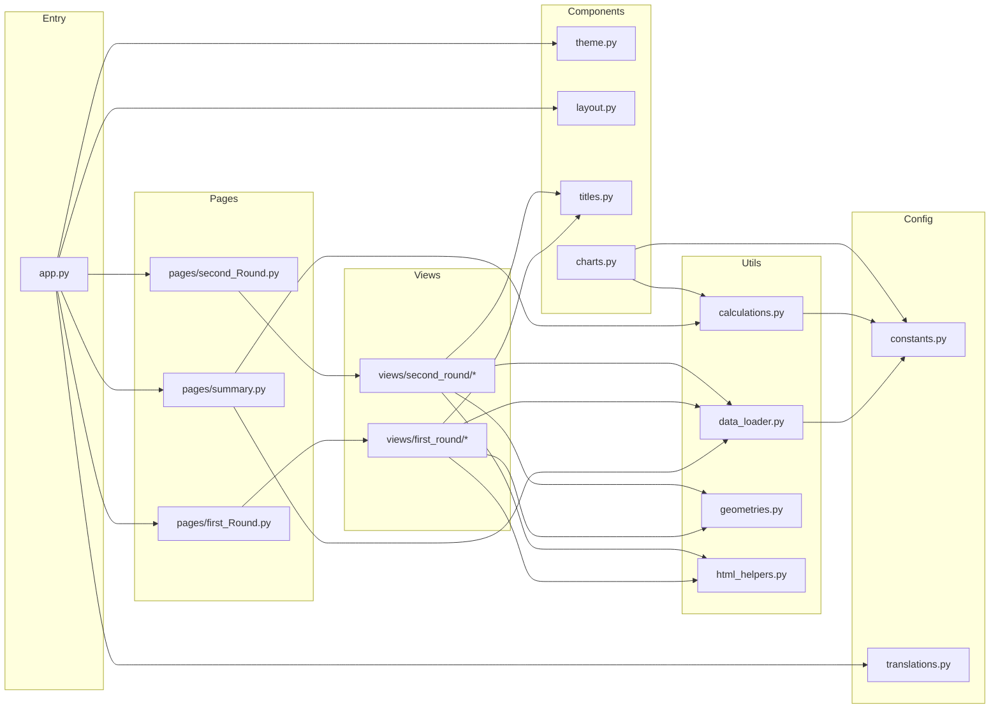
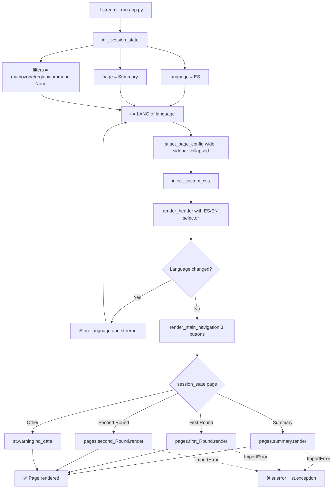
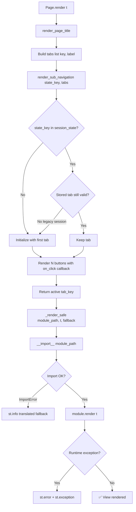
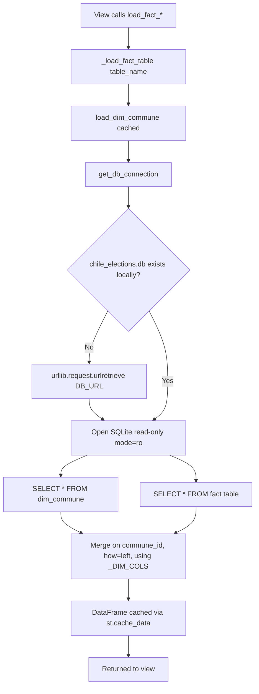
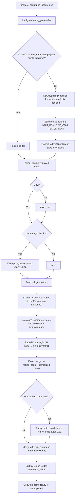
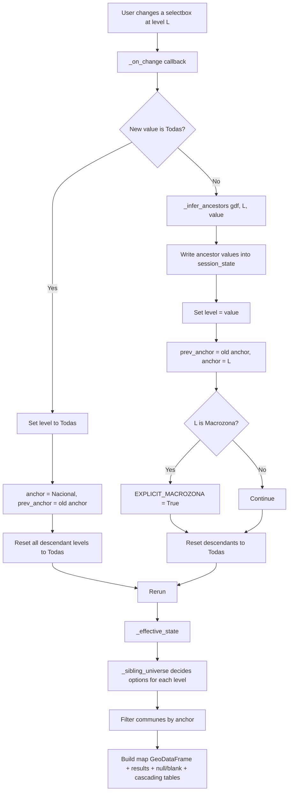
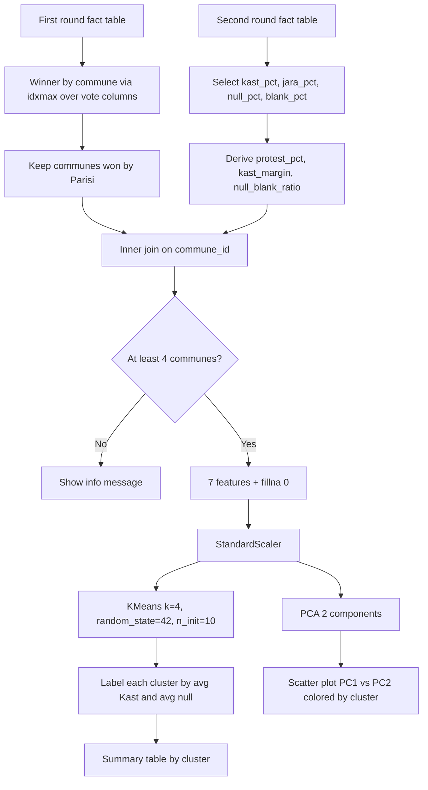
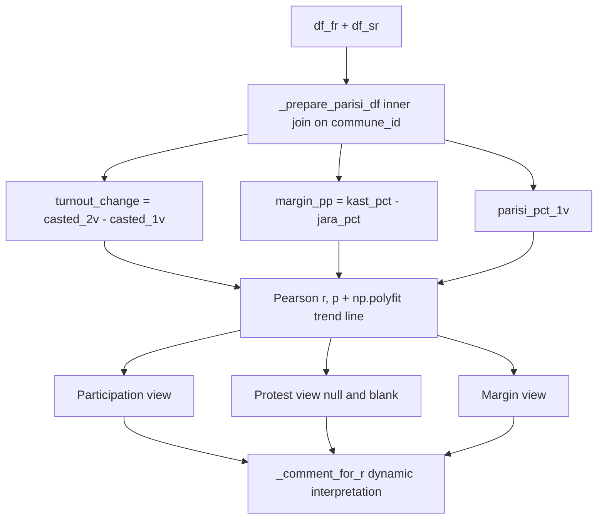
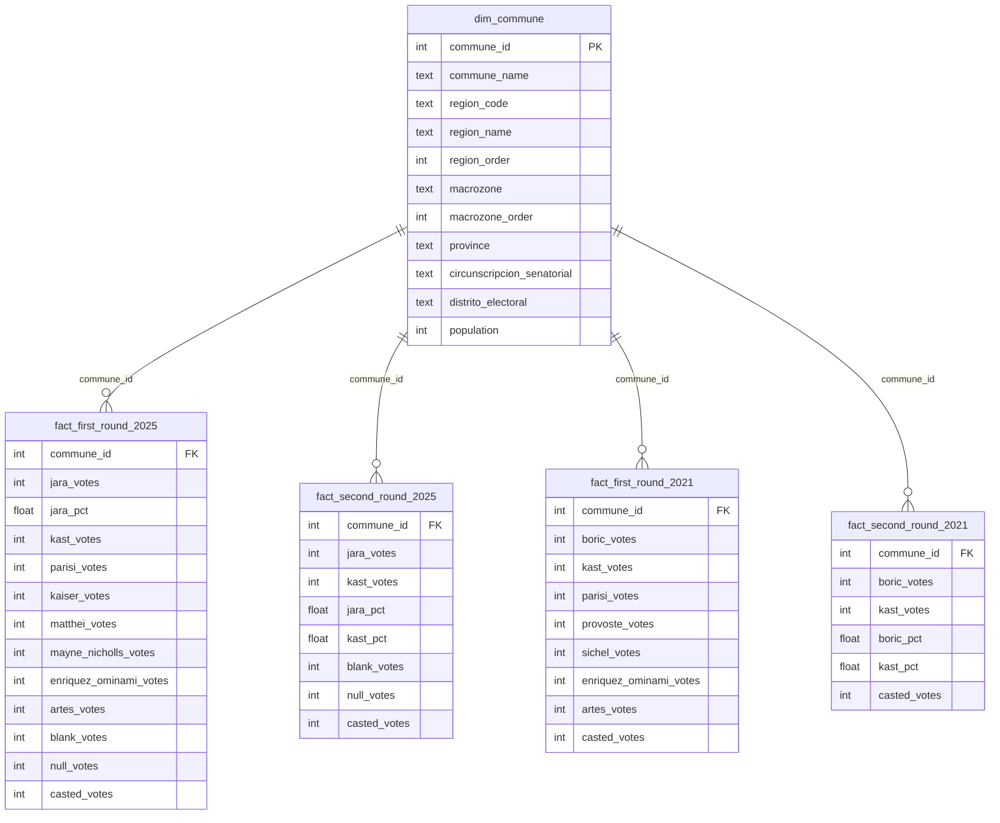

# 🗳️ Dashboard: Chilean Presidential Elections 2025 — Analysis (Streamlit)

  

 [](https://streamlit.io)       

> 🇪🇸 Versión en español: [README.es.md](README.es.md)

## 📋 General Description

This is the **interactive analysis dashboard** for the Chilean Presidential Elections 2025 (first round and runoff). It turns the commune-level results stored in a SQLite database into a bilingual (ES/EN) web application with **KPIs, maps, rankings, statistical tests, historical comparisons (2021 vs 2025) and unsupervised segmentation**.

The app is built with **Streamlit** and follows a strictly layered architecture: a single entry point (`app.py`) dispatches to **pages** (orchestrators with sub-navigation), which dynamically import **views** (one module per analysis), which in turn rely on shared **components**, **utils** (data, calculations, geometries, HTML helpers) and **config** (constants and translations).

🔗 **Live demo:** https://chilean-presidential-election-2025.streamlit.app/

### Key Features

- **3 main pages**: Executive Summary · First Round · Second Round
- **10 analysis views** (4 for the first round, 6 for the runoff) plus the executive summary
- **Six-level territorial navigator**: Macrozone → Region → Senatorial Circumscription → Electoral District → Province → Commune, with a movable anchor and a PyDeck map
- **Full bilingual UI** (ES/EN) driven by a single dictionary of **873 keys per language**
- **Historical comparison 2021 vs 2025** for both rounds (block evolution, transition matrices, fragmentation)
- **Statistics & Machine Learning**: Pearson correlation with p-values, linear trend lines, K-Means + PCA segmentation, Laakso–Taagepera effective number of candidates
- **Robust geospatial layer**: automatic GeoJSON download, geometry repair (`make_valid`), name normalization and fuzzy matching
- **Performance-oriented**: every loader is wrapped in `@st.cache_data`; the SQLite database is opened in **read-only** mode
- **Fault-tolerant page dispatch**: a broken or missing view shows a translated fallback instead of crashing the app
- **Design-system consistency**: one color source of truth (`config/constants.py`) and one title hierarchy (`components/titles.py`)
---

## 🏗️ Architecture Overview

The code is organized in **five layers**. Dependencies only flow downward: a view may import from components, utils and config, but never from another view.

| Layer          | Folder        | Responsibility                                                              | Streamlit-aware? |
| :------------- | :------------ | :-------------------------------------------------------------------------- | :--------------- |
| **Entry**      | `app.py`      | Session state, page config, CSS injection, header, main navigation, dispatch | ✅                |
| **Pages**      | `pages/`      | Page title + sub-navigation tabs + safe dynamic import of views              | ✅                |
| **Views**      | `views/`      | One module per analysis; each exposes `render(t)`                            | ✅                |
| **Components** | `components/` | Reusable UI: theme CSS, header, sub-nav, titles, shared charts               | ✅                |
| **Utils**      | `utils/`      | Data loading, pure calculations, geometries, HTML/number formatting          | Partly           |
| **Config**     | `config/`     | Constants (candidates, colors, macrozones, DB URL) and translations          | ❌                |

> **Design rule:** `utils/calculations.py` and `config/constants.py` contain **no Streamlit, no UI and no translations**, which makes them testable in isolation. `utils/html_helpers.py` only *transforms* data into HTML-ready strings; **it must never contain a `<style>` block** (all CSS lives in the views).



---

## 📊 Process Flow Diagrams

### **Legend**

| Color        | Type          | Description                                              |
| :----------- | :------------ | :------------------------------------------------------- |
| 🔵 Blue       | Input / Start | User interaction, app start, external data sources       |
| 🟠 Orange     | Process       | Rendering, computation, merging                          |
| 🔴 Red        | Decision      | Conditional branching (state exists?, module found?)     |
| 🟢 Green      | Storage       | SQLite database, local GeoJSON cache, `st.session_state` |
| 🟣 Purple     | External      | GitHub raw files, CARTO basemap                          |
| 🟢 Dark Green | Output        | Rendered dashboard view                                  |

### **Diagram 1: Application Start and Page Dispatch**



### **Diagram 2: Sub-Navigation and Safe View Import**



**Why `on_click` callbacks?** In Streamlit, if the active tab is assigned *after* the button is drawn, the button and the content below it can be out of sync for one frame (flicker, or the famous "double-click" bug). `render_sub_navigation` writes the new tab into `st.session_state` inside the `on_click` callback, which Streamlit executes **before** the rerun, so button state and content are always computed from the same state.

### **Diagram 3: Data Loading Pipeline**



### **Diagram 4: Geometry Preparation Pipeline**



### **Diagram 5: Territorial Explorer State Machine**

The six-level navigator keeps **one `selectbox` per level** plus an **anchor** (the last level the user explicitly touched). Selecting a value at any level (a) infers and fills all its ancestors, (b) resets all descendants to `"Todas"`, and (c) moves the anchor.



### **Diagram 6: Parisi Commune Segmentation (K-Means + PCA)**



### **Diagram 7: Data Flow in the Runoff Panorama (Parisi's Votes)**



---

## 🔍 Detailed Analysis by Module

### 1. `app.py` — Main Entry Point

The only entry point of the Streamlit app. It contains **no analysis logic**, only orchestration.

| Function                    | Purpose                                                                                 |
| :-------------------------- | :-------------------------------------------------------------------------------------- |
| `init_session_state()`      | Creates `language="ES"`, `page="Summary"` and the `filters` dict if missing             |
| `render_main_navigation(t)` | Three full-width buttons; the active one is `primary`, the others `secondary`           |
| `main()`                    | Page config → CSS → header → navigation → dynamic dispatch with `ImportError` handling  |

**Session state keys** (internal identifiers, **never translated**):

| Key                          | Values / Type                                  | Purpose                                  |
| :--------------------------- | :--------------------------------------------- | :--------------------------------------- |
| `language`                   | `"ES"` \| `"EN"`                               | Active UI language                       |
| `page`                       | `"Summary"` \| `"First Round"` \| `"Second Round"` | Active main page                     |
| `filters`                    | `{macrozone, region, commune}` → `None`        | Global filters (initial empty state)     |
| `first_round_tab`            | `summary` / `territorial_explorer` / `panorama` / `historical_first_round` | Active FR sub-tab |
| `second_round_tab`           | `summary` / `territorial_explorer` / `panorama` / `jara` / `kast` / `historical` | Active SR sub-tab |
| `communal_*_v2`              | Territorial selector values (FR)               | One key per territorial level            |
| `sr2_*_v1`                   | Territorial selector values (SR)               | Prefixed to avoid collisions with FR     |

> `sys.path.insert(0, ...)` at the top of `app.py` makes `python app.py` work from any directory; `streamlit run app.py` also works without it.

### 2. `config/constants.py` — Global Constants

Single source of truth for everything that is *data*, not UI.

**Candidates 2025 (first round, 8)**

| Candidate              | Vote column              | Party / coalition            | Color     |
| :--------------------- | :----------------------- | :--------------------------- | :-------- |
| Jeannette Jara         | `jara_votes`             | Unidad por Chile             | `#E34843` |
| José Antonio Kast      | `kast_votes`             | Partido Republicano          | `#243C5F` |
| Franco Parisi          | `parisi_votes`           | Partido de la Gente          | `#3466B3` |
| Johannes Kaiser        | `kaiser_votes`           | Partido Nacional Libertario  | `#F1893F` |
| Evelyn Matthei         | `matthei_votes`          | Chile Vamos                  | `#3272BF` |
| Harold Mayne-Nicholls  | `mayne_nicholls_votes`   | Independiente                | `#C0D9E0` |
| Marco Enríquez-Ominami | `enriquez_ominami_votes` | Izquierda Alternativa        | `#DF2884` |
| Eduardo Artés          | `artes_votes`            | Izquierda Radical            | `#CA1518` |

**Other constants**

| Constant                         | Description                                                                                         |
| :------------------------------- | :-------------------------------------------------------------------------------------------------- |
| `CANDIDATES_2025_SR`             | Runoff candidates (Jara, Kast)                                                                      |
| `MACROZONE_MAP` / `MACROZONE_ORDER` | Region number → macrozone, and macrozone → north-to-south order                                  |
| `PADRON_ELECTORAL_2025`          | Electoral roll size: **15,779,102**                                                                 |
| `DB_URL` / `DB_LOCAL_PATH`       | Remote raw URL of `chile_elections.db` and local file name                                          |
| `DEFAULT_FILTERS`                | `{macrozone, region, commune}` all `None`                                                           |
| `CANDIDATE_COLORS`               | Flat dict with **name variants** (full name, surname, with/without accents)                         |
| `CANDIDATE_COLORS_2021`          | Boric, Kast, Parisi, Provoste, Sichel, Enríquez-Ominami, Artés                                      |
| `POLITICAL_GROUPS`               | 8 ideological groups with colors                                                                    |
| `POLITICAL_BLOCKS`               | 3 aggregated blocks: Izquierda, Derecha, Antisistema (`#9AA0A6`)                                    |
| `CANDIDATE_COLOR_VARIANTS`       | `oficial / claro / muy_claro / intenso` shades for Jara and Kast                                    |
| `COLOR_POSITIVE/NEGATIVE/DELTA`  | Indicator colors (`#2E7D32`, `#C0392B`, `#A03A3A`)                                                  |
| `COLOR_VALIDOS/NULOS/BLANCOS`    | Vote-type colors (`#EBE4D6`, `#595959`, `#B4814C`)                                                  |
| `TREND_COLOR_UP/DOWN/FLAT`       | Trend pill colors                                                                                   |
| `CLUSTER_COLORS`                 | 4-color palette for K-Means clusters                                                                |
| `MARGIN_SCALE_COLORS`            | Defeat-margin scale (`0-1%` … `4-5%`)                                                               |
| `HEATMAP_SCALE_PCT / _KAST / _COUNT` | Reusable heatmap colorscales (red for Jara, blue for Kast, red for counts)                      |
| `NEUTRAL_COLOR`                  | `#6B7280` — fallback for unrecognized names                                                         |

**Color helpers**

| Function                        | Description                                                                                                       |
| :------------------------------ | :---------------------------------------------------------------------------------------------------------------- |
| `_get_candidate_color(name)`    | Resolves a color from **any** name variant: exact → numeric id (`"1"`…`"8"`) → normalized → token overlap → first word |
| `_hex_to_rgba(hex, alpha=180)`  | `[r, g, b, a]` list for PyDeck                                                                                    |
| `_hex_to_rgba_string(hex, a)`   | `rgba(r,g,b,a)` string for CSS                                                                                    |

`_get_candidate_color` resolution order:

1. `None`, `NaN` or empty string → `NEUTRAL_COLOR`
2. Exact key in `CANDIDATE_COLORS`
3. Numeric id `"1"…"8"` mapped through `_ID_TO_NAME`
4. Accent-insensitive, case-insensitive equality or substring match
5. Shared token longer than 3 characters
6. First word of the name found inside any key
7. Fallback → `NEUTRAL_COLOR`

### 3. `config/translations.py` — Bilingual Dictionary

A single dictionary `LANG = {"ES": {...}, "EN": {...}}`.

| Property                | Value                                                                          |
| :---------------------- | :----------------------------------------------------------------------------- |
| Keys per language       | **873** (ES and EN are fully symmetric)                                        |
| Lines                   | ~2,235                                                                         |
| Placeholders            | Python `.format()` (e.g. `"{pct}% of total"`)                                  |
| Naming convention       | Prefix by view: `fr_te_*`, `fr_pano_*`, `fr_hist_*`, `sr_pano_*`, `sr_jara_*`, `sr_kast_*`, `sr_hist_*`, `*_orch_*` |
| What is **not** translated | Proper nouns: candidates, parties, regions, macrozones, communes            |
| HTML-bearing texts      | Kept complete (never split) so placeholders stay valid                         |

### 4. `utils/data_loader.py` — Data Loading

| Function                         | Cached | Description                                                          |
| :------------------------------- | :----- | :------------------------------------------------------------------- |
| `get_db_connection()`            | ❌      | Downloads the DB if missing; returns a **read-only** SQLite connection |
| `load_dim_commune()`             | ✅      | Full `dim_commune` table                                              |
| `_load_fact_table(name)`         | ❌      | Reads a fact table and left-joins `_DIM_COLS` on `commune_id`         |
| `load_fact_first_round_2025()`   | ✅      | `fact_first_round_2025` + dimension                                   |
| `load_fact_second_round_2025()`  | ✅      | `fact_second_round_2025` + dimension                                  |
| `load_fact_first_round_2021()`   | ✅      | `fact_first_round_2021` + dimension                                   |
| `load_fact_second_round_2021()`  | ✅      | `fact_second_round_2021` + dimension                                  |

Columns merged into every fact table (`_DIM_COLS`):
`commune_id, commune_name, region_code, region_name, region_order, macrozone, macrozone_order, province`.

> Territorial columns not in `_DIM_COLS` (`circunscripcion_senatorial`, `distrito_electoral`, `population`) are obtained by the views directly from `load_dim_commune()` or from the geometry GeoDataFrame.

### 5. `utils/calculations.py` — Pure Calculations

No Streamlit, no UI, no translations. All functions take raw DataFrames and return dicts or DataFrames.

| Function                                   | Returns                                                                                           |
| :----------------------------------------- | :------------------------------------------------------------------------------------------------ |
| `compute_vote_metrics(df, padron=None)`    | `casted/valid/null/blank` votes and percentages (+ `casted_pct_padron` when `padron` is given)    |
| `compute_round_comparison(cur, prev)`      | `valid_pct_diff`, `null_pct_diff`, `blank_pct_diff` in **percentage points**                      |
| `compute_second_round_results(df)`         | Jara/Kast votes, %, `diff_votes`, `diff_pct`, `winner`                                            |
| `compute_first_round_results(df)`          | Ranked DataFrame (`candidate_name, party, votes, pct, color, short_name, status`)                 |
| `format_thousands(n)`                      | `1234567 → "1.234.567"` (Chilean separator)                                                       |

Formulas used:

```text
valid_votes   = casted_votes − null_votes − blank_votes
valid_pct     = valid_votes / casted_votes × 100
candidate_pct = candidate_votes / valid_votes × 100          (first round)
runoff_pct    = candidate_votes / (jara_votes + kast_votes)  (second round)
status        = "passes_to_runoff" for the 2 most voted, else "does_not_pass"
```

### 6. `utils/geometries.py` — Commune Geometry

| Element                              | Description                                                                                          |
| :----------------------------------- | :--------------------------------------------------------------------------------------------------- |
| `EXCLUDE_COMMUNES`                   | Isla de Pascua and Juan Fernández are removed (they distort the continental frame). **Antártica is kept** (it belongs to Magallanes) |
| `KNOWN_ALIASES`                      | 8 manual name fixes between GeoJSON and INE (e.g. `COIHAIQUE → COYHAIQUE`, `MARCHIGUE → MARCHIHUE`, `LLAY LLAY → LLAILLAY`, `ALTO BIO BIO → ALTO BIOBIO`, `TIL-TIL → TIL TIL`) |
| `normalize_commune_name(v)`          | Uppercase → NFKD accent stripping → remove `(…)` → hyphens to spaces → keep `[A-Z0-9' ]` → collapse spaces → alias lookup |
| `_fuzzy_match_leftovers(...)`        | `difflib.get_close_matches` with cutoff **0.82**, restricted to the **same region**                  |
| `_clean_geometry(geom)`              | `make_valid` → keep only polygons from collections → `unary_union` → `buffer(0)` as last resort       |
| `load_commune_geometries()` ✅        | Downloads/caches `assets/comunas_caracena.geojson` and repairs geometry                              |
| `prepare_commune_geometries()` ✅     | Final GeoDataFrame: geometry + region/macrozone/province/circumscription/district. **Does not include votes** |

### 7. `utils/html_helpers.py` — HTML and Formatting Helpers

| Function                  | Example                                         |
| :------------------------ | :---------------------------------------------- |
| `clean_html(html)`        | Strips leading whitespace per line so Markdown does not treat indented f-strings as code blocks |
| `escape_html(s)`          | Escapes `& < > "`                               |
| `format_number(v)`        | `1234567 → "1.234.567"` (returns `"0"` on error) |
| `format_percentage(v, d)` | `12.34 → "12.34%"`                              |
| `format_signed(v, d)`     | `3.16 → "+3.16"`                                |
| `format_pp(v, d)`         | `3.16 → "+3.16 pp"`                             |
| `hex_to_rgba(hex, a)`     | `#E34843 → rgba(227,72,67,0.12)`                |
| `normalize_commune(s)`    | `Ñuñoa → NUNOA`                                 |

Backward-compatible aliases still exported: `fmt_number`, `fmt_pct`, `fmt_signed`, `fmt_pp`, `norm_commune`.

### 8. `components/` — Reusable UI

| Module       | Contents                                                                                                                        |
| :----------- | :------------------------------------------------------------------------------------------------------------------------------ |
| `theme.py`   | `CUSTOM_CSS` + `inject_custom_css()`: cream background `#F7F7F2`, max width 1100 px, pill-style nav buttons, metric cards, hides Streamlit menu/footer/header |
| `layout.py`  | `render_header(t)` (title + ES/EN selector in a 3:1 grid) and `render_sub_navigation(t, state_key, tabs)`                        |
| `titles.py`  | Six title levels with a fixed hierarchy (see table below)                                                                       |
| `charts.py`  | `render_second_round_chart`, `render_donut_chart`, `render_region_candidate_heatmap`                                            |

**Title hierarchy (`components/titles.py`)** — font `Liberation Sans, Arial, sans-serif`

| Function                    | Size     | Color     | Weight | Used in             |
| :-------------------------- | :------- | :-------- | :----- | :------------------ |
| `render_app_title`          | 32 px    | `#1a1a18` | 700    | Top of the app      |
| `render_page_title`         | 28 px    | `#1a1a18` | 700    | `pages/*.py`        |
| `render_view_title`         | 16.5 pt  | `#111827` | 700    | `views/**/*.py`     |
| `render_view_subtitle`      | 9.5 pt   | `#6b7280` | —      | Under a view title  |
| `render_section_title`      | 12 pt    | `#111827` | 700    | Internal sections   |
| `render_section_subtitle`   | 10 pt    | `#6b7280` | —      | Under a section     |

**Shared charts (`components/charts.py`)**

| Function                          | Implementation notes                                                                                                   |
| :-------------------------------- | :--------------------------------------------------------------------------------------------------------------------- |
| `render_second_round_chart`       | Pure HTML/CSS rounded stacked bar (no Plotly) with winner label, margin in votes and pp                                |
| `render_donut_chart`              | Plotly `Pie` with `hole=0.55`, candidate colors, 280 px high                                                            |
| `render_region_candidate_heatmap` | Candidates (Jara, Kast, Parisi, Kaiser, Matthei) × regions. Plotly cannot color each heatmap cell with a different colorscale, so the chart **stacks 6 traces**: one gray base + one overlay per candidate (NaN everywhere except the cells that candidate won). The regional winner name is added below each column, rotated −90°. Winner is determined by **total votes**, intensity by **% of valid votes** (scale 0–40) |

### 9. `pages/` — Page Orchestrators

| Page                    | Tabs                                                                                    | Session key        |
| :---------------------- | :-------------------------------------------------------------------------------------- | :----------------- |
| `pages/summary.py`      | None (static, two sections: Second Round KPIs + winner block, First Round KPIs + 8-candidate table) | —          |
| `pages/first_Round.py`  | Summary · Territorial Explorer · Panorama · Historical                                  | `first_round_tab`  |
| `pages/second_Round.py` | Summary · Territorial Explorer · Panorama · Jara · Kast · Historical                    | `second_round_tab` |

Both round pages share the same `_render_safe(module_path, t, fallback)`:

- Imports the module with `__import__(module_path, fromlist=["render"])` (the path is a string resolved lazily, so a regular `import` would defeat the fallback).
- `ImportError` → `st.info(fallback)` (translated).
- Any other exception → `st.error(...)` + `st.exception(e)`.

---

## 🗂️ Views Catalog

Every view exposes `render(t)` and is built from small `_build_*_section` functions, each wrapping a `_render_*` function inside a collapsible section.

### First Round

| View                    | File                                          | Content                                                                                                                                                  |
| :---------------------- | :-------------------------------------------- | :------------------------------------------------------------------------------------------------------------------------------------------------------- |
| **Summary**             | `views/first_round/summary.py`                | 6 KPI cards (3+3), candidate table with status pills, donut + region heatmap of communes won, top-5 strongholds (Jara, Kast, Parisi), macrozone table with winner pill and distribution bar. `MIN_CASTED_VOTES = 300` filters tiny communes from stronghold rankings |
| **Territorial Explorer**| `views/first_round/territorial_explorer.py`   | Six-level navigator, PyDeck map, results table + donut (candidates >10%, rest grouped as "Otros"), null/blank analysis with 100-square waffle chart, cascading parent → child tables |
| **Panorama**            | `views/first_round/panorama.py`               | 12 collapsible sections (below)                                                                                                                          |
| **Historical**          | `views/first_round/historical.py`             | 4 featured cards + 8 collapsible sections, 2021 vs 2025 (below)                                                                                          |

**First Round — Panorama sections**

| #  | Section                                  | Notes                                                                                           |
| :- | :--------------------------------------- | :---------------------------------------------------------------------------------------------- |
| 1  | National participation                   | Cards: casted, valid, null, blank, % of electoral roll                                          |
| 2  | Null vote analysis                       | Top regions and top communes                                                                    |
| 3  | Blank vote analysis                      | Top regions and top communes                                                                    |
| 4  | National results + ideological blocks    | Left = Jara + MEO + Artés · Right = Kast + Kaiser + Matthei · Anti-system = Parisi + Mayne-Nicholls |
| 5  | Top communes per candidate               | Horizontal bar charts (`_plot_top_bar`)                                                         |
| 6  | Communes won                             | Table + waffle + winners by macrozone                                                           |
| 7  | Regional winners                         | Winner and runner-up by region                                                                  |
| 8  | Vote in regional capitals                | Capital-city comparison                                                                         |
| 9  | Vote by commune size                     | Stacked bars by population bracket (5 brackets, see [Data Model](#-data-model))                 |
| 10 | Recoverable communes for the runoff      | Communes where \|Jara − Kast\| < **1,000 votes** (`RECOVERABLE_THRESHOLD`), shown as scatter    |
| 11 | Anti-system vote: Franco Parisi          | Communes grouped by intensity: `> 40%`, `35–40%`, `30–35%`, `20–30%`, `< 20%` + top/bottom table |
| 12 | Kaiser: the new libertarian right        | Votes, % of valid, communes won, territorial profile                                            |

**First Round — Historical sections (2021 vs 2025)**

| Card / Section | Description                                                                                          |
| :------------- | :--------------------------------------------------------------------------------------------------- |
| Card 1         | Growth in casted votes (voluntary → compulsory voting)                                               |
| Card 2         | Effective number of candidates 2025 (fragmentation)                                                  |
| Card 3         | Communes that changed winner                                                                         |
| Card 4         | Parisi absolute growth                                                                               |
| 1              | National participation 2021 vs 2025                                                                  |
| 2              | Political block evolution (Boric + Provoste → Jara · Kast → Kast · Sichel → Matthei · Parisi → Parisi · Kaiser = new in 2025) |
| 3              | Electoral realignment: winner transition matrix 2021 → 2025                                          |
| 4              | Winner changes grouped by transition                                                                 |
| 5              | Changed communes: **decisive** (new winner ≥ 40%) vs **close** (< 30%)                               |
| 6              | Political fragmentation (Laakso–Taagepera)                                                           |
| 7              | Franco Parisi: evolution and territory                                                              |
| 8              | Franco Parisi: communes and absorption                                                               |

### Second Round

| View                    | File                                         | Content                                                                                                                                       |
| :---------------------- | :------------------------------------------- | :-------------------------------------------------------------------------------------------------------------------------------------------- |
| **Summary**             | `views/second_round/summary.py`              | 6 KPI cards with deltas vs first round, winner block (stacked bar + margin), FR vs SR comparison table, top-10 communes by margin (Kast and Jara), macrozone table |
| **Territorial Explorer**| `views/second_round/territorial.py`          | Twin of the FR explorer, results shown as 3 cards (Jara, Kast, Difference). Session keys prefixed `sr2_`                                      |
| **Panorama**            | `views/second_round/panorama.py`             | 12 collapsible sections (below)                                                                                                               |
| **Jara**                | `views/second_round/jara.py`                 | 4 cards + 11 sections                                                                                                                         |
| **Kast**                | `views/second_round/kast.py`                 | 4 cards + 9 sections                                                                                                                          |
| **Historical**          | `views/second_round/historical.py`           | Boric vs Kast (2021) against Kast vs Jara (2025): 4 cards + 7 sections                                                                        |

**Second Round — Panorama sections**

| #  | Section                                         | Notes                                                                                      |
| :- | :---------------------------------------------- | :----------------------------------------------------------------------------------------- |
| 1  | National participation                          | Cards                                                                                      |
| 2  | Participation and valid vote: 1V vs 2V          | Trend pills (up / down / flat)                                                             |
| 3  | Null vote analysis                              | Selector: 2V alone or 1V vs 2V comparison                                                  |
| 4  | Blank vote analysis                             | Selector: 2V alone or 1V vs 2V comparison                                                  |
| 5  | National results (2V)                           | Jara vs Kast                                                                               |
| 6  | Communes won                                    | Table + waffle                                                                             |
| 7  | Regional winners                                | Table                                                                                      |
| 8  | Vote in regional capitals                       | Table                                                                                      |
| 9  | Vote by commune size                            | Stacked bars                                                                               |
| 10 | Electoral realignment 1V → 2V                   | Winner transitions                                                                         |
| 11 | Parisi: fate of the anti-system vote            | Selector: **participation / protest / margin**, each with Pearson r, p-value, trend line, and a dynamic interpretation |
| 12 | Parisi: segmentation of his communes            | **K-Means + PCA** (see [Analytical Methods](#-analytical-methods))                         |

**Jara view — sections**

| #  | Section                         | Rule / metric                                                                                  |
| :- | :------------------------------ | :--------------------------------------------------------------------------------------------- |
| 1  | Territorial strongholds         | Communes where Jara > 50% in the runoff                                                        |
| 2  | Flips                           | Won by another candidate in 1V, won by Jara in 2V                                              |
| 3  | Stronghold expansion            | Top 20 communes by absolute vote growth 1V → 2V                                                |
| 4  | Geography of the vote           | Macrozone profile, 1V vs 2V                                                                    |
| 5  | Urban–rural gradient            | % by commune-size bracket                                                                      |
| 6  | Urban–rural intensity           | % by size bracket × macrozone                                                                  |
| 7  | Close losses                    | Communes lost by **less than 5 pp**, bucketed `0-1%`, `1-2%`, `2-3%`, `3-4%`, `4-5%`          |
| 8  | Loss distribution by zone       | Distribution across macrozones                                                                 |
| 9  | Losses by zone and margin       | Heatmap macrozone × margin bucket                                                              |
| 10 | Santiago elite                  | Vitacura, Las Condes, Lo Barnechea: votes and % change 1V → 2V                                 |
| 11 | Protest vote                    | Change in (null + blank) vs change in Jara's %, bucketed `<0`, `0–500`, `500–1,000`, `1,000–2,000`, `2,000+` |

**Kast view — sections**

| #  | Section                         | Rule / metric                                                                                  |
| :- | :------------------------------ | :--------------------------------------------------------------------------------------------- |
| 1  | Territorial strongholds         | Communes with Kast > **75%** (`STRONGHOLD_THRESHOLD`) + victory intensity (>80% "arrasa", >70% bastion, >60% solid, otherwise other) |
| 2  | Regional strongholds            | Regions where Kast's average > **60%** (`REGIONAL_THRESHOLD`)                                  |
| 3  | Geography of the vote           | Macrozone profile, 1V vs 2V                                                                    |
| 4  | Reversed duels                  | Won by Jara in 1V, won by Kast in 2V                                                           |
| 5  | Close margins                   | Communes won by Kast by ≤ 5 pp, sorted from most fragile                                       |
| 6  | Protest vote                    | Change in null/blank vs change in Kast's %                                                     |
| 7  | Growth and loyalty              | Top/bottom `N_GROWTH = 20` communes by absolute and relative growth, with switchable scatter ("Crecimiento Dual" / "Lealtad de Base") |
| 8  | Urban–rural gradient            | % by size bracket                                                                              |
| 9  | Urban–rural intensity           | % by size bracket × macrozone                                                                  |

**Second Round — Historical sections (Boric vs Kast 2021 → Kast vs Jara 2025)**

| Card / Section | Description                                                             |
| :------------- | :---------------------------------------------------------------------- |
| Cards          | Growth in casted votes · 2025 margin · communes that changed winner · Kast absolute growth |
| 1              | National participation 2021 vs 2025                                     |
| 2              | National result: Boric vs Kast (2021) and Kast vs Jara (2025)           |
| 3              | Political block evolution (Left: Boric → Jara · Right: Kast → Kast)    |
| 4              | Electoral realignment: transition matrix                                |
| 5              | Kast: evolution by commune                                              |
| 6              | The left: Boric 2021 → Jara 2025                                        |
| 7              | Changed communes: decisive (≥ 40%) vs close (< 30%)                     |

---

## 🗄️ Data Model

The app reads a SQLite database (`chile_elections.db`) with **one dimension table** and **four fact tables**, all keyed at commune level.



> The ER diagram lists the columns **referenced by the code**; the real tables may contain more (e.g. `*_pct` for every candidate, `blank_pct`, `null_pct`, `casted_pct`). Column naming follows the scraper convention: `{candidate}_votes`, `{candidate}_pct`, `blank_*`, `null_*`, `casted_*`.

**Database source:** `https://raw.githubusercontent.com/adroguetth/Chilean-Presidential-Elections-2025-Analysis/main/raw/database/chile_elections.db` — downloaded automatically on the first run.

**Geometry source:** [caracena/chile-geojson](https://github.com/caracena/chile-geojson) — downloaded on the first run of a territorial explorer and cached in `assets/comunas_caracena.geojson`.

**Commune-size brackets (shared by Panorama, Jara and Kast views)**

| Bracket                    | Population range     |
| :------------------------- | :------------------- |
| Rural                      | < 10,000             |
| Rural-urbano               | 10,000 – 49,999      |
| Centros urbanos pequeños   | 50,000 – 99,999      |
| Centros urbanos medios     | 100,000 – 199,999    |
| Grandes centros urbanos    | ≥ 200,001            |

**Macrozones**

| Order | Macrozone    | Regions (by number)    |
| :---- | :----------- | :--------------------- |
| 1     | Norte Grande | 15, 1, 2               |
| 2     | Norte Chico  | 3, 4                   |
| 3     | Centro       | 5, 13, 6, 7            |
| 4     | Centro Sur   | 16, 8, 9               |
| 5     | Sur          | 14, 10                 |
| 6     | Patagonia    | 11, 12                 |

---

## 🧮 Analytical Methods

### 1. Effective Number of Candidates (Laakso–Taagepera)

Used in *First Round → Historical → Fragmentation*.

```text
share_i = votes_i / valid_votes
ENC     = 1 / Σ (share_i)²
```

The view also shows each candidate's **contribution** to the sum of squares (`share² / Σ share²`) and the change `ENC_2025 − ENC_2021`, labelled "more fragmented" or "less fragmented".

### 2. Pearson Correlation with Trend Line

Used in *Second Round → Panorama → Parisi's fate*. All correlations use `scipy.stats.pearsonr` against **Parisi's first-round %** (`parisi_pct_1v`):

| Dependent variable                                                  | Meaning                         |
| :------------------------------------------------------------------ | :------------------------------ |
| `turnout_change = casted_2v − casted_1v`                            | Participation change            |
| `null_pct`                                                          | Null vote in the runoff         |
| `blank_pct`                                                         | Blank vote in the runoff        |
| `margin_pp = kast_pct − jara_pct`                                   | Runoff margin                   |

A least-squares trend line is drawn with `np.polyfit(x, y, 1)`. `_comment_for_r(r, p, topic, t)` generates a **dynamic interpretation** using thresholds on *r* (e.g. `|r| ≥ 0.3` = clear association, `|r| < 0.15` = flat for blank votes) and prints `p = 0.xxxx` only if `p < 0.05`, otherwise "not significant".

### 3. K-Means + PCA Segmentation of Parisi's Communes

Used in *Second Round → Panorama → Section 12*.

| Step | Detail                                                                                                                   |
| :--- | :----------------------------------------------------------------------------------------------------------------------- |
| 1    | Select communes where Parisi won the first round (`idxmax` over vote columns)                                            |
| 2    | Join with runoff metrics by `commune_id`; require **≥ 4 communes**                                                       |
| 3    | Features (7): `kast_pct, jara_pct, null_pct, blank_pct, protest_pct, kast_margin, null_blank_ratio`                      |
| 4    | `protest_pct = null_pct + blank_pct` · `kast_margin = kast_pct − jara_pct` · `null_blank_ratio = null_pct / (blank_pct + 0.01)` |
| 5    | `StandardScaler` → `KMeans(n_clusters=4, random_state=42, n_init=10)` (k falls back to `max(2, n−1)` if fewer than 4 communes) |
| 6    | Automatic cluster naming from cluster means (see table below)                                                            |
| 7    | `PCA(n_components=2)` over the scaled matrix → 2-D scatter                                                               |

| Rule (evaluated in order)         | Cluster label key                  | Meaning                         |
| :-------------------------------- | :--------------------------------- | :------------------------------ |
| avg Kast > 60 **and** avg null < 5 | `sr_pano_cluster_feudos_kast`      | Kast strongholds                |
| avg Kast > 50                     | `sr_pano_cluster_proclives_kast`   | Pro-Kast                        |
| avg Kast < 40                     | `sr_pano_cluster_proclives_jara`   | Pro-Jara                        |
| otherwise                         | `sr_pano_cluster_mixto`            | Mixed                           |

If two clusters receive the same label, a `#2`, `#3`… suffix is appended. `random_state=42` makes the segmentation **reproducible**. The fixed `k = 4` is a design decision (no elbow/silhouette optimization is computed).

### 4. Electoral Realignment (Transition Matrix)

For each commune, the winner in election A and election B is computed; the cross-tabulation `winner_A × winner_B` is rendered as a heatmap and as grouped lists (*e.g. "Boric → Kast"*). Used in FR Historical, SR Panorama (1V → 2V) and SR Historical (2021 → 2025). Changed communes are further split into **decisive** (new winner ≥ 40%) and **close** (< 30%).

### 5. Protest Vote Analysis

```text
protest_change   = (null_2v − null_1v) + (blank_2v − blank_1v)
candidate_change = candidate_pct_2v − candidate_pct_1v
```

Communes are bucketed by `protest_change` (`<0`, `0–500`, `500–1,000`, `1,000–2,000`, `2,000+`) and the average change of the candidate's % is shown per bucket (Jara and Kast views).

### 6. Close-Race Classification

| Analysis                    | Rule                                                           |
| :-------------------------- | :------------------------------------------------------------- |
| Recoverable (FR Panorama)   | `|jara_votes − kast_votes| < 1,000`                            |
| Jara close losses (SR)      | `−5 ≤ (jara_pct − kast_pct) < 0` on Jara+Kast votes            |
| Kast close margins (SR)     | `0 < (kast_pct − jara_pct) ≤ 5`                                |

---

## ⚙️ Local Execution Guide

### Prerequisites

- Python 3.9 or higher (3.12 recommended)
- Internet access **on the first run** (database + GeoJSON download)
- Write permission in the project directory (`chile_elections.db` and `assets/` are created at runtime)
- Git (optional)

### Execution Triggers

| Trigger                | Command                                           |
| :--------------------- | :------------------------------------------------ |
| **Streamlit (normal)** | `streamlit run app.py`                            |
| **Custom port**        | `streamlit run app.py --server.port 8502`         |
| **Headless server**    | `streamlit run app.py --server.headless true`     |
| **Direct execution**   | `python app.py` (works because of `sys.path.insert`; recommended only for import checks) |

> ⚠️ Always run the commands from the `dashboard/` folder. The geometry cache path (`assets/…`) and the database path (`chile_elections.db`) are **relative to the working directory**.

---

## 🚀 Installation and Local Setup

### Step-by-Step Installation

#### 1. **Clone the Repository**

```bash
git clone https://github.com/adroguetth/Chilean-Presidential-Elections-2025-Analysis.git
cd Chilean-Presidential-Elections-2025-Analysis/dashboard
```

#### 2. **Create Virtual Environment (recommended)**

```bash
python -m venv venv

# Windows
venv\Scripts\activate

# Linux/Mac
source venv/bin/activate
```

#### 3. **Install Dependencies**

```bash
pip install -r requirements.txt
```

Libraries imported by the code (use these if you need to rebuild `requirements.txt`):

| Package        | Used for                                                              |
| :------------- | :-------------------------------------------------------------------- |
| `streamlit`    | App framework, caching, session state                                 |
| `pandas`       | Data manipulation, SQL reads                                          |
| `numpy`        | `polyfit`, numeric operations                                         |
| `plotly`       | Charts (`graph_objects`)                                              |
| `pydeck`       | Territorial maps (`GeoJsonLayer`)                                     |
| `geopandas`    | GeoJSON reading, CRS handling                                         |
| `shapely`      | Geometry repair, `union_all`, simplification (`union_all` requires Shapely 2.x) |
| `scikit-learn` | `KMeans`, `PCA`, `StandardScaler`                                     |
| `scipy`        | `scipy.stats.pearsonr`                                                |

Standard-library modules in use: `sqlite3`, `urllib.request`, `difflib`, `unicodedata`, `re`, `os`, `sys`, `uuid`, `math`.

#### 4. **Run the App**

```bash
streamlit run app.py
```

#### 5. **Open the Browser**

The app opens automatically at `http://localhost:8501`.

#### 6. **First-Run Behavior**

| Moment                               | What happens                                                              | Created artifact                 |
| :----------------------------------- | :------------------------------------------------------------------------ | :------------------------------- |
| First data access                    | `chile_elections.db` is downloaded from GitHub                            | `./chile_elections.db`           |
| First Territorial Explorer visit     | GeoJSON files are downloaded, merged and repaired                         | `./assets/comunas_caracena.geojson` |
| Subsequent runs                      | Both files are reused; loaders are served from `st.cache_data`            | —                                |

---

## 📁 Project Structure

```text
Chilean-Presidential-Elections-2025-Analysis/
│
├── README.md
├── .gitignore
│
└── dashboard/
    ├── app.py                          # Main entry point (193 lines)
    ├── requirements.txt                # Python dependencies
    ├── .streamlit/
    │   └── config.toml                 # Streamlit configuration
    │
    ├── config/
    │   ├── constants.py                # Candidates, colors, macrozones, DB URL (559 lines)
    │   └── translations.py             # ES/EN dictionary, 873 keys per language (2,235 lines)
    │
    ├── components/
    │   ├── theme.py                    # Global CSS injection
    │   ├── layout.py                   # Header + sub-navigation
    │   ├── titles.py                   # 6-level title hierarchy
    │   └── charts.py                   # Result bar, donut, region × candidate heatmap
    │
    ├── pages/
    │   ├── summary.py                  # Executive summary (743 lines)
    │   ├── first_Round.py              # FR orchestrator (4 tabs)
    │   └── second_Round.py             # SR orchestrator (6 tabs)
    │
    ├── utils/
    │   ├── data_loader.py              # SQLite loaders (cached)
    │   ├── calculations.py             # Pure vote calculations
    │   ├── geometries.py               # GeoJSON download, repair and merge
    │   └── html_helpers.py             # Formatting and HTML helpers
    │
    ├── views/
    │   ├── first_round/
    │   │   ├── summary.py              # 850 lines
    │   │   ├── territorial_explorer.py # 1,795 lines
    │   │   ├── panorama.py             # 2,066 lines
    │   │   └── historical.py           # 1,580 lines
    │   └── second_round/
    │       ├── summary.py              # 913 lines
    │       ├── territorial.py          # 1,591 lines
    │       ├── panorama.py             # 2,532 lines
    │       ├── jara.py                 # 1,751 lines
    │       ├── kast.py                 # 1,755 lines
    │       └── historical.py           # 1,324 lines
    │
    ├── assets/                         # (runtime) comunas_caracena.geojson
    └── chile_elections.db              # (runtime) downloaded on first run
```

> The codebase totals roughly **22,000 lines of Python** across 24 modules; about 80% lives in `views/`.

### Naming Conventions

| Type                    | Pattern                       | Example                                         |
| :---------------------- | :---------------------------- | :---------------------------------------------- |
| View entry point        | `render(t)`                   | `views.second_round.kast.render`                |
| Section builder         | `_build_<name>_section(...)`  | `_build_close_margins_section`                  |
| Section renderer        | `_render_<name>(...)`         | `_render_close_margins`                         |
| Private helpers         | Leading underscore            | `_table_css`, `_plot_top_bar`                   |
| Translation keys        | `<view_prefix>_<topic>`       | `sr_kast_kpi_bastiones`, `fr_te_tooltip_region` |
| Derived columns in views| Double underscore             | `__kast_pct`, `__margin_pp`, `__bucket`         |
| CSS classes in views    | Short view prefix             | `.nb-card`, `.hr-card`, `.pa-tabla-parisi-segment` |

---

## 🔧 Customization and Configuration

### Adding a New Language

1. Copy the `"EN"` block in `config/translations.py` into a new key (e.g. `"PT"`).
2. Translate all 873 values, keeping every `{placeholder}` intact.
3. Add the code to the `options` list in `components/layout.py → render_header`.

### Adding a New View

1. Create `views/<round>/<name>.py` exposing `render(t)`.
2. Add translation keys to **both** `ES` and `EN`.
3. Register the tab in `pages/first_Round.py` or `pages/second_Round.py`:

```python
tabs = [
    ...
    ("my_view", t["my_view_label"]),
]
...
elif selected_tab == "my_view":
    _render_safe("views.second_round.my_view", t, fallback=t["sr_orch_fallback_my_view"])
```

### Changing Candidate Colors

Edit **only** `config/constants.py`:

```python
CANDIDATES_2025["Jeannette Jara"]["color"] = "#E34843"
CANDIDATE_COLORS["Jara"] = "#E34843"      # keep name variants in sync
```

### Adjustable Thresholds

| Constant                  | File                                   | Default | Effect                                                    |
| :------------------------ | :------------------------------------- | :------ | :-------------------------------------------------------- |
| `MIN_CASTED_VOTES`        | `first_round/summary.py`, `first_round/panorama.py`, `second_round/panorama.py` | 300 | Minimum casted votes for a commune to enter rankings |
| `RECOVERABLE_THRESHOLD`   | `first_round/panorama.py`              | 1000    | Max Jara–Kast vote gap to count a commune as "recoverable" |
| `STRONGHOLD_THRESHOLD`    | `second_round/kast.py`                 | 75.0    | Kast stronghold cutoff (%)                                |
| `REGIONAL_THRESHOLD`      | `second_round/kast.py`                 | 60.0    | Regional stronghold cutoff (%)                            |
| `N_GROWTH`                | `second_round/kast.py`                 | 20      | Rows in growth/loyalty tables                             |
| `DECISIVE_THRESHOLD`      | `*/historical.py`                      | 40.0    | Winner % to call a changed commune "decisive"             |
| `CLOSE_THRESHOLD`         | `*/historical.py`                      | 30.0    | Winner % below which a changed commune is "close"         |
| `k_optimal`               | `second_round/panorama.py`             | 4       | K-Means clusters                                          |
| `cutoff` (fuzzy)          | `utils/geometries.py`                  | 0.82    | Name similarity to accept a match                         |
| `EXCLUDE_COMMUNES`        | `utils/geometries.py`                  | Easter Island, Juan Fernández | Communes removed from the map          |

### Map Configuration (`_render_mapa`)

| Territorial level | Zoom | Simplification tolerance |
| :---------------- | :--- | :----------------------- |
| Nacional          | 4.2  | 0.008                    |
| Macrozona         | 5.5  | 0.008                    |
| Región            | 7    | 0.003                    |
| Circunscripción   | 7.5  | 0.003                    |
| Distrito          | 8    | 0.001                    |
| Provincia         | 8.5  | 0.001                    |
| Comuna            | 10   | 0.0005                   |

- Basemap: CARTO Positron (`https://basemaps.cartocdn.com/gl/positron-gl-style/style.json`).
- Fill color = winner's color at alpha **165**, outline at alpha **255**.
- The map is centered on the centroid of the selected zone (fallback: `-33.4, -70.6`, Santiago).
- Tooltip shows name, region, winner (+ %), valid, null and blank votes.

### Territorial State Machine — Do Not Translate

The identifiers `LEVELS`, `COLS`, `KEYS`, `"Todas"`, `"Nacional"`, and the helpers `_on_change`, `_infer_ancestors`, `_effective_state`, `_sibling_universe`, `_prepare`, `_reset`, `_clean`, `_fold`, `_num_key`, `_unique`, `_filter` in `views/*/territorial*.py` are **intentionally kept in Spanish**.

```python
LEVELS = ["Macrozona", "Región", "Circunscripción", "Distrito", "Provincia", "Comuna"]
COLS = {
    "Macrozona": "macrozone", "Región": "region_name",
    "Circunscripción": "circunscripcion_senatorial", "Distrito": "distrito_electoral",
    "Provincia": "province", "Comuna": "commune_name",
}
```

> Renaming them (e.g. `"Todas"` → `"All"`) is considered a **time bomb**: any change risks subtle navigation bugs (double-click issues, lost context, sibling-universe mismatches). Do not translate, do not rename, do not refactor. Only the UI texts shown to the user go through `translations.py`.

| Helper                    | Role                                                                                          |
| :------------------------ | :-------------------------------------------------------------------------------------------- |
| `_clean(v)`               | NaN → `""`; NFC-normalize and strip                                                           |
| `_fold(v)`                | `_clean` + `casefold()` for accent/case-safe comparisons                                      |
| `_num_key(v)`             | Sort key: integers first, then text                                                           |
| `_unique(df, col, ...)`   | Ordered unique values (by order column, numeric key or alphabetic)                            |
| `_filter(df, col, val)`   | Filter by value; `None`, `""`, `"Todas"` return the whole frame                               |
| `_prepare(gdf)`           | Ensures territorial columns exist (merges `dim_commune` if missing)                           |
| `_reset()`                | All levels → `"Todas"`, anchor → `"Nacional"`                                                 |
| `_infer_ancestors(...)`   | Fills parent levels from a child value                                                        |
| `_on_change(gdf, level)`  | Callback factory implementing the transitions in Diagram 5                                    |
| `_effective_state(gdf)`   | Resolves the consistent state to render                                                       |
| `_sibling_universe(...)`  | Decides which communes define the options of each selector                                    |

---

## 🌐 Deployment

The project is configured for **Streamlit Community Cloud**.

1. Fork this repository.
2. Go to [share.streamlit.io](https://share.streamlit.io/).
3. Create a new app pointing to `dashboard/app.py`.
4. Streamlit installs `dashboard/requirements.txt` automatically.

Deployment considerations:

| Aspect                    | Detail                                                                                   |
| :------------------------ | :--------------------------------------------------------------------------------------- |
| Ephemeral filesystem      | `chile_elections.db` and `assets/comunas_caracena.geojson` are re-downloaded after a container restart |
| Outbound network          | Required to reach `raw.githubusercontent.com` (database and GeoJSON)                      |
| Memory                    | GeoPandas + Plotly + cached DataFrames; keep within the platform quota                    |
| Forked repositories       | Change `DB_URL` in `config/constants.py` if you host your own database                    |

---

## 📈 Performance Estimates

| Metric                           | Value                                                                    |
| :------------------------------- | :----------------------------------------------------------------------- |
| 🗂️ Python modules                 | 24                                                                       |
| 📝 Lines of code                  | ~22,000                                                                  |
| 🌐 Translation keys               | 873 × 2 languages                                                        |
| 🧭 Main pages / sub-views         | 3 / 10                                                                   |
| 🗄️ SQLite tables read             | 5 (1 dimension + 4 facts)                                                |
| 🏙️ Territorial granularity        | Commune level, 6 navigation levels                                       |
| 💾 Caching strategy               | `@st.cache_data` on all loaders and geometry preparation                 |
| 🔒 DB access mode                 | Read-only (`mode=ro`)                                                    |
| ⏱️ First load                     | Longer: DB download + (explorers) GeoJSON download and repair            |
| ⏱️ Subsequent loads               | Fast: cached DataFrames and local files                                  |
| 🗺️ Map rendering                  | Geometry simplified per level (tolerance 0.0005 – 0.008)                 |

---

## 🐛 Troubleshooting

### Common Issues and Solutions

| Error / Symptom                                         | Likely Cause                                    | Solution                                                                 |
| :------------------------------------------------------ | :---------------------------------------------- | :----------------------------------------------------------------------- |
| `urllib.error.URLError` on startup                      | No internet on first run                        | Connect, or place `chile_elections.db` manually in the working directory |
| Database download fails / corrupt file                  | Interrupted download                            | Delete `chile_elections.db` and rerun                                    |
| `no such table: fact_*` / `no such table: dim_commune`  | Wrong or outdated database file                | Delete the local `.db` and let the app download it again                 |
| Map is empty or "no data" in Territorial Explorer       | GeoJSON download failed (the loader swallows errors) | Delete `assets/comunas_caracena.geojson` and retry with internet     |
| A region/commune is missing on the map                  | Name mismatch not covered by aliases or fuzzy cutoff | Add an entry to `KNOWN_ALIASES` or lower the fuzzy `cutoff`          |
| `ImportError: cannot import name 'union_all'`           | Shapely < 2.0                                   | `pip install --upgrade "shapely>=2.0"`                                   |
| `ModuleNotFoundError: sklearn`                          | scikit-learn not installed                      | `pip install scikit-learn`                                               |
| "Error importing page" banner                           | A module failed to import                       | Read the displayed exception; check dependencies                         |
| A tab shows a fallback message                          | The view module is missing or raised `ImportError` | Check the file name and that it defines `render(t)`                   |
| `KeyError: '<some_key>'` when rendering                 | Translation key missing in one language         | Add the key to both `ES` and `EN`                                        |
| Tab needs two clicks                                    | `on_click` pattern bypassed                     | Always use `render_sub_navigation`, never set the tab after the button   |
| Selectors jump or lose context                          | Renamed territorial identifiers                 | Revert the rename (see *Do Not Translate*)                               |
| Raw HTML/code block appears instead of a table          | Indented f-string not passed through `clean_html` | Wrap with `clean_html()` before `st.markdown(..., unsafe_allow_html=True)` |
| Files not found (`assets/...`)                          | App launched from another directory             | `cd dashboard` before `streamlit run app.py`                             |

### Debugging Tips

```bash
# Verbose Streamlit logging
streamlit run app.py --logger.level=debug

# Check that every module imports correctly
python -c "import app"

# Clear Streamlit's data cache (or press C in the running app)
streamlit cache clear
```

```python
# Quick sanity checks in a Python shell (from dashboard/)
from utils.data_loader import load_fact_first_round_2025
df = load_fact_first_round_2025()
print(df.shape, df["commune_id"].nunique())

from utils.geometries import prepare_commune_geometries
gdf = prepare_commune_geometries()
print(gdf["commune_id"].isna().sum(), "geometries without a matching commune_id")
```

---

## ⚠️ Known Technical Debt

Documented in the source and intentionally left for a future cleanup pass:

| Area                                      | Detail                                                                                                        |
| :---------------------------------------- | :------------------------------------------------------------------------------------------------------------ |
| Hardcoded Spanish strings                 | Population bracket labels/subtitles, Plotly hover `label_map` in `_plot_top_bar`, Parisi bracket labels (`_classify_parisi_brackets_4/_5`, `_classify_parisi_intensity`) and some dynamic `p_txt` text should move to `translations.py` |
| Duplicated helpers                        | `format_thousands` (calculations) duplicates `format_number` (html_helpers); `_plot_top_bar`, `_table_css`, `_candidate_cell` and the KPI card CSS are repeated across views |
| Backward-compat aliases                   | `GRIS_TENDENCIA`, `fmt_number`, `fmt_pct`, `fmt_signed`, `fmt_pp`, `norm_commune` to be removed after import unification |
| Duplicated logic in SR Historical         | `_render_featured_cards` recomputes the "communes changed" count that `_render_realignment` also computes     |
| Documentation vs code                     | `views/second_round/jara.py` docstring says close losses are "≤ 2 pp", but `_prepare_narrow_losses` uses **< 5 pp** (buckets 0–5%). The code is the reference |
| GeoJSON download loop                     | `load_commune_geometries` iterates `range(1, 17)` (16 files) while the docstring mentions 17 regional files; region 16 (Ñuble) has a dedicated geometry fix in `prepare_commune_geometries` |
| Silent error handling                     | The GeoJSON download wraps each file in `try/except: pass`; a failed region disappears from the map without a warning |
| Fixed `k` in K-Means                      | `k = 4` is not optimized (no elbow or silhouette analysis)                                                    |
| Working-directory-relative paths          | `chile_elections.db` and `assets/` depend on where Streamlit is launched                                      |
| `pages/` folder name                      | Streamlit treats a `pages/` directory next to the entry script as its native multipage mechanism. The app hides the sidebar and header and uses its own navigation, but renaming the folder (e.g. `app_pages/`) would avoid any interference |

---

## 📄 License and Attribution

- **License**: MIT
- **Author**: Alfonso Droguett
  - 🔗 **LinkedIn:** [Alfonso Droguett](https://www.linkedin.com/in/adroguetth/)
  - 🐙 **GitHub:** [@adroguetth](https://github.com/adroguetth)
  - 📧 **Email:** adroguett.consultor@gmail.com
- **Dependencies**:
  - Streamlit (Apache 2.0)
  - Pandas (BSD 3-Clause)
  - NumPy (BSD 3-Clause)
  - Plotly (MIT)
  - PyDeck (Apache 2.0)
  - GeoPandas (BSD 3-Clause)
  - Shapely (BSD 3-Clause)
  - scikit-learn (BSD 3-Clause)
  - SciPy (BSD 3-Clause)
- **Data sources**:
  - Electoral results: SERVEL (collected with the project's [web scraper](../first_round/1_web_scraper))
  - Commune boundaries: [caracena/chile-geojson](https://github.com/caracena/chile-geojson)
  - Basemap: © CARTO, © OpenStreetMap contributors

---

## 📊 Pre-extracted Data

The database used by the dashboard is publicly available:

**URL:** https://raw.githubusercontent.com/adroguetth/Chilean-Presidential-Elections-2025-Analysis/main/raw/database/chile_elections.db

```bash
# Download directly
curl -O https://raw.githubusercontent.com/adroguetth/Chilean-Presidential-Elections-2025-Analysis/main/raw/database/chile_elections.db

# Or with wget
wget https://raw.githubusercontent.com/adroguetth/Chilean-Presidential-Elections-2025-Analysis/main/raw/database/chile_elections.db
```

```bash
# Explore it from the terminal
sqlite3 chile_elections.db ".tables"
sqlite3 chile_elections.db "SELECT commune_name, region_name, macrozone FROM dim_commune LIMIT 5;"
```

---

## 🤝 Contribution

1. Report issues with the full traceback and the view/tab where it happened
2. Keep **all user-facing text** in `config/translations.py` (both `ES` and `EN`)
3. Keep **colors** in `config/constants.py` and **titles** in `components/titles.py`
4. Do **not** rename the territorial state-machine identifiers (see *Do Not Translate*)
5. Pass any indented HTML through `clean_html()` before `st.markdown`
6. Keep `utils/calculations.py` free of Streamlit and UI code
7. Test every change in both languages and in both rounds before opening a PR
8. Document new views in this README (Views Catalog)

---

**⭐ If this project is useful to you, please consider giving it a star on GitHub!**

  
