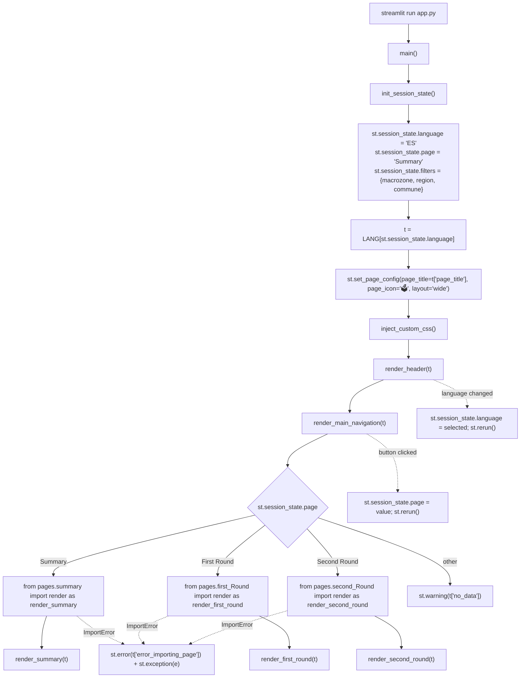

# 🚀 `app.py` — Streamlit bootstrap and dispatch

TL;DR: a 100-line Streamlit entry point that seeds session state, sets page config, injects the global CSS, paints the header and the three-button top nav, then lazily imports the selected page module inside a `try/except ImportError`.

The single most fragile thing in this file is **where `st.set_page_config` and `init_session_state()` sit relative to everything else** — and the half-solution around it. Everything below is arranged around that.

---

## 📍 1. Where it lives

Root of the repo, one file. `streamlit run app.py` is the only supported launch path (the `sys.path.insert` also makes `python app.py` work, but that's a convenience, not the contract). It imports from `config.translations`, `components.layout`, `components.theme`, and lazily from `pages.*`. It imports nothing from `utils/` or `views/` — if you ever see those appear at the top of this file, the layering has been broken.

No DB, no disk writes. The only side effect is `st.session_state`.

---

## 🧩 2. The real hard part: `set_page_config` ordering, and why `init_session_state` sits before it

`st.set_page_config()` raises `StreamlitAPIException` if any other `st.*` call has already produced output in this script run. Streamlit does not enforce this at import time — it enforces it at first render. So the invariant "page config is first" is enforced lazily, at runtime, on every rerun, and the failure mode is a red exception box that wipes the UI.

Look at the order in `main()`:

```
init_session_state()
lang = st.session_state.language
t = LANG[lang]
st.set_page_config(...)
inject_custom_css()
```

Three things are load-bearing here:

1. **`init_session_state()` must be before `set_page_config`.** It touches `st.session_state`, which is fine — `session_state` access does **not** count as output and does not trip the exception. But it has to run first because `t` is needed for `page_title=t["page_title"]`, and `t` depends on `language`, which lives in session state. If you ever refactor `init_session_state` to call `st.markdown` or `st.write`, you break `set_page_config` on every run. That coupling is not obvious from the function signature and is the most likely way a future PR crashes the app.

2. **`inject_custom_css()` must be after.** It calls `st.markdown(CUSTOM_CSS, unsafe_allow_html=True)`. Move it one line up and you get `StreamlitAPIException: set_page_config() can only be called once per app page, and must be called as the first Streamlit command`. The current order is the only correct one; there is no comment marking it. If you're adding a new global call in `main()`, it goes *after* `set_page_config`.

3. **No other `st.*` call is allowed before `set_page_config`.** This includes `st.error`, `st.warning`, `st.spinner`. The `try/except ImportError` is deliberately below it, so a broken page import cannot pre-empt page config. If someone moves the dispatch block above `set_page_config` "to fail earlier", the app dies on the first broken page with a config exception instead of the intended `st.error`.

This ordering is the entire reason `main()` reads top-to-bottom in the order it does. The docstring on `main()` does not state it; only the surrounding code does.

### Why `set_page_config` is called on every rerun, not guarded

A common pattern is `if "config_set" not in st.session_state: st.set_page_config(...)`. This repo does not do that, and that's correct: `set_page_config` is idempotent **within a single run** as long as it's first. Guarding it with session state would skip it on reruns where the session was created in a prior run — and Streamlit still requires it to fire once per script execution. So the unguarded call is right, and the only thing protecting it is the ordering above.

### What `init_session_state` does *not* do, on purpose

It does not read from query params, cookies, or a user store. Language defaults to `"ES"`, page to `"Summary"`, filters to a dict of `None`s. The `if key not in st.session_state` pattern (rather than `.setdefault` or a defaults dict) is hand-written because the semantics matter: on a fresh session, all three keys are missing and get seeded; on a rerun, all three exist and are preserved. `.setdefault` would work but obscures the "only on first run" intent, and a defaults dict would tempt someone to `dict.update` and clobber the user's page on every rerun. The current form is the cheapest way to express "seed once, never overwrite".

`filters` is seeded but nothing reads it. That is dead weight in the strict sense; it's kept as a placeholder. If you're auditing session state, this is the one key you can delete today without touching any consumer.

### Lazy dispatch: the point is the *import graph*, not the import statement

The dispatch is:

```python
try:
    if st.session_state.page == "Summary":
        from pages.summary import render as render_summary
        render_summary(t)
    ...
except ImportError as e:
    st.error(...)
    st.exception(e)
```

The `try` wraps the **import**, not just the `render(t)` call. That is deliberate. A module-level `from pages.summary import render` would execute at import time of `app.py` and take the whole app down if `pages/summary.py` (or anything in its transitive imports — `utils.data_loader`, `views.first_round.*`, Plotly extensions) fails to import. Because the imports are inside the `if/elif`, only the selected page's subgraph is imported per rerun, and a broken page becomes a localized error box while the header, language selector, and other nav buttons stay live.

Two consequences worth knowing:

- **Per-rerun import cost.** Streamlit re-executes `app.py` on every interaction, so `from pages.summary import render` runs on every rerun. Python caches the module after the first import, so the second time it's a dict lookup — cheap. But if a page module has top-level side effects (it shouldn't), you'll pay them once per session, not once per rerun.
- **`ImportError` only, not `Exception`.** If a page module raises at import time for a reason that isn't `ImportError` (e.g. `KeyError` from a missing translation constant evaluated at module level, `sqlite3.OperationalError` from a module-level DB open), the `except ImportError` does **not** catch it and the app crashes with a full traceback. The narrow catch is a deliberate trade-off: catching `Exception` here would also swallow `st.rerun`'s internal `RerunException` and `StreamlitAPIException`, breaking navigation. The cost is that a non-`ImportError` at page import time is an unhandled crash. Page modules are therefore expected to be import-safe and defer all I/O to `render(t)`.

The dispatch is a chain of `if/elif` on string literals (`"Summary"`, `"First Round"`, `"Second Round"`), not a dict. Adding a page means editing two places: `render_main_navigation` (new button) and `main` (new branch). That's mechanical and greppable, which is why it hasn't been refactored into a registry — a registry would move the branch logic into a data structure and make it invisible to `grep "Second Round"`.

---

## 🔄 3. Flow (real identifiers only)



---

## ⚠️ 4. Error handling and what actually fails

| Point | Mechanism | Result | Recoverable? |
|---|---|---|---|
| Page module import (`pages.summary`, `pages.first_Round`, `pages.second_Round`) | `except ImportError as e` around the dispatch block | `st.error` + `st.exception` | Yes — header and nav still render, user can switch pages |
| Page module raises non-`ImportError` at import time | **Uncaught** | Full traceback, app down | No — this is the deliberate cost of the narrow catch |
| `render(t)` raises inside a page | **Uncaught here** | Streamlit's own exception box | Yes, via reload/rerun; each page owns its error UX |
| `st.session_state.page` set to an unknown value | `else: st.warning(t["no_data"])` | Translated warning | Yes — any nav button fixes it |
| `LANG[lang]` or `t["..."]` KeyError | **Uncaught** | Traceback | No — add the key to both `ES` and `EN` |
| `set_page_config` called after another `st.*` output | `StreamlitAPIException` | Traceback | No — code must be reordered |
| `st.set_page_config` called twice in one run | `StreamlitAPIException` | Traceback | No — remove the second call |

There is no logging framework in this file. No `logging`, no `print`. The only diagnostics are Streamlit's `st.error`/`st.exception`/`st.warning` (user-visible) and Streamlit's own server log on stdout/stderr. There is no retry, no dead-letter, no fallback page — the design is fail-fast on the shell, fail-localized on the page import boundary.

The `except ImportError` is the one real try/except in the file. Everything else is either Streamlit's problem (widget errors, config ordering) or the page's problem (`render(t)` internals). That division is intentional and is the reason the shell stays usable when a single page is broken.
