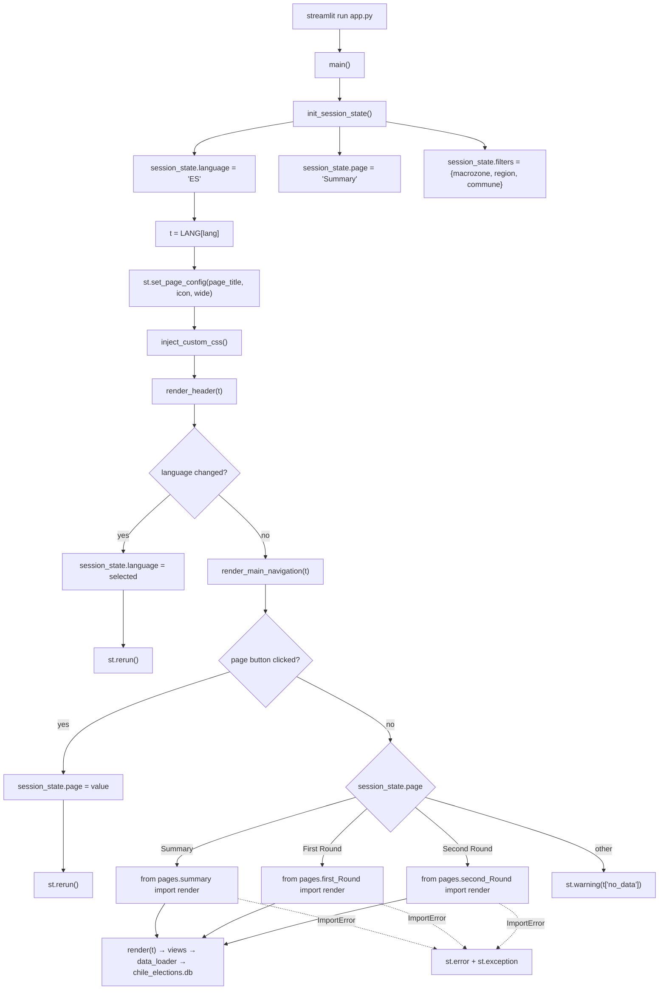

# 🚀 `app.py` — Application Entry Point

> **Layer:** orchestration / bootstrap

> **Runtime:** `streamlit run app.py`

> **Reads:** `config.translations.LANG`, `components.layout.render_header`, `components.theme.inject_custom_css`

> **Writes:** `st.session_state` (`language`, `page`, `filters`) — no disk or database writes

> **Dispatches to:** `pages/summary.py`, `pages/first_Round.py`, `pages/second_Round.py`

`app.py` is the only executable entry point of the dashboard. It does not
render analytical content: it initializes the session, sets the page
configuration, injects the global CSS, paints the header and the top-level
navigation, and imports the selected page module at call time.

---

## 📁 1. File Architecture

```text
dashboard/
├── app.py                  # bootstrap + top-level dispatch  (this file)
├── config/
│   ├── constants.py        # data constants, colors, DB path
│   └── translations.py     # LANG = {"ES": {...}, "EN": {...}}
├── components/
│   ├── layout.py           # render_header(), render_sub_navigation()
│   ├── theme.py            # CUSTOM_CSS, inject_custom_css()
│   ├── titles.py           # six title levels
│   └── charts.py           # reusable Plotly/HTML charts
├── pages/                  # one module per top-level page
│   ├── summary.py
│   ├── first_Round.py
│   └── second_Round.py
├── views/                  # analytical views (no routing)
│   ├── first_round/
│   └── second_round/
├── utils/                  # data access, calculations, geometry, formatting
├── assets/                 # cached commune GeoJSON
├── chile_elections.db      # SQLite, read-only at runtime
└── docs/                   # this documentation set
```

`app.py` sits at the outermost layer. Its only legal dependencies are
`config/` and `components/`, plus the three `pages/` modules that it imports
lazily. It must never import `utils/` or `views/` directly: data access and
analytics belong to the lower layers.

---

## 🔄 2. End-to-End Data Flow

1. **Process start.** Streamlit executes the module top to bottom. The
   `sys.path.insert(0, os.path.dirname(os.path.abspath(__file__)))` call makes
   `config`, `components`, `pages`, `utils` and `views` importable regardless
   of the current working directory.
2. **`main()` is called.** The `if __name__ == "__main__"` guard at the bottom
   invokes it once per script run (Streamlit re-executes the module on every
   rerun, so `init_session_state()` is idempotent by design).
3. **State initialization.** `init_session_state()` seeds three keys only when
   absent:
   - `language = "ES"`
   - `page = "Summary"`
   - `filters = {"macrozone": None, "region": None, "commune": None}`
4. **Translation resolution.** `lang = st.session_state.language` and
   `t = LANG[lang]`. Every visible string downstream comes from this flat
   dictionary; no string is translated inside `app.py`.
5. **Page configuration.** `st.set_page_config(...)` runs before any other
   Streamlit output. It sets the browser title from `t["page_title"]`, the
   🗳️ icon, `layout="wide"` and `initial_sidebar_state="collapsed"`.
6. **Global CSS.** `inject_custom_css()` appends `CUSTOM_CSS` through
   `st.markdown(..., unsafe_allow_html=True)`: background `#F7F7F2`,
   `max-width: 1100px`, button/dividers/metric overrides, and the hiding of
   `#MainMenu`, the footer and the Streamlit header.
7. **Header.** `render_header(t)` draws the country line, the app title with
   the ballot icon, the subtitle, and the ES/EN selector. A language change
   writes `st.session_state.language` and calls `st.rerun()`.
8. **Top navigation.** `render_main_navigation(t)` draws three equal columns
   (Summary / First Round / Second Round). A click writes
   `st.session_state.page` and calls `st.rerun()`; the active button is
   rendered with `type="primary"`.
9. **Dispatch.** After the rerun, `main()` reads `st.session_state.page` and
   performs a **lazy import** inside the `try` block:

   | State value | Import | Call |
   |---|---|---|
   | `"Summary"` | `pages.summary` | `render(t)` |
   | `"First Round"` | `pages.first_Round` | `render(t)` |
   | `"Second Round"` | `pages.second_Round` | `render(t)` |
   | anything else | — | `st.warning(t["no_data"])` |

10. **Downstream.** The page orchestrator renders its sub-navigation and
    imports a view. Data reaches the UI through `utils.data_loader`, which
    opens `chile_elections.db` read-only. `app.py` itself never opens the
    database and never persists state to disk.

**Storage destination:** `st.session_state` for the UI state, SQLite
(`chile_elections.db`) for the read path. The application is read-only by
design; there is no write-back path.

---

## 🛠️ 3. Logs and Custom Logic (Hand-Written)

### Logging and diagnostics

`app.py` has **no logging framework** (no `logging`, no `print`). Diagnostics
are emitted through Streamlit itself:

- `st.error(f"{t['error_importing_page']}: {e}")` plus `st.exception(e)` for a
  failed page import;
- `st.warning(t["no_data"])` for an unknown page identifier.

Streamlit writes its own server log to stdout/stderr (and the terminal that
launched `streamlit run`), which is the only process-level log available.

### Hand-written logic

1. **Idempotent session seed (`init_session_state`).** Written by hand instead
   of a settings library because Streamlit state is per-session and must
   survive reruns. Using `if key not in st.session_state` avoids resetting
   the user's page or filters on every rerun.
2. **Lazy page dispatch.** The import statements live *inside* `main()` and
   inside the `try` block. A module-level import would crash the whole app
   when one page is missing; the lazy form converts a broken page into a
   localized error message while the header and navigation stay usable.
   This also keeps startup time low: only the selected page's module graph is
   imported.
3. **Language switch with explicit `st.rerun()`.** The selectbox value is
   compared with the stored language; only on change is the state updated and
   the rerun forced. This guarantees that `t` is recomputed before any widget
   is painted, avoiding a frame with mixed languages.
4. **Navigation as buttons, not `st.tabs`.** The three top-level pages are
   stored in `session_state.page` so they survive reruns and can be changed
   from anywhere. `st.tabs` would reset on rerun and cannot be driven
   programmatically.
5. **`sys.path` bootstrap.** Allows both `streamlit run app.py` and
   `python app.py` from any directory without installing the dashboard as a
   package.

### Ordering constraint

`st.set_page_config` must be the first Streamlit command executed. For that
reason `init_session_state()` (pure Python) precedes it, and no `st.*` call is
allowed before it. Moving `inject_custom_css()` above it would raise
`StreamlitAPIException`.

---

## 🗺️ 4. Flow Diagram



---

## ⚠️ 5. Error Handling and Exceptions

| Failure point | Mechanism | User-visible result | Recovery |
|---|---|---|---|
| Page module missing or its import graph broken | `except ImportError as e` around the dispatch block | `t["error_importing_page"]` message plus the full traceback via `st.exception` | Header and navigation remain usable; the user can switch page |
| Unknown `session_state.page` value | `else: st.warning(t["no_data"])` | Translated warning | Select any navigation button |
| Exception raised *inside* a page's `render(t)` | **Not caught in `app.py`** | Streamlit's red exception box (`client.showErrorDetails = true`) | Reload or switch page; each page/view implements its own `try/except` |
| Missing translation key | `KeyError` at `LANG[lang]` or `t["..."]` | Streamlit traceback | Add the key to both `ES` and `EN` |
| `st.set_page_config` called twice / too late | `StreamlitAPIException` | Streamlit traceback | Keep it as the first `st.*` call |
| Corrupt or absent database | Raised later in `utils.data_loader` | Page-level error box | Download is retried on next run (see `data_loader.md`) |

**Design boundary:** `app.py` only guards the *import* boundary. Runtime
failures are deliberately delegated to the page/view that owns the data, so
the message can be specific and the rest of the shell keeps working.
