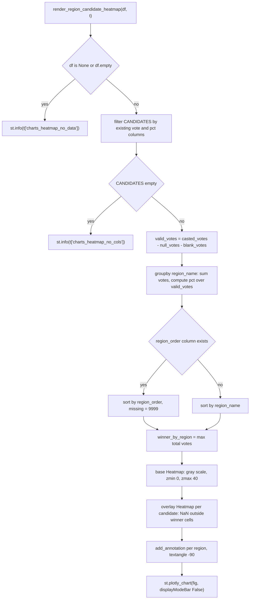

# 📊 `components/charts.py` — Reusable Chart Components

> **Layer:** 3 — components (presentation)

> **Runtime entry point:** `render_donut_chart(data, t)` and `render_region_candidate_heatmap(df, t)` from `views/first_round/summary.py`; `render_second_round_chart(results, t)` has no active importer

> **Reads:** a pre-aggregated `dict` of communes won, a commune-level `pd.DataFrame`, a results `dict`, and the translation dict `t`

> **Writes:** Streamlit UI only — raw HTML through `st.markdown` and Plotly figures through `st.plotly_chart`

> **Downstream:** `st.markdown`, `st.plotly_chart`, Plotly `go.Figure`; no session state, disk or database writes

`components/charts.py` holds the three chart renderers that need logic beyond a
plain table: a hand-built HTML/CSS runoff bar, a Plotly donut of communes won,
and a region × candidate heatmap that paints each regional winner with its own
candidate color. The module owns presentation and light aggregation only; it
never opens `chile_elections.db` and never caches. Colors are resolved through
`_get_candidate_color()` from `config/constants.py`, and every user-visible
label other than candidate names comes from `t`.

**In one line:** three self-contained chart renderers — a runoff bar (HTML/CSS),
a donut (Plotly), and a region heatmap with per-candidate overlays — none of
which touch state, disk or database.

> See also: [`constants.md`](constants.md) · [`calculations.md`](calculations.md) · [`summary.md`](summary.md)

---

## 🗂️ 1. File Architecture

```text
dashboard/
├── components/
│   ├── charts.py      # this file: 3 render functions, no state
│   ├── layout.py      # header and sub-navigation; not duplicated here
│   ├── theme.py       # global CSS; chart backgrounds are styled there too
│   └── titles.py      # title hierarchy; charts emit no titles
├── config/
│   └── constants.py   # NEUTRAL_COLOR, _get_candidate_color()
├── utils/
│   ├── calculations.py # format_thousands()
│   └── html_helpers.py # clean_html(); NOT applied in this module
└── views/first_round/
    ├── summary.py      # imports render_donut_chart + heatmap
    └── territorial_explorer.py # has its own private _render_donut_chart
```

This is the component layer: it may import `config/` and `utils/`, and must not
import `views/` or `pages/`. Chart data preparation belongs to the caller:
`views/first_round/summary.py` computes `communes_won` with
`value_counts().to_dict()` and passes the raw `df_fr_2025_raw` to the heatmap.
The module must not duplicate `utils/calculations.py` metric logic, nor the
`components/titles.py` heading styles. Note the existing duplication:
`views/first_round/territorial_explorer.py` defines a different private
`_render_donut_chart(fr_df, t)` (only candidates above 10 % plus an `Otros`
slice) that does not use this module.

**Declared dependencies.** `math` (`math.nan`), `pandas`,
`plotly.graph_objects`, `streamlit`, `utils.calculations.format_thousands`,
`config.constants.NEUTRAL_COLOR`, `config.constants._get_candidate_color`.

---

## 🔄 2. End-to-End Data Flow

There is no single entry point; Streamlit reruns call the renderer selected by
the active view on every interaction. No result is cached or persisted.

| Function                          | Input                                                        | Internal work                                                | Output destination                                           |
| --------------------------------- | ------------------------------------------------------------ | ------------------------------------------------------------ | ------------------------------------------------------------ |
| `render_second_round_chart`       | `results` with `jara_votes`, `kast_votes`, `jara_pct`, `kast_pct`, `diff_votes`, `diff_pct`, `winner` | color lookup, sign formatting, HTML string                   | **four** `st.markdown(..., unsafe_allow_html=True)` calls (one for the bar, one per KPI column) |
| `render_donut_chart`              | `data` = `{short_name: communes_won}`, `t`                   | descending sort, short→full name map, color lookup           | `go.Pie` → `st.plotly_chart`                                 |
| `render_region_candidate_heatmap` | commune `df`, `t`                                            | region aggregation, % over valid votes, winner detection, trace stacking | `go.Heatmap` base + overlays → `st.plotly_chart`             |

> **Importer status.** `render_second_round_chart` is fully implemented but
> currently has **no active importer** in the codebase — it is a shared
> component kept for future use. The two charts actually rendered by
> `views/first_round/summary.py` are `render_donut_chart` and
> `render_region_candidate_heatmap`.

### 2.1 `render_second_round_chart` (HTML/CSS bar)

1. Resolves `kast_color`/`jara_color` from the hardcoded names
   `"José Antonio Kast"` and `"Jeannette Jara"`.
2. Computes `diff_sign` (`"+"` only when `diff_votes > 0`) plus
   `format_thousands(abs(diff_votes))` and `abs(diff_pct)`.
3. Emits a centered winner header (`t["winner"]` + winner name in winner color).
4. Emits a `display:flex` bar with **Kast first (left)** and **Jara second
   (right)**, each segment width taken directly from `kast_pct` and `jara_pct`.
5. Emits three columns below: Jara votes (`t["votes"]`), the difference
   (`t["difference"]`, `t["votes"]`, `"pp"`), and Kast votes.

### 2.2 `render_donut_chart`

1. Returns early with `st.info(t["charts_donut_no_data"])` when `data` is empty.
2. Sorts `data.items()` by count descending (`sorted(..., reverse=True)`; ties
   keep dict insertion order).
3. Converts short labels through the module-local `short_to_full` map (8 entries,
   see table below) and asks `_get_candidate_color()` for each color.
4. Builds `go.Pie` with `hole=0.55`, white slice borders (`width=2`),
   `textinfo="label+percent"`, `textposition="inside"`,
   `insidetextorientation="horizontal"`, `hoverinfo="label+value+percent"`,
   `showlegend=False`.
5. Layout: height 280, zero margins, transparent paper and plot backgrounds,
   system sans-serif stack. Renders with `config={"displayModeBar": False}`.

**`short_to_full` map (8 entries, fixed):**

| Short label        | Full name              |
| ------------------ | ---------------------- |
| `Jara`             | Jeannette Jara         |
| `Kast`             | José Antonio Kast      |
| `Parisi`           | Franco Parisi          |
| `Kaiser`           | Johannes Kaiser        |
| `Matthei`          | Evelyn Matthei         |
| `Mayne-Nicholls`   | Harold Mayne-Nicholls  |
| `Enríquez-Ominami` | Marco Enríquez-Ominami |
| `Artés`            | Eduardo Artés          |

Unknown keys are passed through unchanged to `_get_candidate_color()`, which
either fuzzy-matches them or returns `NEUTRAL_COLOR`.

### 2.3 `render_region_candidate_heatmap`

1. Returns early for `None`/empty `df` → `st.info(t["charts_heatmap_no_data"])`.
2. The local `CANDIDATES` tuple list (5 entries, see table below) is filtered
   by column presence (`v in df.columns and p in df.columns`). If none survive
   → `st.info(t["charts_heatmap_no_cols"])`.
3. If `valid_votes` is absent it is computed as
   `casted_votes - null_votes - blank_votes`, then every candidate vote column
   is coerced with `pd.to_numeric(..., errors="coerce").fillna(0)`.
4. `groupby("region_name", as_index=False)` sums `valid_votes` and each vote
   column; each `*_pct` is `votes / valid_votes.replace(0, 1) * 100`, rounded
   to two decimals.
5. **Ordering.** With `region_order` present, a name→order map is built from
   `dropna().drop_duplicates()`, missing regions get `9999`, and the frame is
   sorted north→south; otherwise it sorts by `region_name`.
6. **Winner.** For each region,
   `max(votos_por_cand.items(), key=lambda x: x[1])` picks the candidate with
   the most **total votes**, not the highest percentage.
7. **Rendering.** A light-gray base `go.Heatmap` covers all cells; one overlay
   `go.Heatmap` per candidate paints only the cells that candidate won; one
   `fig.add_annotation` per region prints the winner at `y=-0.02` in paper
   coordinates, `textangle=-90`. The figure is 440 px high with top-side x-axis
   labels (`tickangle=-40`), reversed y-axis (Jara at top), no legend or scale.

**`CANDIDATES` (5 entries, fixed order):**

| Votes column    | % column      | Short name | Color source                                |
| --------------- | ------------- | ---------- | ------------------------------------------- |
| `jara_votes`    | `jara_pct`    | `Jara`     | `_get_candidate_color("Jeannette Jara")`    |
| `kast_votes`    | `kast_pct`    | `Kast`     | `_get_candidate_color("José Antonio Kast")` |
| `parisi_votes`  | `parisi_pct`  | `Parisi`   | `_get_candidate_color("Franco Parisi")`     |
| `kaiser_votes`  | `kaiser_pct`  | `Kaiser`   | `_get_candidate_color("Johannes Kaiser")`   |
| `matthei_votes` | `matthei_pct` | `Matthei`  | `_get_candidate_color("Evelyn Matthei")`    |

---

## 📝 3. Logs, Custom Logic and Technical Debt

###  3.1 Logging and diagnostics

There is **no logging at all** in this module: no `logging`, no `print`, no
`st.error`, no `st.warning`, no `st.exception`. The only diagnostics are three
informational guards — `st.info(t["charts_donut_no_data"])`,
`st.info(t["charts_heatmap_no_data"])` and
`st.info(t["charts_heatmap_no_cols"])`. An operator sees an empty chart area or
one of those info strings; anything else (bad column, malformed `results` dict,
Plotly failure) surfaces as Streamlit's uncaught exception box. There are no
counters, timings or trace IDs.

### 3.2 Hand-written logic

1. **Per-candidate color compositing without a per-cell colorscale
   (`render_region_candidate_heatmap`).** Plotly's `Heatmap` accepts one
   `colorscale` per trace, not per cell. The function draws a six-trace stack:
   one base trace whose `colorscale` is `[[0.0, "#FCFCFA"], [1.0, "#E8E8E0"]]`
   (`zmin=0`, `zmax=40`, `showscale=False`), plus five overlay traces. Each
   overlay builds `overlay_z` cell by cell: the percentage only when
   `s == short and winner_by_region[r] == short`, otherwise `math.nan`.
   NaN cells are transparent, so exactly one overlay paints each winning cell.
   The overlay scale is `[[0.0, color + "40"], [1.0, color]]` — the `"40"`
   suffix is the hex alpha channel appended to `#RRGGBB`, giving
   `#RRGGBB40` (8 hex digits, 25 % opacity). This works because
   `_get_candidate_color()` always returns `#RRGGBB`. Invariant: the two
   candidate loops must use the same `short_names` and `regions` order or the
   masking lands on the wrong cell. `hoverinfo="skip"` on overlays prevents six
   tooltips per cell; the base trace keeps the `%{z:.2f}%` hover template.
2. **Winner by total votes, independent of the displayed percentage.**
   `winner_by_region` is computed from the summed vote columns, while the cell
   intensity comes from `region_agg[pcol]`. Because valid votes are shared
   across candidates, the two rankings normally agree, but the explicit split
   means a region is annotated and colored by absolute votes even if a rounding
   or a different denominator made the percentage column disagree. `max()` on a
   dict returns the first key on a tie, so ties follow the fixed candidate order
   Jara → Kast → Parisi → Kaiser → Matthei.
3. **North-to-south region ordering with a sentinel.** The function never
   hardcodes region names. It extracts `region_name`/`region_order` pairs,
   drops nulls and duplicates, maps them onto the aggregated frame, fills
   unknown regions with `9999`, sorts ascending and drops the helper column.
   The sentinel keeps unrecognized regions at the bottom instead of raising.
   Without `region_order` the fallback is alphabetical, which is a different
   visual order — a data-contract dependency worth remembering.
4. **Capability filtering of candidate columns.** Rather than assuming the full
   first-round schema, the initial five tuples are filtered with
   `if v in df.columns and p in df.columns`. This lets the same renderer survive
   a reduced frame (for example a second-round table) by rendering fewer rows,
   and it yields `charts_heatmap_no_cols` instead of a `KeyError` when nothing
   matches. The filter is all-or-nothing per candidate: a votes column without
   its percentage column is silently excluded.
5. **HTML/CSS runoff bar with signed-difference formatting.**
   `render_second_round_chart` avoids Plotly entirely. Segment order is fixed
   (Kast left, Jara right) and widths are the raw `kast_pct`/`jara_pct`, so the
   bar does not renormalize: if the two percentages do not sum to 100 the right
   edge is short. `diff_sign` is `"+"` for positive `diff_votes`, empty
   otherwise, and both the vote count and the pp value are rendered from
   absolute values — a negative (Jara-favored) difference therefore loses its
   minus sign. The winner color is selected by exact string equality against
   `"José Antonio Kast"`; any other winner string, including a localized or
   abbreviated name, falls back to Jara's color.
6. **Donut label canonicalization.** Plotly receives short labels, but colors
   are resolved with full names. The local `short_to_full` dictionary maps the
   eight 2025 short names to canonical names (see table in §2); unknown keys are
   passed through unchanged to `_get_candidate_color()`. Sorting happens before
   color resolution, so slice order and legend-free label order are stable for
   a given dict.

###  3.3 Technical debt

- **`render_second_round_chart` has no active importer.** Fully implemented,
  currently unused; keeping it is a conscious choice, but a linter would flag
  it as dead code.
- **Missing HTML escaping.** `render_second_round_chart` interpolates raw
  candidate names and translation strings without `clean_html()` or
  `html.escape()`. Safe today (values are numeric or translations), but fragile.
- **Hardcoded `zmax=40` and base gray scale.** Values above 40 % share the
  darkest gray and are not comparable with the candidate overlays. The scale is
  not taken from `config/constants.py`.
- **No `try/except`.** The heatmap has no fallback for a stale fact table
  (missing `region_order`) or a malformed frame.
- **Duplicated donut.** `views/first_round/territorial_explorer.py` defines its
  own private `_render_donut_chart(fr_df, t)` with a different rule (>10 % +
  `Otros`) instead of parameterizing this module.

---

## 🧭 4. Flow Diagram



---

## 🧯 5. Error Handling and Exceptions

| Failure point                                                | Mechanism                                                    | User-visible result                                          | Recovery                                       |
| ------------------------------------------------------------ | ------------------------------------------------------------ | ------------------------------------------------------------ | ---------------------------------------------- |
| `data` empty in `render_donut_chart`                         | explicit `if not data` guard                                 | `t["charts_donut_no_data"]` info box                         | Caller supplies a non-empty `communes_won`     |
| `df` `None`/empty in heatmap                                 | `if df is None or df.empty` guard                            | `t["charts_heatmap_no_data"]`                                | Reload data; loader error is reported upstream |
| No candidate vote+pct columns                                | list-comprehension filter plus `if not CANDIDATES`           | `t["charts_heatmap_no_cols"]`                                | Fix the fact-table schema                      |
| `region_name` missing                                        | none — `groupby("region_name")` raises `KeyError`            | Streamlit red exception box                                  | Join `dim_commune` before calling              |
| `casted_votes`/`null_votes`/`blank_votes` missing and `valid_votes` absent | none — subtraction raises `KeyError`                         | Streamlit red exception box                                  | Provide `valid_votes` or the three columns     |
| Non-numeric vote values                                      | `pd.to_numeric(..., errors="coerce").fillna(0)`              | Zeroed cells, no warning                                     | Fix upstream types                             |
| `valid_votes <= 0`                                           | only `.replace(0, 1)` guards zero; negatives are not clamped | `0` for exactly zero; nonsensical percentages for negative totals | Validate `null+blank <= casted` upstream       |
| `results` missing a key                                      | none — direct `results["..."]` indexing                      | `KeyError`                                                   | Caller must pass the documented seven keys     |
| Winner is not exactly `"José Antonio Kast"`                  | ternary falls through to Jara                                | Wrong winner color, correct text                             | Keep canonical names in `results["winner"]`    |
| Negative `diff_votes`                                        | `diff_sign` empty plus `abs()`                               | Difference shown without sign                                | Compute the sign explicitly if Jara can lead   |
| Plotly or Streamlit render failure                           | none                                                         | Exception box                                                | Reload; no retry logic exists                  |

> ⚠️ **Gaps.** The heatmap has no `try/except`; a stale fact table without
> `region_order` silently changes order; the base gray scale and the `zmax=40`
> clip are hardcoded rather than taken from `config/constants.py`. No HTML
> escaping or `clean_html()` is applied to the runoff block.

---

## 🔌 6. Public API

| Symbol                                   | Kind     | Purpose                                                      |
| ---------------------------------------- | -------- | ------------------------------------------------------------ |
| `render_second_round_chart(results, t)`  | function | HTML/CSS runoff bar with winner header, Kast/Jara segments and three KPI columns. **No active importer.** |
| `render_donut_chart(data, t)`            | function | Plotly donut of communes won per candidate; empty-data guard. |
| `render_region_candidate_heatmap(df, t)` | function | Region × candidate heatmap with per-candidate overlays; empty/schema guards. |
