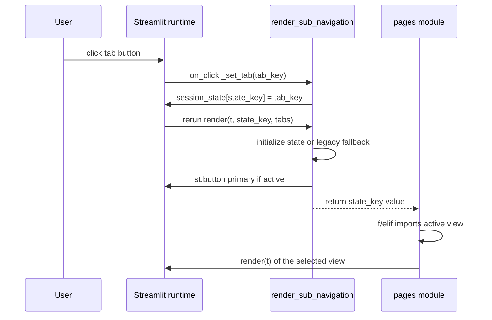

# 🧭 `components/layout.py` — Header and Sub-Navigation

> **Layer:** 3 — components (presentation and UI state)

> **Runtime entry point:** `render_header(t)` from `app.py`; `render_sub_navigation(t, state_key, tabs)` from `pages/first_Round.py` and `pages/second_Round.py`

> **Reads:** `t` (translation dict), `st.session_state.language`, `st.session_state[state_key]`, and the caller's `tabs` list

> **Writes:** `st.session_state.language` on a language change; `st.session_state[state_key]` through an `on_click` callback

> **Downstream:** `st.columns`, `st.selectbox`, `st.button`, `st.markdown`, `st.divider`, `st.rerun`; page dispatch reads the returned tab key

`components/layout.py` owns the two persistent strips at the top of the app: the
header with the ES/EN selector, and the per-page tab bar used by the First and
Second Round orchestrators. Its important piece is `render_sub_navigation`: it
stores the active tab in an `on_click` callback so the button style and the view
below are computed from the same state in the same frame, eliminating the
Streamlit first-click/double-click flicker. The module contains no data access,
no chart code and no logging.

---

## 📁 1. File Architecture

```text
dashboard/
├── app.py                    # init_session_state(); render_header(t); page dispatch
├── components/
│   ├── layout.py             # this file: render_header + render_sub_navigation
│   ├── theme.py              # styles the buttons produced here
│   └── titles.py             # render_page_title(); header duplicates its format
├── pages/
│   ├── first_Round.py        # render_sub_navigation(t, "first_round_tab", 4 tabs)
│   └── second_Round.py       # render_sub_navigation(t, "second_round_tab", 6 tabs)
└── config/
    └── translations.py       # country, app_title, app_subtitle, language, tab labels
```

`layout.py` is a component-layer module and its only import is `streamlit`. It
must not import `pages/` or `views/` — the tab labels are resolved by the caller
and passed as `(tab_key, tab_label)` tuples, so `layout.py` never evaluates a
translation key itself. It also must not duplicate `components/titles.py`: the
header currently rebuilds the app-title HTML by hand (see technical debt below),
and page titles are still rendered by `pages/*.py` via `render_page_title`.

**State contract.** `render_header` requires `st.session_state.language` to
exist; it accesses the attribute directly and would raise `AttributeError`
otherwise. `app.py::init_session_state()` seeds it to `"ES"` before the header
is painted. `render_sub_navigation` creates its own `state_key` if missing, so
it is safe on a cold session.

---

## 🔄 2. End-to-End Data Flow

### `render_header(t)`

1. `st.columns([3, 1])` splits the row into a 3/4 text column and a 1/4 selector
   column.
2. The left column emits one `st.markdown` block with three stacked `div`s:
   `t["country"]` at 13 px `#888780`, `🗳️ {t["app_title"]}` at 32 px/700
   `#1a1a18`, and `t["app_subtitle"]` at 13 px `#888780`.
3. The right column reads `current_lang = st.session_state.language`, builds
   `options = ["ES", "EN"]`, and computes `idx = options.index(current_lang)`.
4. `st.selectbox(t["language"], options=options, index=idx,
   key="language_selector", label_visibility="collapsed")` paints the selector.
5. If `selected != current_lang`, the function writes
   `st.session_state.language = selected` and calls `st.rerun()` immediately.
   The whole app re-executes with `t = LANG[lang]`, so no frame mixes languages.
6. `st.divider()` closes the header.

### `render_sub_navigation(t, state_key, tabs)`

1. `if not tabs: return ""` — a page can render no bar without crashing.
2. `valid_keys = [k for k, _ in tabs]` is the set of legal identifiers.
3. If `state_key not in st.session_state`, initialize it to `valid_keys[0]`.
4. Legacy sanity check: if the stored value is not in `valid_keys` (old sessions
   may still hold `"zones"` or `"communal"`), reset it to the first tab.
5. Define the closure `_set_tab(tab_key)` that assigns
   `st.session_state[state_key] = tab_key`; it is passed as `on_click` with
   `args=(tab_key,)`, and therefore runs **before** Streamlit reruns the script.
6. `st.columns(len(tabs))` creates one equal column per tab; `current` is read
   once from state.
7. For each `(tab_key, tab_label)` the loop calls `st.button` with
   `use_container_width=True`, `type="primary" if is_active else "secondary"`,
   and key `f"sub_nav_{state_key}_{tab_key}_{idx}"`.
8. The function returns `st.session_state[state_key]` after rendering.

| Caller | `state_key` | Tab keys passed | Consumption of return value |
|---|---|---|---|
| `pages/first_Round.py` | `first_round_tab` | `summary`, `territorial_explorer`, `panorama`, `historical_first_round` | `if/elif` imports the matching `views.first_round.*` module |
| `pages/second_Round.py` | `second_round_tab` | `summary`, `territorial_explorer`, `panorama`, `jara`, `kast`, `historical` | `if/elif` imports the matching `views.second_round.*` module |
| `app.py` | — | — | Calls `render_header(t)` once, before `render_main_navigation(t)` |

Tab keys are stable identifiers and are never translated; labels come from `t`
(`t["summary"]`, `t["sr_orch_tab_panorama"]`, and so on). The `t` parameter of
`render_sub_navigation` is currently unused inside the function — it exists for
signature symmetry with `render_header` and as a hook for future in-component
labels.

---

## 🛠️ 3. Logs and Custom Logic

### Logging and diagnostics

There is **no logging** in this module: no `logging`, no `print`, no `st.error`,
`st.warning` or `st.exception`. It also emits no informational boxes on its own.
The observable signals are purely visual: the selected language in the
selectbox, the `primary` styling of the active tab, and the page content chosen
by the caller. Streamlit's server log records reruns and uncaught exceptions,
but `layout.py` contributes no messages. Failures such as a missing
`session_state.language` become a Streamlit traceback.

### Hand-written logic

1. **Callback-driven tab state machine (`_set_tab`).** The naive pattern
   (button returns `True`, then assign the tab) updates state after the widgets
   have already been painted, so the old tab stays highlighted for one frame and
   a fast second click is needed to see the new view. Here the assignment is
   registered as `on_click`, which Streamlit executes at the start of the rerun.
   By the time the script reaches the buttons and the caller's `if/elif`, the
   state already holds the clicked key; button style and content agree in one
   frame. There is deliberately no `st.rerun()` in the callback — the rerun is
   implicit.
2. **Idempotent initialization plus legacy migration.** The `state_key not in
   st.session_state` check seeds the first tab without resetting a valid choice
   on later reruns. The second check (`value not in valid_keys`) is the migration
   path: tab identifiers were renamed (old `"zones"`, `"communal"`), and a
   browser session that still holds one would otherwise render no active button
   and dispatch to an `else` branch. Both checks funnel to `valid_keys[0]`,
   making the first tab the universal fallback.
3. **Collision-proof widget key scheme.** The key
   `sub_nav_{state_key}_{tab_key}_{idx}` embeds three discriminators: the page
   state key (`first_round_tab` vs `second_round_tab`), the tab identifier, and
   the positional index. `state_key` prevents cross-page collisions if both
   pages are mounted in one run; `tab_key` keeps keys stable when labels are
   translated; `idx` disambiguates any accidental duplicate tab key. Because the
   keys are stable across reruns, Streamlit does not treat the buttons as new
   widgets.
4. **Explicit language switch with immediate rerun.** `index=idx` is computed
   from session state, not from a constant, so the selectbox reflects the
   current language after a rerun. The change is committed only when
   `selected != current_lang`; writing state and calling `st.rerun()` guarantees
   that `LANG[lang]` is recomputed before any downstream text is rendered.
   Note that the widget itself also triggers a rerun, so a language change costs
   two script executions but never shows mixed-language output.
5. **Equal-width tab layout with state-derived styling.** `st.columns(len(tabs))`
   makes the bar proportional to the number of tabs instead of hardcoding
   widths; the only difference between an active and inactive tab is
   `type="primary"` versus `type="secondary"`, which `components/theme.py`
   translates into the dark `#1a1a18` fill versus the white outlined button.
   `use_container_width=True` keeps every label inside its column.

### Technical debt

`render_header` reproduces `components/titles.render_app_title` (32 px, 700,
`#1a1a18`) as inline HTML instead of calling it, because it also needs the
country line above, the subtitle below, the 🗳️ emoji, and the selector column.
A title-size change in `titles.py` will not propagate. The emoji and the
`padding-top` / `margin-top:-2px` / `padding-bottom` spacing are hardcoded, and
`st.session_state.language` is read without `.get()`, which is only safe because
`app.py` initializes it first. Migrating the block requires an emoji/prefix
option in `render_app_title` and a new meta-line helper in `titles.py`; until
then this remains a conscious exception.

---

## 🗺️ 4. Flow Diagram



---

## ⚠️ 5. Error Handling and Exceptions

| Failure point | Mechanism | User-visible result | Recovery |
|---|---|---|---|
| `st.session_state.language` absent in `render_header` | none — direct attribute access | `AttributeError` traceback before the app paints | `app.py::init_session_state()` must run first |
| Language stored outside `["ES", "EN"]` | `options.index(current_lang)` raises `ValueError` | Traceback | Reset state; only the selectbox writes valid values |
| Language change | explicit state write plus `st.rerun()` | UI repaints in the new language | Automatic |
| `tabs` empty | `if not tabs: return ""` | No bar; caller's dispatch falls through | Pass at least one tab |
| `state_key` absent | initializes to `valid_keys[0]` | First tab active | Automatic |
| Stored tab no longer in `tabs` | `not in valid_keys` guard | Silently falls back to the first tab | Automatic (legacy sessions) |
| Duplicate widget key | `idx` in `sub_nav_{state_key}_{tab_key}_{idx}` | Normally impossible; a duplicate would raise `StreamlitDuplicateElementKey` | Keep tab keys unique |
| `st.button` label missing/empty | none | Empty clickable button | Fix the caller's translation lookup |
| Callback raises | none — exceptions surface on the rerun | Streamlit exception box, state may be partially updated | Fix callback; state assignment is a single statement |
| `st.columns` called with a very large tab list | none | Narrow, unreadable buttons | Keep the bar to a handful of tabs |

**Gaps:** there is no validation that `state_key` is a string or that tab keys
are unique, and no diagnostic when the legacy fallback fires — a renamed tab is
migrated silently, which is convenient for users but invisible to operators.
The header's direct state access is the only hard failure mode in normal use.
