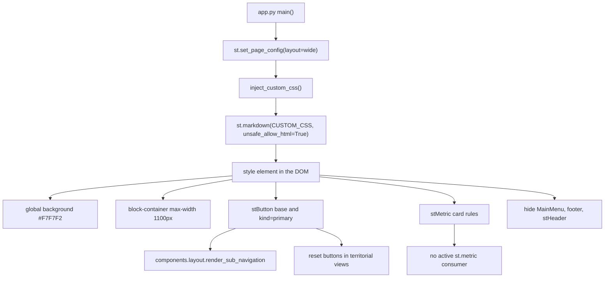

# `components/theme.py` — Global CSS Theme

> **Layer:** 3 — components (visual foundation)
> **Runtime entry point:** `inject_custom_css()` called once by `app.py::main()` immediately after `st.set_page_config`
> **Reads:** the module-level `CUSTOM_CSS` string only; no session state, no data
> **Writes:** a `<style>` element in the Streamlit DOM via `st.markdown(..., unsafe_allow_html=True)`
> **Downstream:** every widget and HTML block in the app inherits the result; `components/layout.py` depends on the `kind="primary"` button rule

`components/theme.py` is the single source of truth for the dashboard's visual
shell: warm off-white background, 1100 px content column, compact outlined
buttons with a dark active state, custom dividers and metric cards, transparent
column containers, and hidden Streamlit chrome. It contains one CSS string and
one injection function. There is no calculation and no logging; the file is
data plus a two-line side effect.

---

## 1. File Architecture

```text
dashboard/
├── app.py                 # inject_custom_css() at startup, before the header
├── components/
│   ├── theme.py           # this file: CUSTOM_CSS + inject_custom_css()
│   ├── layout.py          # emits st.button(kind="primary") styled here
│   └── titles.py          # inline font sizes; not driven by this CSS
├── config/
│   └── constants.py       # data colors only — no UI colors
└── views/                 # custom nb-card / table HTML; relies on transparent columns
```

This is a component-layer module whose only dependency is `streamlit`. It must
not import `config.constants`: the CSS colors (`#F7F7F2`, `#E0DED8`, `#888780`,
`#1a1a18`, …) are declared UI colors, deliberately separate from candidate,
block and scale colors. It also must not duplicate `components/titles.py`:
typography for headings is inline in that module, while this file sets only the
global `font-family` fallback. The CSS is not processed by Python; it is passed
verbatim, without `clean_html()`.

**Scope.** A single `<style>` block affects the whole document for the life of
the browser session, including Plotly containers and native Streamlit widgets.
Because Streamlit re-executes `app.py` on every rerun, the block is re-emitted
each run into the same element slot; calling `inject_custom_css()` a second time
inside one run would append a duplicate block.

---

## 2. End-to-End Data Flow

1. `app.py::main()` seeds session state and calls `st.set_page_config(...)`.
   `st.set_page_config` must remain the first `st.*` call, so CSS injection
   cannot precede it.
2. `inject_custom_css()` is called before `render_header(t)` and before any page
   content, so the first painted frame already has the final background and
   width.
3. The function executes `st.markdown(CUSTOM_CSS, unsafe_allow_html=True)`.
   Streamlit inserts the string as raw HTML; the browser parses the `<style>`
   element and applies the rules globally.
4. Rule evaluation is pure CSS cascade: `!important` declarations in this block
   beat Streamlit's injected theme rules; more specific selectors such as
   `div[data-testid="stButton"] > button[kind="primary"]` beat the base button
   rule.
5. Widgets rendered later in the same run (`st.button` in `layout.py`, the reset
   buttons in the territorial views, all custom HTML) are matched immediately,
   with no Python-side styling step.

| CSS block | Selector(s) | Concrete override | Why |
|---|---|---|---|
| Global background | `.stApp`, `[data-testid="stAppViewContainer"]`, `[data-testid="stMain"]`, `.main`, `.block-container` | `background-color: #F7F7F2 !important` | One warm paper tone across every Streamlit wrapper; without listing all wrappers the default white leaks through |
| Typography | `html`, `body`, `[class*="css"]` | `-apple-system, BlinkMacSystemFont, "Segoe UI", sans-serif` | System stack, no webfont download; `[class*="css"]` is a legacy Streamlit selector kept for compatibility |
| Content width | `.block-container` | `max-width: 1100px`, `padding-top: 1.5rem`, `padding-bottom: 2rem` | Keeps tables and maps readable on wide monitors and consistent across pages |
| Column chrome | `div[data-testid="stHorizontalBlock"]`, `stColumn`, `stElementContainer` | `background/border/box-shadow: none !important` | Streamlit adds container surfaces; views draw their own cards, so the wrappers must disappear |
| Navigation buttons | `div[data-testid="stButton"] > button` | white background, `1px solid #E0DED8`, radius `7px`, `padding: 0.25rem 0.65rem`, `min-height: 0`, `font-size: 12px`, weight 500, color `#888780`, `transition: 0.15s` | Compact pill-like buttons instead of Streamlit's tall default |
| Button hover | same selector `:hover` | background `#f0efec`, border `#c0bdb5`, text `#1a1a18` | Visible affordance without a heavy shadow |
| Active button | `button[kind="primary"]` | background and border `#1a1a18`, text `#ffffff`; hover `#2a2a26` | The active tab/page is the only dark button in the bar; driven by `layout.py` |
| Dividers | `hr` | no border, `border-top: 1px solid #E0DED8`, `margin: 0.75rem 0`, `opacity: 1` | Replaces Streamlit's faint divider with the palette border |
| Metric cards | `div[data-testid="stMetric"]` and label/value/delta children | white card, `1px solid #E0DED8`, radius `10px`, padding `0.7rem 1rem`; label 10 px uppercase, value 20 px/600 `#1a1a18`, delta 11 px | Makes native metrics match the hand-built cards; no active view currently calls `st.metric`, so this is dormant styling |
| Plotly frame | `div[data-testid="stPlotlyChart"]` | transparent background, radius `8px`, `overflow: hidden` | Charts already paint transparent paper; the wrapper must not add a white box |
| Hidden chrome | `#MainMenu`, `footer`, `header[data-testid="stHeader"]` | `visibility: hidden` (menu/footer), `display: none` (header) | Removes the Streamlit toolbar and the empty top bar for an embedded-dashboard look |

**Storage destination:** the browser DOM. Nothing is written to disk, session
state or the database, and the CSS is re-sent on every rerun.

---

## 3. Logs and Custom Logic (Hand-Written)

### Logging and diagnostics

There is **no logging** here: no `logging`, no `print`, no `st.error`,
`st.warning`, `st.exception` or `st.info`. Injection cannot fail loudly from
Python's point of view — `st.markdown` accepts any string. If a selector stops
matching, the only symptom is visual (default Streamlit styling returns); no
message is produced in the UI or in the server log beyond the normal rerun
lines. Debugging is done in the browser devtools by checking which
`data-testid` the installed Streamlit version emits.

### Hand-written logic

1. **Multi-wrapper background targeting.** Streamlit has changed its layout
   wrappers across versions (`.stApp`, `stAppViewContainer`, `stMain`, `.main`).
   Rather than betting on one, the stylesheet sets the same `#F7F7F2` with
   `!important` on all of them plus `.block-container`. This is a compatibility
   shim written by hand: any wrapper not listed would show white bands around
   the content. The cost is redundancy and the need to revisit the list after a
   Streamlit upgrade.
2. **Attribute-driven active state.** The only "state machine" in the theme is
   CSS: `st.button(type="primary")` renders a `kind="primary"` attribute, and
   the rule `div[data-testid="stButton"] > button[kind="primary"]` paints it
   dark. No Python class is toggled and no inline style is injected per button.
   This is why `components/layout.py` only has to choose `primary` versus
   `secondary`; the visual contract lives entirely here. The rule order matters:
   the base `button` rule comes first, the `[kind="primary"]` rule later, so the
   active fill wins without extra specificity.
3. **Container flattening to hand layout control to views.** Streamlit wraps
   every column and element in a container that may carry a border, background
   or shadow depending on theme settings. The block that zeroes
   `stHorizontalBlock`, `stColumn` and `stElementContainer` is a deliberate
   reset: views such as `views/first_round/summary.py` draw their own
   `nb-card` surfaces with inline CSS, and double surfaces would produce visible
   seams. The reset uses `!important` on three properties because Streamlit's
   defaults are injected at a similar specificity.
4. **Native metric reskin as a fallback design system.** The `stMetric` rules
   restyle label, value and delta independently (`10px` uppercase label,
   `20px/600` value, `11px` delta) so a future view can use `st.metric` and
   still match the custom cards. No active view does so today, making this the
   one block with no current consumer — harmless, but it can drift from the
   hand-built cards without anyone noticing.
5. **Chrome hiding with two different mechanisms.** `#MainMenu` and `footer`
   use `visibility: hidden` (they keep their layout box but are invisible),
   while `header[data-testid="stHeader"]` uses `display: none` (the box is
   removed, reclaiming vertical space). The asymmetry is intentional: hiding
   the header's box avoids a blank strip above the 1100 px container, whereas
   the menu and footer are already out of the content flow.

### Technical debt

The CSS is a single hardcoded string: changing a UI color means editing inside
`CUSTOM_CSS`, with no constant, validation or link to other UI files. It is not
passed through `utils.html_helpers.clean_html()`, contrary to the project-wide
HTML rule; the leading `<style>` and newline make Markdown tolerate it. The
`[class*="css"]` selector is a legacy Streamlit hook. There are no tests: a
Streamlit release that renames `stAppViewContainer`, `stMain`, `stMetric` or
`stPlotlyChart` silently disables the corresponding block, and `!important`
usage is expected but makes overrides harder to reason about.

---

## 4. Flow Diagram



---

## 5. Error Handling and Exceptions

| Failure point | Mechanism | User-visible result | Recovery |
|---|---|---|---|
| `inject_custom_css()` called before `st.set_page_config` | none in this module; Streamlit enforces ordering | `StreamlitAPIException` from `set_page_config`, not from the CSS | Keep `inject_custom_css()` after page config, as `app.py` does |
| Streamlit renames a `data-testid` | none — selectors simply stop matching | Partial or total loss of theme (white background, default buttons) | Update the selector list after the upgrade |
| CSS string malformed | none — browser ignores invalid declarations | Only the invalid rule is dropped | Inspect devtools; no Python error |
| Duplicate injection in one run | none — no idempotency guard | Two identical `<style>` blocks; harmless but larger DOM | Call once from `app.py` |
| `CUSTOM_CSS` shadowed/reassigned elsewhere | none | Unexpected theme | Keep the constant module-local |
| `st.metric` styling used with a future Streamlit markup change | no test | Cards fall back to default metric look | Compare against custom `nb-card` output |
| Hidden header removes the deploy menu | intentional `display: none` | No Streamlit toolbar | Re-enable the rule for admin deployments |
| Print/PDF export | none | Background colors may be dropped by the browser's print settings | Use a screenshot/PDF pipeline with background graphics enabled |

**Gaps:** no `try/except` (there is nothing to catch at Python level), no
version check, no feature detection, and no visual regression test. The theme is
also global and unconditional: there is no light/dark switch and no way to scope
the stylesheet to a single page.
