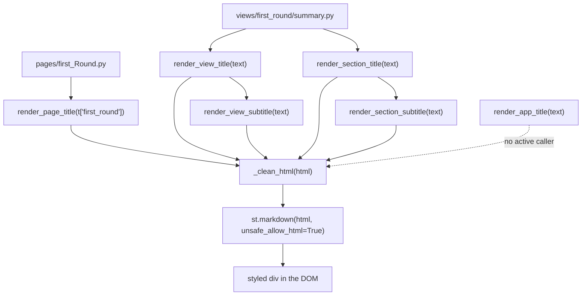

# `components/titles.py` — Title Hierarchy

> **Layer:** 3 — components (presentation)
> **Runtime entry point:** the six `render_*` functions, called directly by `pages/*.py` and `views/**/*.py`
> **Reads:** a single `text` string per call (already resolved from `t` by the caller), plus `FONT_FAMILY`
> **Writes:** styled HTML through `st.markdown(..., unsafe_allow_html=True)`; no state, no data, no disk
> **Downstream:** Streamlit DOM; every page and view that needs a heading

`components/titles.py` is the dashboard's typographic contract. It exposes six
levels — app title, page title, view title, view subtitle, section title, section
subtitle — each with a fixed size, weight, color and margin. Views never emit
their own `<h1>`–`<h6>` or ad-hoc heading `div`s; they call one of these
functions. The module does not translate anything: the caller passes the
already-resolved string, and the text is injected into a hand-written HTML
template after `_clean_html()` normalizes indentation.

---

## 1. File Architecture

```text
dashboard/
├── components/
│   ├── titles.py        # this file: FONT_FAMILY + 6 render functions
│   ├── theme.py         # global body font and background (different stack)
│   ├── layout.py        # header rebuilds the app-title format inline
│   └── charts.py        # no headings
├── utils/
│   └── html_helpers.py  # clean_html() imported as _clean_html
├── pages/
│   ├── summary.py
│   ├── first_Round.py
│   └── second_Round.py  # render_page_title(t["..."])
└── views/
    ├── first_round/     # summary, panorama, territorial_explorer, historical
    └── second_round/    # summary, panorama, jara, kast, territorial, historical
```

`titles.py` belongs to the component layer and imports only `streamlit` plus
`utils.html_helpers.clean_html` (aliased `_clean_html`). It must not import
`config.translations`; doing so would make it language-aware and break the rule
that components receive text, not keys. It must not duplicate `theme.py`: the
global body font is the system stack, while titles deliberately use
`FONT_FAMILY = "'Liberation Sans', Arial, sans-serif"`. It also must not
duplicate heading styles inside views — `render_section_title` alone has 88 call
sites across 13 importing modules.

**Usage profile (active code).** `render_section_title` 88 calls,
`render_section_subtitle` 46, `render_view_title` 16, `render_view_subtitle` 6,
`render_page_title` 3 (one per `pages/*.py`). `render_app_title` has **zero**
active callers: `components/layout.py::render_header` rebuilds the same 32 px
block by hand to keep the 🗳️ emoji, the country line and the subtitle in one
two-column layout.

---

## 2. End-to-End Data Flow

Every function follows the same three-step pipeline; only the CSS values differ.

1. The caller resolves a translation key (`t["first_round"]`,
   `t["sr_jara_sub_proteccion"]`, …) or composes a dynamic label and passes it as
   `text`.
2. The function interpolates `text` into an indented f-string containing one
   `<div style="font-family: {FONT_FAMILY}; font-size: …; …">`.
3. The f-string is passed to `_clean_html()`, which strips leading and trailing
   whitespace from **each line**, drops the outer blank lines, and rejoins with
   `\n`. This prevents Markdown from interpreting the four-space indentation as
   a code block.
4. The cleaned string is sent to `st.markdown(..., unsafe_allow_html=True)`.
   Streamlit inserts it as raw HTML; the browser applies the inline styles.
5. The function returns `None`. There is no state, no caching and no
   post-processing; a rerun re-emits the same HTML.

| Function | Size | Weight | Color | Margins | Typical caller |
|---|---|---|---|---|---|
| `render_app_title` | `32px` | `700` | `#1a1a18` | `line-height: 1.2`, `margin-bottom: 2px` | none (header duplicates it) |
| `render_page_title` | `28px` | `700` | `#1a1a18` | `line-height: 1.2`, `margin-top: 0`, `margin-bottom: 1.2rem` | `pages/first_Round.py`, `pages/second_Round.py`, `pages/summary.py` |
| `render_view_title` | `16.5pt` | `700` | `#111827` | `margin-top: 16px`, `margin-bottom: 8px` | `views/**` view headers |
| `render_view_subtitle` | `9.5pt` | default (`400`) | `#6b7280` | `margin-bottom: 16px` | directly below a view title |
| `render_section_title` | `12pt` | `700` | `#111827` | `margin-top: 12px`, `margin-bottom: 6px` | section headers inside views |
| `render_section_subtitle` | `10pt` | default (`400`) | `#6b7280` | `margin-bottom: 16px` | explanation under a section title |

`FONT_FAMILY` is a module constant, not a parameter: all six levels share
`'Liberation Sans', Arial, sans-serif`. The first two levels use `px`; the four
view/section levels use `pt`. That mix is in the source and is not normalized.

**Storage destination:** the Streamlit page only. No translation lookup, no
database read, no `session_state` write, no file output.

---

## 3. Logs and Custom Logic (Hand-Written)

### Logging and diagnostics

There is **no logging** in this module: no `logging`, no `print`, no `st.error`,
`st.warning`, `st.exception` or `st.info`. It also cannot report a bad heading
level — each level is a separate function, so a wrong choice is a code change,
not a runtime condition. Failures (missing `utils` import, a broken f-string)
surface as an uncaught exception during the view's render; otherwise the only
observable output is the painted heading. There are no metrics or timings.

### Hand-written logic

1. **Markdown-safe HTML normalization (`_clean_html`).** Python f-strings in
   this file are indented for readability, which would leave four leading spaces
   on every line. Markdown treats four spaces as a code block and would print
   the HTML literally. `utils.html_helpers.clean_html()` strips every line and
   joins with a newline, so the first character of the block is `<`. The
   invariant is absolute: **every** function in this module calls `_clean_html`
   before `st.markdown`. Any new title helper that skips it will render as code
   in the page. `clean_html` does not escape or minify, and it collapses leading
   indentation inside `<pre>` content if one were ever added.
2. **A fixed six-level scale instead of semantic `<h1>`–`<h6>`.** The module
   bypasses Streamlit/Markdown headings entirely and emits `<div>`s with inline
   `font-size`, `font-weight`, `color` and margins. Reasons: Streamlit adds
   anchor links and its own heading typography to `h1`–`h6`, and the custom CSS
   in `components/theme.py` does not reset them; inline `div` styles are
   deterministic and cannot be overridden by the theme's cascade. The trade-off
   is that the document has no semantic heading outline for screen readers or
   SEO, and the scale is duplicated per function rather than generated from a
   shared table.
3. **Manual HTML builder with per-level templates.** Each of the six functions
   contains its own f-string template rather than calling a shared
   `_render(text, size, weight, color, margins)` helper. That duplication is
   deliberate in the sense that each block is small and independently
   adjustable, but it means six places must change to alter `FONT_FAMILY`
   rendering (the constant is shared, so the family is single-sourced; the
   margins and colors are not). It also makes the exact CSS of a level
   greppable at the call site.
4. **Raw interpolation and a trusted-text boundary.** `text` is inserted without
   `escape_html()`. This is required for translated strings that intentionally
   contain markup (the `LANG` dictionary has 18 values per language containing
   `<`), but it means the functions are not safe for arbitrary user or database
   content. The implicit contract is "pass a translation or a developer-authored
   label"; a commune name containing `<` passed here would be interpreted as
   HTML. No validation enforces the contract.
5. **Stateless, idempotent paint.** No function reads or writes
   `st.session_state`, so a title can be rendered any number of times per run
   and always produces identical HTML for identical input. This is what lets
   views re-render freely on every interaction without stale heading state; the
   cost is that each call allocates a new string and a new Streamlit element.

### Technical debt

`render_app_title` is currently dead code because `render_header` replicates its
format (see `components/layout.md`). The title font (`Liberation Sans`) differs
from the global body font set in `theme.py` (`-apple-system, …`), so a page can
show two sans-serif stacks side by side; the mix of `px` and `pt` across levels
compounds the inconsistency. There is no shared style table, no test that the
six levels stay ordered, and no escaping for dynamic text.

---

## 4. Flow Diagram



---

## 5. Error Handling and Exceptions

| Failure point | Mechanism | User-visible result | Recovery |
|---|---|---|---|
| Missing `utils.html_helpers` import | none — module import fails | `ModuleNotFoundError` at page import, reported by the page's `_render_safe` fallback | Restore the module/`sys.path` bootstrap in `app.py` |
| New helper forgets `_clean_html` | none | HTML printed as an indented code block | Always wrap the f-string |
| `text` is `None` | f-string renders `None` | Literal "None" heading | Pass a resolved translation |
| `text` contains `<` from data | raw interpolation, no escaping | Markup interpreted (intended for translations, unsafe for data) | Use `escape_html()` upstream for untrusted values |
| Wrong level chosen | none — each level is a separate function | Visually wrong hierarchy, no error | Use the documented function |
| Long text | no `white-space` or truncation rule | Wraps inside the 1100 px container | Shorten the label or add layout CSS |
| `FONT_FAMILY` changed | constant shared by all six templates | All levels update together | Intentional single source |
| Streamlit removes `unsafe_allow_html` | none | Raw HTML shown as text or dropped | Pin the Streamlit version / migrate to components |

**Gaps:** no validation of `text`, no escaping, no runtime assertion that the six
levels remain visually ordered, and no logging when a view passes an empty
string. The module is intentionally tiny, so the main risk is misuse at the call
site rather than an internal failure.
